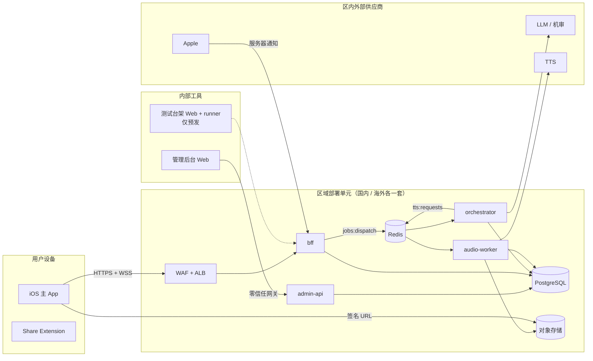
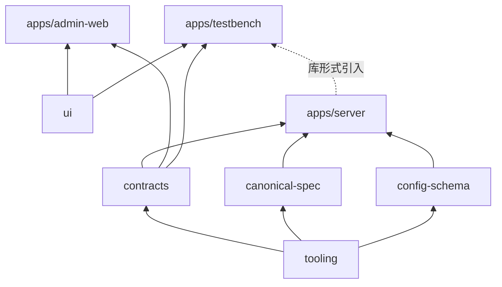

# Post&Comments Reader 架构设计 · 00 总览与共享规范

| 项 | 内容 |
| --- | --- |
| 文档版本 | v1.2（2026-11-26） |
| v1.1 变更 | 新增 05 文档索引；待决策项 D9–D16（D16：未决事项一律取各表「未决前的默认」）；`ErrorCode` 增加 `DAILY_LIMIT`、`AUTH_REVOKED`、`SERVICE_PAUSED`、`BRANCH_DISABLED`、`SITE_RULE_DISABLED`；`config/` 补齐 `clients`、`regions`、`privacy`、`ops`、`review-accounts`、`vendors/pricing`；依据改为主 PRD v2.7 草案与三份子 PRD；新增 `config/credit-rates/<region>.yaml`（统一额度池费率系数）与 `vendors/pricing/<region>.yaml`（渠道单价），`quota.update` 改为 `remainingMc` |
| v1.2 变更 | 长远方案：D4、D6、D7 改为已定；新增 D17–D24（边缘层 Hono + Workers、R2、水印、多平台、隐私法域、两区安全层、审批策略、实验）；WS 协议增加 `chapter.map`、`seek`、`seek.ack`，`progress` 改为位置语义；新增 `Platform`、`StoreProvider`、`AttestProvider`、`Jurisdiction` 枚举；仓库新增 `apps/edge`、`packages/signed-url`；规格补全：WS 增加 `extend`、`job.capped`、`job.truncated` |
| 依据 | 主 PRD v2.7 草案；《iOS 客户端 PRD》v1.3、《管理后台 PRD》v1.3、《测试台架 PRD》v1.3；在线文档《技术选型分析》（Claude 文档）的两个标签页：「技术选型分析」页（选型结论与各端选型）与「完整技术架构」页（下文简称「完整技术架构」，即在线版系统架构设计） |
| 读者 | 参与开发的工程师与 AI 编码代理 |
| 本文范围 | 文档索引、系统边界、仓库结构、共享包、跨端约定、待决策项 |

本套架构文档共 6 份，每份可以单独阅读（配套的产品文档：主 PRD v2.7 草案、《iOS 客户端 PRD》v1.3、《管理后台 PRD》v1.3、《测试台架 PRD》v1.3 与《业务闭环评审》）：

| 文件 | 内容 |
| --- | --- |
| `00-overview.md` | 本文：总览、仓库结构、共享包与跨端约定 |
| `01-ios-client.md` | iOS 客户端：模块、DesignSystem 组件库、页面、数据、采集、播放、后台、安全、测试 |
| `02-backend.md` | 后端服务：模块、接口、关键时序、数据模型、库清单、部署 |
| `03-admin-console.md` | 管理后台：页面、组件库、权限、数据层、配置发布 |
| `04-testbench.md` | 后端 Web 测试台架：runner、fixture 格式、门禁、报告 |
| `05-toolchain-and-resources.md` | 全阶段资源清单与使用规范：服务器与云服务、三方库、开发工具与 CI、AI 助手扩展（依赖的唯一登记处） |
| `adr/` | 架构决策记录 0001–0016（索引见 `adr/README.md`；仓库建立后迁入 `docs/adr/`） |

---

## 1. 系统边界



核心约束（细节见各端文档）：

1. 国内区与海外区是两套独立部署，不共享账户库和业务数据；同一份代码、同一个镜像、同一套 Pulumi 定义。
2. 第三方站点的登录凭证只存在用户手机的 Keychain 中，服务端没有代抓能力。
3. 同语种播报原文零篡改：LLM 只输出 `unit_id` 顺序、情绪与模板化串场；TTS 读取客户端提交的 `clean_text`。
4. 外部供应商只收到随机任务 ID，不收到用户 ID；海外走 ZDR 通道。
5. 共享配置（提示词、schema、站点规则、音色表、开关）以 Git 为唯一来源，CI 签名后两区发布。

---

## 2. 仓库结构

单仓（monorepo）。TypeScript 部分用 pnpm workspaces + Turborepo，iOS 用 XcodeGen + SPM。

```text
post-reader/
├─ AGENTS.md                       # 仓库级 AI 代理规则（CLAUDE.md 引用此文件）
├─ apps/
│  ├─ ios/                         # 见 01-ios-client.md
│  ├─ server/                      # 见 02-backend.md
│  ├─ admin-web/                   # 见 03-admin-console.md
│  ├─ edge/                        # 海外区 Cloudflare Workers（Hono）：切片与样帖音频分发、配置包下发、样帖列表、导出下载（02 §22.1）
│  └─ testbench/                   # 见 04-testbench.md（web/ + runner/）
├─ packages/
│  ├─ contracts/                   # zod schema、OpenAPI 生成、WS 消息、错误码
│  ├─ canonical-spec/              # 清洗与摘要规格、黄金向量、TS 参考实现
│  ├─ ui/                          # 管理后台与测试台架共用的 React 组件库
│  ├─ config-schema/               # config/ 目录下各类配置文件的 zod 校验
│  ├─ signed-url/                  # 签名 URL 签发与校验（只用 Web Crypto，Node 26 与 Workers 共用）
│  └─ tooling/                     # tsconfig、biome、vitest 共享配置
├─ config/                         # 配置即代码（见第 5 节）
├─ evals/                          # promptfoo 配置与 fixtures
├─ infra/                          # Pulumi
├─ docs/
│  ├─ architecture/                # 本套文档
│  ├─ adr/                         # 架构决策记录
│  ├─ specs/                       # 功能级任务规格
│  └─ runbooks/                    # 运维手册
├─ .github/workflows/
├─ package.json  pnpm-workspace.yaml  turbo.json  biome.json  lefthook.yml
└─ .nvmrc  .xcode-version
```

### 2.1 依赖方向



- `packages/*` 不依赖 `apps/*`；`apps/*` 之间不互相依赖。唯一例外：`testbench/runner` 以库的形式引入 `apps/server` 的 `pipeline` 等模块（通过 `apps/server` 导出的 `@post-reader/server/pipeline` 子路径），以便在每一步挂检查点。
- iOS 不依赖 TS 包，但消费两样产物：`packages/contracts/dist/openapi.yaml`（生成 Swift 客户端）与 `packages/canonical-spec/vectors/*.json`（Swift 侧黄金向量测试）。

### 2.2 根命令

| 命令 | 作用 |
| --- | --- |
| `pnpm i` | 安装 |
| `pnpm verify` | Biome + typecheck + 单元测试（代理宣称完成前必须通过） |
| `pnpm test:int` | 集成测试（Testcontainers：PostgreSQL、Redis） |
| `pnpm contracts:gen` | zod → `openapi.yaml`，并拷贝到 `apps/ios/Packages/APIClient/` |
| `pnpm spec:vectors` | 运行 TS 侧黄金向量 |
| `pnpm db:migrate:new <name>` | `drizzle-kit generate` |
| `pnpm dev` | Docker Compose 起本地依赖 + 各 app 的 dev 模式 |
| `make -C apps/ios project` | XcodeGen 生成工程 |
| `make -C apps/ios test` | `xcodebuild test`（模拟器） |

---

## 3. 共享包

### 3.1 `packages/contracts`

端云契约的唯一来源。

```text
packages/contracts/
├─ src/
│  ├─ common.ts          # Id、Region、Lang（BCP 47）、Tier、Emotion、CacheScope 等基础类型
│  ├─ canonical-post.ts  # CanonicalPost / Unit（与 canonical-spec 同步）
│  ├─ prefs.ts           # 结构化偏好：density、weights、style
│  ├─ api/
│  │  ├─ auth.ts         # /auth/*、/attest/*
│  │  ├─ me.ts           # /me、DELETE /account
│  │  ├─ jobs.ts         # /jobs*
│  │  ├─ samples.ts
│  │  ├─ config.ts       # /config/bundle
│  │  ├─ billing.ts      # /subscriptions/sync、/webhooks/app-store
│  │  └─ admin/*.ts      # admin-api 契约（不进 openapi.yaml 的公共部分）
│  ├─ ws.ts              # WebSocket 上下行消息（判别联合）
│  ├─ errors.ts          # 错误码枚举与 problem+json 结构
│  └─ openapi.ts         # 汇总生成
└─ dist/openapi.yaml     # 生成产物，入库，CI 校验与源一致
```

**基础枚举**

| 类型 | 取值 |
| --- | --- |
| `Region` | `cn` · `intl`（`intl` 部署在美国，覆盖中国大陆以外的全部 App Store 店面，D7） |
| `Platform` | `ios` · `android` · `web`（契约与平台无关；本期交付 `ios`，D20） |
| `StoreProvider` | `apple` · `google` · `web`（权益层与商店解耦，D20） |
| `AttestProvider` | `app_attest` · `play_integrity` · `web_risk`（设备证明抽象，D20） |
| `Jurisdiction` | `cn` · `eu_eea` · `uk` · `us_ca` · `us_other` · `row`（隐私法域，按店面映射，D21） |
| `Tier` | `free` · `plus` · `pro` |
| `CacheScope` | `PUBLIC` · `PRIVATE` |
| `Emotion` | `NEUTRAL` · `EMPHATIC` · `SARCASTIC` · `LAUGHING` · `DOUBTFUL` · `SOLEMN` · `EXCITED` · `WHISPER`（PRD 8.2） |
| `Density` | `brief` · `standard` · `deep`（`deep` 仅 `pro`） |
| `Weight` | `op_replies` · `practical_reversal` · `dedupe_spam`（PRD 6.2） |
| `Style` | `solo_radio` · `duo_roundtable` · `fireside` · `rapid_cut` · `crowd_list`（PRD 8.1） |
| `Branch` | `same_lang` · `translate` |
| `ErrorCode` | `AUTH_EXPIRED` · `SIGNATURE_INVALID` · `REPLAY_DETECTED` · `ATTEST_REQUIRED` · `RATE_LIMITED` · `QUOTA_EXHAUSTED` · `TIER_REQUIRED` · `REGION_MISMATCH` · `CONTENT_BLOCKED` · `UPSTREAM_DEGRADED` · `VALIDATION_FAILED` · `CLIENT_TOO_OLD` · `DAILY_LIMIT` · `AUTH_REVOKED` · `SERVICE_PAUSED` · `BRANCH_DISABLED` · `SITE_RULE_DISABLED` · `NOT_FOUND` · `INTERNAL`（`RATE_LIMITED` 只表示令牌桶频控；当日次数上限 $R_{\text{daily}}$ 用 `DAILY_LIMIT`，响应带 `resetAt`） |

**WebSocket 消息（判别联合，字段 `t`）**

```ts
// 上行
type ClientMsg =
  | { t: 'hello'; accessToken: string; protocol: 1; ts: number; nonce: string; sig: string }
  | { t: 'subscribe'; jobId: string }
  | { t: 'resume'; jobId: string; lastSeq: number }
  | { t: 'progress'; jobId: string; unitId: string; offsetMs: number }   // 当前播放位置（位置语义，支持跳转）
  | { t: 'seek'; jobId: string; unitId: string }                          // 跳到某单元（章节起点或进度条吸附点），服务端移动合成窗口
  | { t: 'extend'; jobId: string }                                        // 单篇达到 P_post_max 后用户确认「继续生成」
  | { t: 'cancel'; jobId: string }
  | { t: 'ping' };

// 下行（每条带 seq，单任务内单调递增）
type ServerMsg =
  | { t: 'job.accepted'; jobId: string; seq: number; branch: Branch; expectedUnits: number }
  | { t: 'chapter.map'; jobId: string; seq: number;
      chapters: { chapterId: string; title: string; firstUnitId: string; unitIds: string[]; estDurationMs: number }[] }   // 编排完成后立即下发，进度条与跳章依据
  | { t: 'script.unit'; jobId: string; seq: number; unitId: string; chapterId: string; role: 'host' | 'op' | 'commenter';
      voiceSlot: number; emotion: Emotion; lang: string; textSha256: string; translatedText?: string;
      pauseBeforeMs: 0 | 200 | 350 | 550 }
  | { t: 'segment.ready'; jobId: string; seq: number; unitId: string; url: string; expiresAt: string;
      audioSha256: string; durationMs: number; bytes: number; scope: CacheScope }
  | { t: 'quota.update'; jobId: string; seq: number; remainingMc: number }   // 统一额度池余额，毫点（1 点 = 1000 毫点），可为负
  | { t: 'quota.exhausted'; jobId: string; seq: number; lastSegmentSeq: number }
  | { t: 'job.degraded'; jobId: string; seq: number; reason: DegradeReason; unitId?: string }
  | { t: 'seek.ack'; jobId: string; seq: number; unitId: string; cached: boolean }   // cached = 目标单元切片已就绪
  | { t: 'job.capped'; jobId: string; seq: number; usedMc: number; capMc: number; atChapterId: string }   // 达到单篇上限，在章节边界停止
  | { t: 'job.truncated'; jobId: string; seq: number; keptChars: number }               // 文本超过 L_post_max，已截取前部
  | { t: 'job.completed'; jobId: string; seq: number; totalDurationMs: number }
  | { t: 'job.failed'; jobId: string; seq: number; code: ErrorCode }
  | { t: 'reconnect'; afterMs: number }
  | { t: 'pong' };
```

跳章规则：合成窗口只覆盖「当前播放位置 + 30 s」；`seek` 后窗口移到目标单元，原窗口内未开始的合成取消排队；跳过的单元不合成、不扣点，之后播到时再合成（02 §22.2）。

规则：只增加可选字段或新消息类型；客户端遇到未知 `t` 必须忽略而不是报错；破坏性变更提升 `protocol`。

### 3.2 `packages/canonical-spec`

```text
packages/canonical-spec/
├─ SPEC.md               # 清洗步骤、摘要算法、版本历史
├─ vectors/
│  ├─ cjk.json
│  ├─ emoji-zwj.json
│  ├─ bidi.json
│  ├─ zero-width.json
│  ├─ html-entities.json
│  ├─ whitespace.json
│  └─ edge-cases.json    # 空串、超长、仅 emoji、仅空白
└─ src/
   ├─ clean.ts           # 参考实现
   ├─ hash.ts
   └─ vectors.test.ts
```

清洗与摘要规则（`schemaVersion = 1`）：

1. 解码 HTML 实体 → 2. NFC → 3. 删除 C0/C1 控制字符（保留 `\n`）、BOM、U+200B、U+2060、U+202A–U+202E、U+2066–U+2069 → 4. U+200C/U+200D 仅在 emoji 序列或文字连写上下文中保留 → 5. 换行统一为 `\n`，连续空行折叠为一个，首尾空白去除 → 6. 不在本阶段做 SSML 转义（待决策项 D3）。

```text
H_i = hex( SHA256( lp(unitId) ‖ lp(authorId) ‖ lp(cleanText) ) )
lp(x) = uint32_be(len(utf8(x))) ‖ utf8(x)
```

向量格式：

```json
{
  "name": "family-emoji-kept",
  "raw": "我家 👨‍👩‍👧 去了",
  "unitId": "c_123",
  "authorId": "u_9",
  "expectedClean": "我家 👨‍👩‍👧 去了",
  "expectedHash": "<64 hex>"
}
```

TS（Vitest）与 Swift（Swift Testing）两侧都必须 100% 通过；规则变更升级 `schemaVersion` 并新增向量，旧向量保留。

### 3.3 `packages/ui`

管理后台与测试台架共用的 React 组件库，构建在 Ant Design 5 之上。组件清单见 `03-admin-console.md` 第 4 节；测试台架专用组件见 `04-testbench.md` 第 5 节。

### 3.4 `packages/config-schema`

为 `config/` 目录中每类文件提供 zod schema；CI、`admin-api`、`testbench` 共用。

---

## 4. 跨端约定

### 4.1 命名

| 对象 | 约定 | 示例 |
| --- | --- | --- |
| 数据库表 / 列 | `snake_case`，表名复数 | `quota_ledger.idempotency_key` |
| TS 类型 / 组件 | `PascalCase` | `CanonicalPost`、`JobTimeline` |
| TS 变量 / 函数 | `camelCase` | `createJob` |
| JSON 字段（API、WS） | `camelCase` | `audioSha256` |
| Redis 键 | 冒号分段 | `rl:daily:{userId}:{yyyymmdd}` |
| Swift 类型 | `PascalCase`；协议用名词或 `-ing` | `PlaybackCoordinator`、`AudioCaching` |
| 文件 | TS `kebab-case.ts`；Swift 与类型同名 | `llm-gateway.ts`、`PlaybackEngine.swift` |
| 配置版本 | `<task>@<semver>` | `select@1.3.0` |

### 4.2 ID

- 服务端主键：UUIDv7（应用生成）。
- 对外暴露的任务 ID：`task_id` 为与 `jobs.id` 不同的随机 128 位值，作为发往外部供应商的唯一标识。
- 客户端本地：`post_key = sha256(site + ":" + postId)` 前 32 位 hex。

### 4.3 时间与语言

- 时间一律 UTC ISO 8601 传输，展示时本地化。
- 语言代码使用 BCP 47（`zh-CN`、`en-US`）；Tier 定义见 PRD 5.1，集中放在 `config/langs.yaml`。

### 4.4 错误

- HTTP：RFC 9457 `application/problem+json`，含 `code`（`ErrorCode`）与 `traceId`。
- WS：`job.failed.code` 复用同一枚举。
- 客户端只按 `code` 分支处理，不解析 `detail` 文本。

### 4.5 日志与隐私红线（所有端）

不记录：帖子正文、评论、译文、URL、Cookie、邮箱、`Authorization` 头、用户 ID 与内容的关联。允许记录：`traceId`、`taskId`、`region`、站点 ID、错误码、耗时、字节数。

---

## 5. 配置即代码（`config/`）

```text
config/
├─ langs.yaml                 # 语种 Tier、默认 target_lang 映射
├─ tiers.yaml                 # 档位权益：可用 density、weights、style，Q_* 默认值
├─ quotas.yaml                # R_daily、令牌桶参数、配额重置口径、公共缓存扣费口径、补偿上限
├─ credit-rates/<region>.yaml # 统一额度池费率系数：渠道 × 计价单位 → 毫点（服务端包；客户端包只带「额度说明」的参考消耗）
├─ prompts/<task>/<semver>.md
├─ schemas/<task>/<semver>.ts # 结构化输出 zod
├─ transitions/<lang>.yaml    # 串场句式模板（带槽位）
├─ voices/<region>.yaml       # 槽位 → 厂商音色、标定增益
├─ routing/<region>.yaml      # task → 主/备渠道（渠道 ID = 区域.厂商.模型.线路，计费两层共用）、超时
├─ vendors/pricing/<region>.yaml # 渠道单价：渠道 × 计价单位 → 本区币种微单位（后台成本指标与台架成本报告共用，评审 F25）
├─ site-adapters/<site>.json  # 站点提取规则
├─ allowlist.yaml             # 公开免登白名单（可进共享缓存）
├─ flags.yaml                 # 特性开关（含运行时开关白名单）
├─ clients.yaml               # 客户端最低 / 建议版本、客户端展示开关
├─ regions.yaml               # 各区允许的 App Store 店面（主 PRD U14）
├─ privacy/<jurisdiction>.yaml # 法域策略：同意方式与默认值、权利请求时限、最低年龄、政策附录、当地代表（D21）
├─ experiments.yaml           # 实验定义：分组、流量、指标（D24）
├─ safety/<region>.yaml       # 出声前安全检查的策略与供应商（D22）
├─ ops.yaml                   # 灰度自动回滚阈值、风控倍数
├─ review-accounts.yaml       # 审核演示账号（邮箱哈希 + 密钥引用，仅生产区生效）
└─ compliance/<region>.yaml   # 模型备案公示、合成标识资源版本、投诉时限与类别
```

发布流程：PR → CI 校验 schema 与评测门禁 → 合并 → 打包并以 Ed25519 签名 → 上传两区 `config-bundles` 为候选 → 后台 `publisher` 发布（可灰度）→ 服务端 5 分钟内生效、客户端前台时拉取验签。

配置包结构：

```json
{
  "kind": "server" ,
  "version": "2026.11.26-3",
  "createdAt": "2026-11-26T03:00:00Z",
  "gitSha": "abc1234",
  "files": { "routing/cn.yaml": "<base64>", "...": "..." },
  "evalReport": "https://…/runs/123"
}
```

`kind` 分 `server`（服务端用，含提示词与路由）与 `client`（客户端用，只含站点规则、白名单、开关、合规公示、「额度说明」的参考消耗），客户端包里不包含任何提示词。

---

## 6. 环境

| 环境 | 用途 | 数据 |
| --- | --- | --- |
| `local` | Docker Compose：PostgreSQL 18、Valkey、S3 兼容本地存储（SeaweedFS）、Mailpit、厂商 Mock | 合成 |
| `cn-staging` · `intl-staging` | 预发；测试台架；TestFlight | 合成 / 公开样本 |
| `cn-prod` · `intl-prod` | 生产 | 真实 |

---

## 7. 待决策项

| ID | 事项 | 默认方案（未决前按此开发） | 影响文档 |
| --- | --- | --- | --- |
| D1 | 国内 / 海外是否两个 Bundle ID | 两个 Bundle ID，每个包固定一个区 | 01、02 |
| D2 | 命中他人生成的公共缓存是否扣额度 | 命中的音频按所在档位的语音合成费率扣，未实际调用的文本生成与翻译不扣；可由开关改为不扣（主 PRD U3） | 02 |
| D3 | SSML 转义放清洗还是 TTS 边界 | TTS 边界 | 00、01、02 |
| D4 | PRD 12.6 自然度评测方法 | **已定（长远方案）**：双轨。人工盲评为基准真值；评测模型分数持续与人工对齐，相关性达标（台架配置）才参与放行；评分口径带版本号，跨版本基线不直接比较 | 04 |
| D5 | `T_quota_reset` 口径 | 配置项，默认自然月 | 02、03 |
| D6 | 国内区 Redis 选型 | **已定**：阿里云云数据库 Redis 开源版 7.0（社区版协议），队列、Streams、缓存共用；不使用 Tair 专有引擎，取消「验证后再换」 | 02、05 |
| D7 | 海外区部署位置 | **已定**：美国，单一海外区，覆盖中国大陆以外全部店面；欧盟、英国用户数据出境依据欧美数据隐私框架（DPF）与标准合同条款（SCC），不设区间迁移 | 00、02、主 PRD 9.3 |
| D8 | 最低 iOS 版本 | iOS 18 | 01 |
| D9 | Node.js 基线 | Node 26 LTS（原 24）；V1 验证不通过则回退 24 | 02、04、05 |
| D10 | PostgreSQL 基线 | 18（原 17），两区同一大版本 | 00、02、05 |
| D11 | 订阅事件如何改变档位与配额 | 主 PRD v2.7 草案 §11.4 | 02、03、04 |
| D12 | 数据保留期 | 主 PRD v2.7 草案 §9.5 | 02 |
| D13 | 国内投诉举报时限、实名认证、数据导出时限 | 投诉入口国内必做；不做实名；导出海外 30 天（主 PRD v2.7 §13 U5、U7、U9） | 02、03 |
| D14 | 主 PRD v2.7 草案是否定稿 | 未定稿前按草案开发，草案第 13 节各项取默认 | 全部 |
| D15 | 可豁免门禁清单 | G6、G8、G11、G15（测试台架 PRD TB-WAIVE-02） | 04 |
| D16 | 各 PRD 待确认事项未决时如何开发 | 一律取各表「未决前的默认」列：主 PRD v2.7 第 13 节、iOS PRD 第 10 节、管理后台 PRD 第 10 节、测试台架 PRD 第 10 节；确认后只改配置与文档 | 全部 |
| D17 | 海外区边缘层 | **已定**：Cloudflare Workers + Hono，第一天即用框架；承载切片与样帖音频分发、配置包下发、样帖列表、导出文件下载、后台与台架静态页；业务逻辑与状态不进边缘 | 02 §22.1、05 |
| D18 | 海外区对象存储 | **已定**：Cloudflare R2（Workers 绑定直读，无出网费）；签名 URL 用 Ed25519，签发在主体后端，校验在边缘，共用 `packages/signed-url` | 02、05 |
| D19 | 数字水印 | 默认：自嵌统一水印（开源 AudioSeal，两区相同，限幅之后、编码之前嵌入），并保留厂商自带水印、写入元数据隐式标识；国内元数据格式按国家标准（主 PRD 13 U21 待合规确认） | 02 §22.3、04 G10 |
| D20 | 多平台 | **已定**：预期接入 Android 或 Web。契约、错误码、权益层（`StoreProvider`）、设备证明（`AttestProvider`）、推送令牌从第一版起与平台无关；本期只交付 iOS | 00、02 §22.4–22.5 |
| D21 | 隐私合规架构 | **已定**：全球基线（按 GDPR 级别）+ 法域策略配置（`Jurisdiction`），一个安装包、一套后端；策略经 `GET /me` 下发 | 主 PRD 9.7、02 §22.6 |
| D22 | 两区安全层 | **已定**：出声前安全检查两区都进流水线，区别只在策略与供应商；海外过滤违法内容（含涉及未成年人的内容）并阻断进入公共缓存 | 02 §22.7 |
| D23 | 后台审批策略 | **已定**：可配置。单人模式 = 重新验证 + 原因；多人模式 = 第二人批准；接口相同 | 后台 PRD 5.20、03 |
| D24 | 产品实验 | **已定**：实验分组与指标归因从第一版起具备（配置灰度分桶之上增加实验分配记录与指标） | 02 §22.8 |
