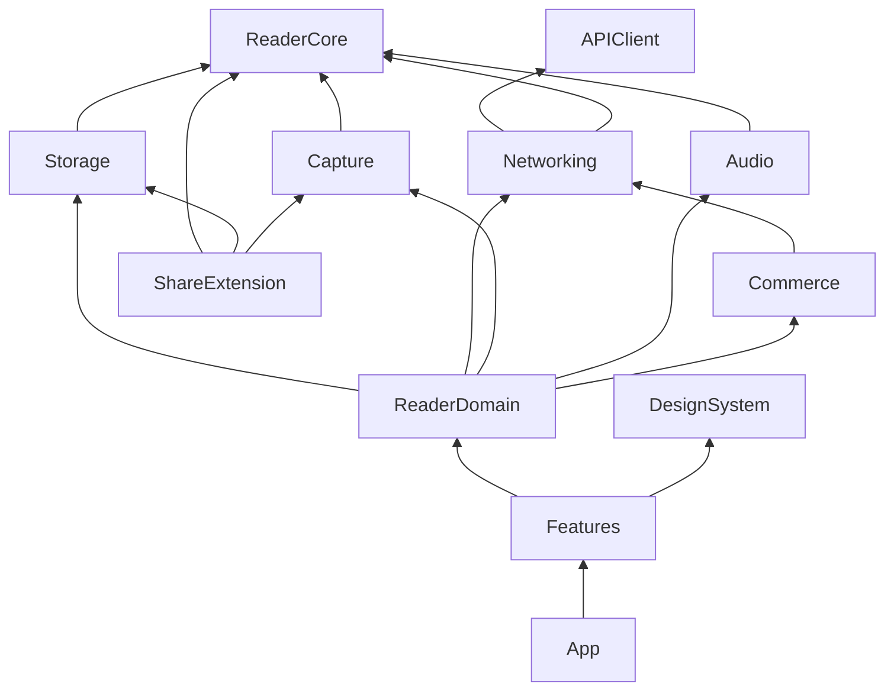
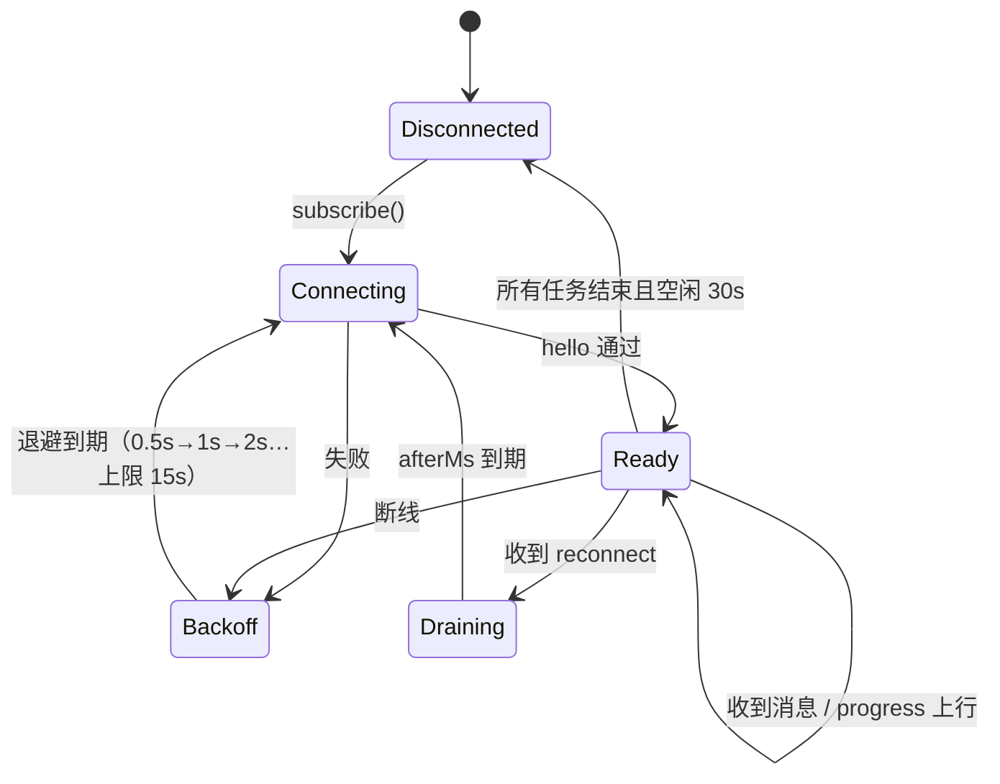
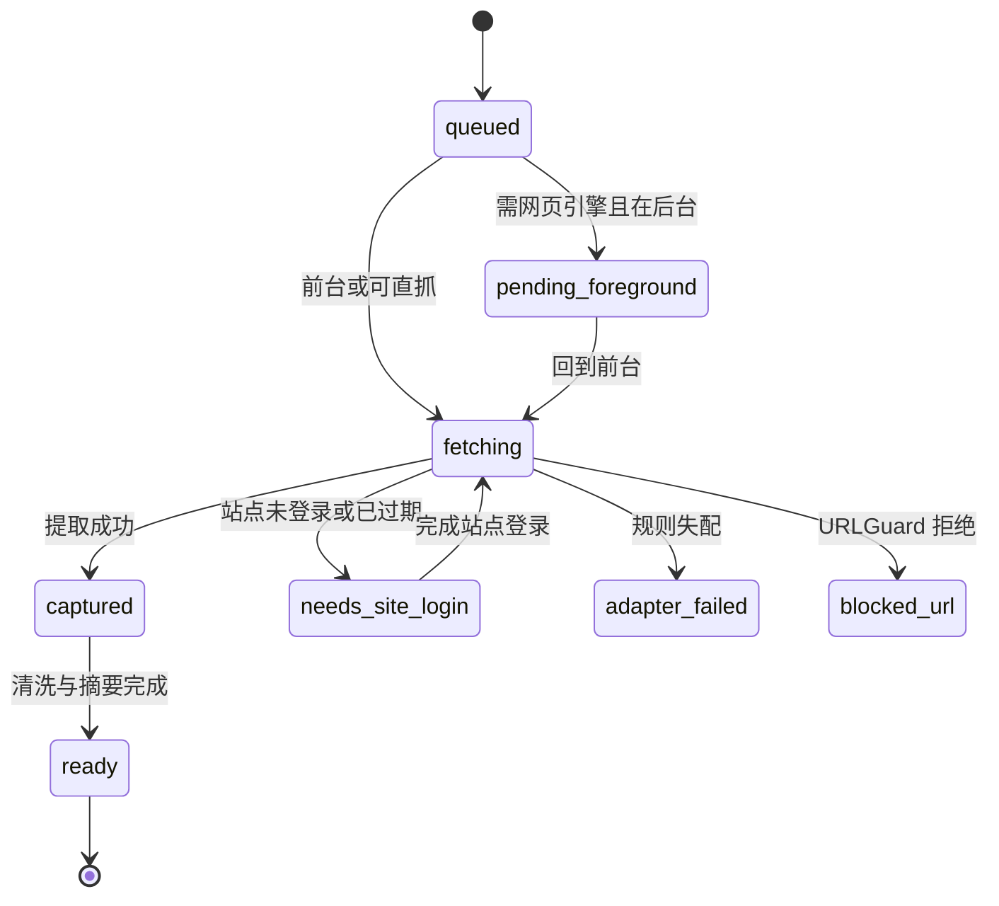
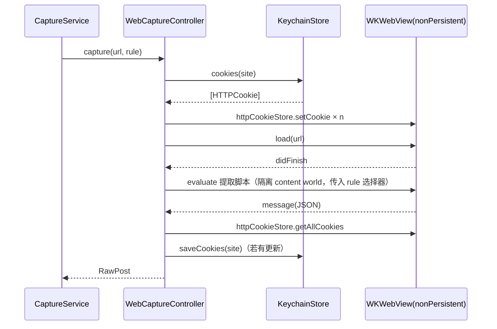
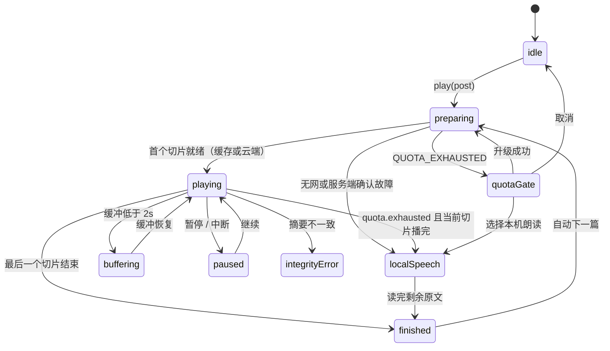
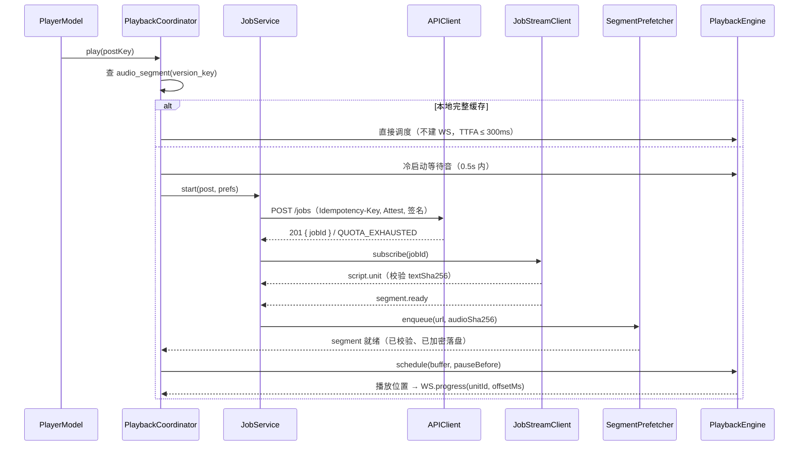
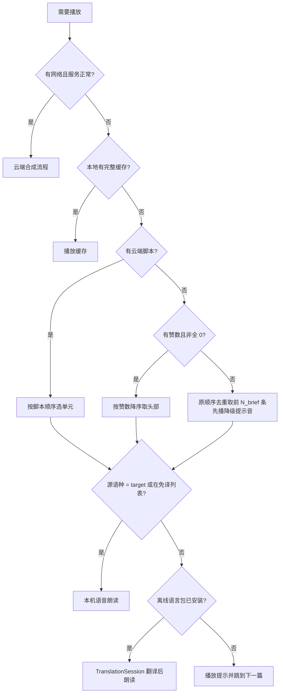
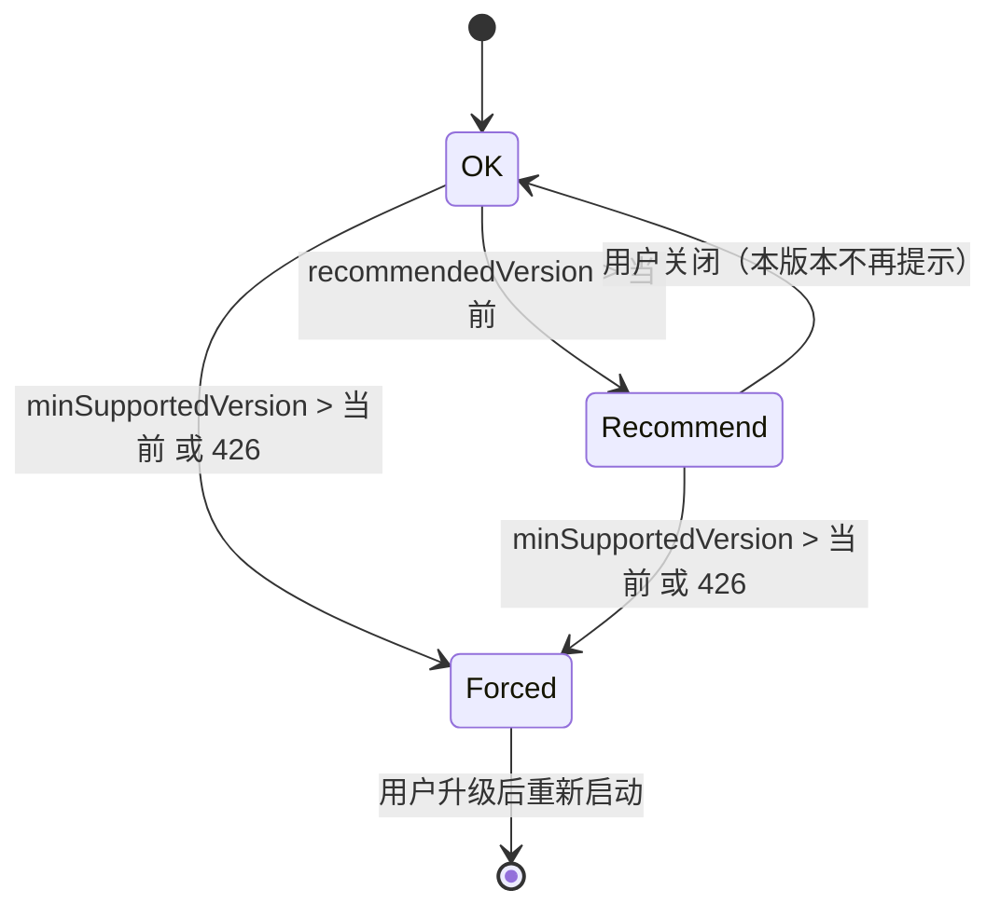

# Post&Comments Reader 架构设计 · 01 iOS 客户端

| 项 | 内容 |
| --- | --- |
| 文档版本 | v1.3（2026-11-26） |
| 依据 | 主 PRD v2.7 草案（重点：5、6.1、6.3、7、8、9.1、9.4、10.2、10.3、11.2–11.4）；《iOS 客户端 PRD》v1.3；`00-overview.md` |
| v1.1 变更 | 完整性失败改为跳过单元（§8.4）；后台刷新任务不再预取内容（§14）；新增首次启动钥匙串清理（§15.3）；新增页面与路由（§6）；新增 §22：支持码、投诉、数据导出、诊断上报、版本门控、内置配置包、交易监听、运行时开关处理、审核演示账号 |
| v1.2 变更 | 新增 §23：设计风格定位、Liquid Glass 两套外观与分层规则、`PRGlassSurface`、App 图标、场景生命周期、测试要求；统一额度池：`GET /me` 的 `quota` 改为毫点字段，新增 `QuotaInfoScreen`，文案「合成时长」改为「额度」 |
| v1.3 变更 | 新增 §24：章节跳转（`chapter.map`、`seek`、位置语义的 `progress`）、法域策略与同意、设备证明与推送抽象、客户端能力声明；切片缓存不转码以保留标识；§24.6 规格补全：年龄确认、计费时区、单篇上限 |
| 技术基线 | Swift 6 语言模式（strict concurrency）、SwiftUI、部署目标 iOS 18+；用 Xcode 27（iOS 27 SDK）构建，具体小版本以 `.xcode-version` 为准（满足 App Store 上传要求，见 05 §1） |
| 视觉基线 | PRD 7.3 冻结原型 `prototype/ios-app`（tag `prototype-frozen-2026-11-23`）、`prototype/ios-app/DESIGN.md`、`docs/ios_ui_freeze.md`；iOS 26+ 的 Liquid Glass 适配见 §23 |

---

## 1. 设计目标与硬约束

| 约束 | 数值 / 要求 | 来源 | 架构对策 |
| --- | --- | --- | --- |
| Share Extension 内存峰值 | < 15 MB | PRD 7.1 | 扩展只链接 `ReaderCore`、`Storage`（收件箱子集）、`Capture.DirectFetcher`；不链接 WebKit、AVFoundation |
| 后台常驻内存 | ≤ 80 MB（`M_bg_ram`） | PRD 10.3 | 后台不持有 WKWebView，音频缓冲上限固定，图片不解码 |
| 本地磁盘 | 总 ≤ 400 MB；音频缓存 ≤ 100 MB | PRD 10.3 | `DiskBudget` 统一记账，见 §9.5 |
| 端侧解析 + 清洗 | ≤ 120 ms | PRD 10.1 | 解析在后台任务执行，规则为数据驱动 |
| 冷启动同语种 TTFA | P95 ≤ 1.5 s（端到端） | PRD 10.1 | 主帖先上传先合成；切片下载与校验流水线化 |
| 缓存直读 TTFA | P95 ≤ 300 ms | PRD 10.1 | 本地 `version_key` 命中直接播放，不建 WS |
| 播放缓冲 | ≥ 10 s | PRD 10.1 | `SegmentPrefetcher` 维持缓冲水位 |
| 凭证 | 只在 Keychain，`ThisDeviceOnly`，不入 App Group | PRD 9.1.1 | WebKit 非持久存储 + Keychain 导入导出，见 §10.5、§15.1 |
| 原文校验 | 播放前逐单元校验摘要；不一致跳过该单元，超过 3 个停止该帖 | PRD 6.1、6.3 | `IntegrityVerifier`，见 §8.4 |

---

## 2. 目录结构

```text
apps/ios/
├─ project.yml                     # XcodeGen 定义（.xcodeproj 不入库）
├─ Makefile                        # project / test / lint / snapshot
├─ Config/
│  ├─ Base.xcconfig
│  ├─ Debug.xcconfig               # API_HOST_CN / API_HOST_INTL 指向 local 或 dev
│  ├─ Staging.xcconfig
│  ├─ Release.xcconfig
│  └─ Pins.xcconfig                # 证书固定公钥（主 + 备）
├─ App/                            # 主 App target
│  ├─ PostReaderApp.swift          # @main，装配 AppEnvironment
│  ├─ AppEnvironment.swift         # 依赖组装（composition root）
│  ├─ AppRouter.swift              # 全局路由
│  ├─ AppLifecycle.swift           # scenePhase、后台任务注册
│  ├─ CarPlay/                     # CarPlaySceneDelegate、模板
│  ├─ Resources/                   # Assets、Localizable.xcstrings、earcons、合成标识音频
│  ├─ Info.plist
│  ├─ PostReader.entitlements
│  └─ PrivacyInfo.xcprivacy
├─ ShareExtension/
│  ├─ ShareViewController.swift    # 托管 SwiftUI
│  ├─ ShareView.swift
│  ├─ Info.plist
│  └─ ShareExtension.entitlements
├─ Packages/
│  ├─ ReaderCore/
│  ├─ Storage/
│  ├─ Networking/
│  ├─ APIClient/                   # swift-openapi-generator 产物（openapi.yaml + 插件配置）
│  ├─ Capture/
│  ├─ Audio/
│  ├─ Commerce/
│  ├─ ReaderDomain/
│  ├─ DesignSystem/
│  ├─ Features/                    # 一个包，多个 library product
│  │  ├─ Sources/FeatureOnboarding
│  │  ├─ Sources/FeatureHome
│  │  ├─ Sources/FeaturePlayer
│  │  ├─ Sources/FeaturePlaylist
│  │  ├─ Sources/FeatureSearch
│  │  ├─ Sources/FeatureNotifications
│  │  ├─ Sources/FeatureSettings
│  │  ├─ Sources/FeatureSiteLogin
│  │  ├─ Sources/FeaturePostDetail
│  │  └─ Sources/FeatureBilling   # QuotaGate、订阅页
│  └─ TestSupport/                 # 假实现、fixture、快照工具
├─ UITests/
└─ AGENTS.md
```

---

## 3. 模块与依赖



| 包 | 职责 | 对外暴露（节选） | 禁止依赖 |
| --- | --- | --- | --- |
| `ReaderCore` | 纯逻辑：数据模型、清洗、摘要、URL 守卫、站点规则模型、语种工具 | `CanonicalPost`、`Unit`、`Cleaner`、`UnitHasher`、`URLGuard`、`SiteRule`、`LangTag` | 除 Foundation、CryptoKit 外的一切 |
| `Storage` | 加密数据库、音频缓存、Keychain、共享收件箱、磁盘预算 | `AppDatabase`、`Repositories`、`AudioCache`、`KeychainStore`、`SharedInbox`、`DiskBudget` | UI、网络 |
| `APIClient` | OpenAPI 生成代码 | `Client`、`Operations`、`Components` | 手工修改 |
| `Networking` | HTTP 中间件、签名、Attest、WebSocket、区域端点 | `APITransport`、`RequestSigner`、`AttestService`、`JobStreamClient`、`RegionEndpoint` | UI |
| `Capture` | 直抓、网页引擎抓取、规则运行时 | `DirectFetcher`、`WebCaptureController`、`SiteAdapterRuntime` | 音频 |
| `Audio` | 播放引擎、本机语音、离线翻译、Now Playing、提示音 | `PlaybackEngine`、`LocalSpeech`、`OfflineTranslator`、`NowPlayingBridge`、`Earcons` | 网络 |
| `Commerce` | 登录、订阅 | `AuthService`、`StoreService` | UI |
| `ReaderDomain` | 业务服务（只依赖下层协议） | `QueueService`、`CaptureService`、`JobService`、`PlaybackCoordinator`、`QuotaService`、`AccountService`、`CleanupService`、`ConfigService` | SwiftUI |
| `DesignSystem` | token 与组件 | 见 §5 | 业务模块 |
| `Features` | 页面与页面 Model | 各 `*Screen` | Storage、Networking 等 Infra（只能经 Domain） |

依赖方向由 SPM `Package.swift` 的 `dependencies` 声明强制；`Features` 不声明对 Infra 包的依赖，编译期即阻止越层调用。

---

## 4. 工程配置

### 4.1 `project.yml`（节选）

```yaml
name: PostReader
options:
  deploymentTarget: { iOS: "18.0" }
  bundleIdPrefix: com.example.postreader
settings:
  base:
    SWIFT_VERSION: 6.0
    SWIFT_STRICT_CONCURRENCY: complete
    ENABLE_USER_SCRIPT_SANDBOXING: YES
configs:
  Debug: debug
  Staging: release
  Release: release
configFiles:
  Debug: Config/Debug.xcconfig
  Staging: Config/Staging.xcconfig
  Release: Config/Release.xcconfig
packages:
  ReaderCore: { path: Packages/ReaderCore }
  Storage: { path: Packages/Storage }
  # …其余本地包
  GRDB: { url: https://github.com/groue/GRDB.swift, from: "7.0.0" }   # SQLCipher 变体见 §9.1
  Sentry: { url: https://github.com/getsentry/sentry-cocoa, from: "8.0.0" }
targets:
  PostReader:
    type: application
    platform: iOS
    sources: [App]
    entitlements: { path: App/PostReader.entitlements }
    dependencies:
      - package: Features
      - target: ShareExtension
    preBuildScripts:
      - name: SwiftLint
        script: swiftlint --strict
  ShareExtension:
    type: app-extension
    platform: iOS
    sources: [ShareExtension]
    dependencies:
      - package: ReaderCore
      - package: Storage
        product: StorageInbox
      - package: Capture
        product: CaptureDirect
```

依赖库的具体版本以 `Package.resolved` 锁定为准，上表只表示主版本线。

### 4.2 能力与权限

| 能力 | 主 App | Share Extension | 用途 |
| --- | --- | --- | --- |
| App Groups `group.<bundle>.shared` | ✓ | ✓ | 共享收件箱 |
| Keychain Sharing `<team>.<bundle>.shared` | ✓ | ✓ | 登录态、收件箱密钥 |
| Sign in with Apple | ✓ | | 登录 |
| App Attest（`com.apple.developer.devicecheck.appattest-environment`） | ✓ | | 设备证明 |
| Background Modes：`audio`、`fetch` | ✓ | | 后台播放、`BGAppRefreshTask` |
| CarPlay Audio（`com.apple.developer.carplay-audio`） | ✓ | | 车载（需向 Apple 申请） |
| In-App Purchase | ✓ | | 订阅 |

`Info.plist` 要点：`NSCameraUsageDescription`（扫码添加贴文，仅主 App）；`BGTaskSchedulerPermittedIdentifiers = [<bundle>.refresh]`；`NSAppTransportSecurity.NSPinnedDomains` 见 §15.2；`NSExtensionActivationRule` 只接受 URL 与纯文本中的 URL。

### 4.3 双 Bundle ID（待决策 D1 的默认方案）

两个 App 目标共享全部代码，差异只在 xcconfig：

| 配置项 | 国内版 | 海外版 |
| --- | --- | --- |
| `PRODUCT_BUNDLE_IDENTIFIER` | `com.example.postreader.cn` | `com.example.postreader` |
| `HOME_REGION` | `cn` | `intl` |
| `API_HOST` | 国内区域域名 | 海外区域域名 |
| `SENTRY_DSN` | 国内自建 Sentry | 海外 Sentry SaaS |
| App Store 店面 | 中国大陆 | 其余店面 |

若 D1 最终改为单一 Bundle ID，`RegionEndpoint` 改为运行时按 StoreKit 店面国家与登录页选择决定，见 §8.1。

---

## 5. DesignSystem 组件库

视觉取值来自冻结原型；本节规定组件 API 与行为。所有组件支持深浅色、动态字体（至 `accessibility3`）与 VoiceOver。页面中禁止写死颜色、字号、间距，只能使用 token。

### 5.1 Token

```swift
public enum PRColor {          // 语义色，资产目录中各含 Light / Dark
  public static let bgPrimary, bgSecondary, bgElevated: Color
  public static let textPrimary, textSecondary, textTertiary, textInverse: Color
  public static let accent, accentMuted: Color
  public static let separator, fill: Color
  public static let success, warning, danger: Color
  public static let speakerPalette: [Color]   // 播放页发言人色带，长度 = 音色槽位上限
}
public enum PRFont {           // 全部基于 Dynamic Type 文本样式
  public static let largeTitle, title, headline, body, callout, subheadline, footnote, caption: Font
  public static let mono: Font // 验证码、调试信息
}
public enum PRSpace { public static let xxs = 2.0, xs = 4.0, s = 8.0, m = 12.0, l = 16.0, xl = 24.0, xxl = 32.0 }
public enum PRRadius { public static let s = 8.0, m = 12.0, l = 16.0, sheet = 20.0 }
public enum PRMotion { public static let quick = 0.15, standard = 0.25, emphasized = 0.35 } // 秒；尊重“减弱动态效果”
public enum PRIcon { /* SF Symbols 名称常量，避免散落字符串 */ }
```

### 5.2 组件清单

| 组件 | 用途 | 关键参数 | 状态 / 变体 | 备注 |
| --- | --- | --- | --- | --- |
| `PRButton` | 通用按钮 | `title`、`icon?`、`role: .primary/.secondary/.tertiary/.destructive`、`size`、`isLoading` | normal / pressed / disabled / loading | 最小点击区域 44×44 pt |
| `PRIconButton` | 图标按钮 | `icon`、`accessibilityLabel`（必填） | 同上 | 播放控制、关闭 |
| `PRCountdownButton` | 发送验证码 | `seconds = 120`、`onSend` | idle / counting(n) / resend | PRD 7.3 两分钟倒计时 |
| `PRCodeField` | 6 位验证码输入 | `length = 6`、`onComplete` | empty / partial / complete / error | 支持系统短信与邮件验证码自动填充；`textContentType(.oneTimeCode)` |
| `PRTextField` | 邮箱等输入 | `title`、`text`、`kind: .email/.plain`、`error?` | normal / focused / error | |
| `PRPostCard` | 全应用唯一的帖子卡片 | `post: PostCardModel`、`context: .home/.favorites/.playlist/.search`、`onAction` | default / playing / capturing / needsSiteLogin / failed | **不显示任何点赞、收藏、浏览、热度、排名数字**（PRD 7.3）；可显示图片或视频缩略图 |
| `PRPostCardMenu` | 卡片「更多」菜单 | `actions` | 加入播放列表 / 接下来播放 / 查看原文 / 立即播放 / 删除（仅收藏页，二次确认） | |
| `PRCollapsibleText` | 可折叠正文 | `text`、`lineLimit` | collapsed / expanded | 折叠只改变显示，不改变播报文本 |
| `PRSegmentedTabs` | 首页「推荐 / 收藏」 | `selection`、`items` | | |
| `PRBottomSheet` | 搜索、通知、播放列表等全局底部弹层 | `detents: [.medium, .large]`、`content` | half / full / dismissed | 基于 `.sheet` + `presentationDetents` |
| `PRMiniPlayer` | 底部常驻迷你播放条 | `nowPlaying`、`onTap`、`onPlayPause` | idle(隐藏) / playing / paused / buffering / local(本机语音) | 本机语音状态显示小标签 |
| `PRPlayerControls` | 播放页主控件 | `state`、`onPrevChapter`、`onPlayPause`、`onNextChapter`、`onPrevPost`、`onNextPost`、`canPrevPost`、`rate` | | 上一章 / 下一章语义同耳机（PRD 8.4）；上一篇 / 下一篇按播放列表切换（iOS PRD IOS-PLAY-12），首位时上一篇禁用 |
| `PRProgressScrubber` | 进度条（按章节分段） | `chapters`、`position`、`onSeek` | | 章节边界可视化 |
| `PRSpeakerChip` | 当前发言人 | `role`、`slot`、`displayName?` | host / op / commenter | 颜色取 `speakerPalette[slot]` |
| `PRTranscriptRow` | 原文 / 译文对照行 | `unit`、`mode: .original/.translated/.both`、`isCurrent` | current 高亮 | 默认逐条展示译文和原文（PRD 6.1） |
| `PRReadModeToggle` | 单帖「朗读译文 / 朗读原文」 | `isOriginalAllowed`、`reason?` | Tier 3 源语种时禁用并显示原因 | PRD 5.2.3 |
| `PRListRow` | 设置列表行 | `title`、`subtitle?`、`accessory: .chevron/.value(String)/.toggle(Binding)` | | |
| `PRSectionHeader` | 分组标题 | `title` | | |
| `PRSiteLoginRow` | 站点登录列表行 | `site`、`state: .loggedIn/.expired` | | 仅列出已登录过的站点（PRD 7.3） |
| `PRBanner` | 页内提示条 | `kind: .info/.warning/.error`、`message`、`action?` | | 例：「该帖需在 App 内完成站点登录」 |
| `PRToast` | 轻提示 | `message`、`duration` | | 由 `ToastCenter` 统一排队 |
| `PRConfirmDialog` | 二次确认 | `title`、`message`、`destructiveTitle` | | 删除收藏、一键清理、注销 |
| `PREmptyState` | 空状态 | `icon`、`title`、`message`、`action?` | | |
| `PRSkeleton` | 加载占位 | `shape` | | 遵守「减弱动态效果」 |
| `PRUpgradeCard` | 升级方案卡 | `targetTier`、`price`、`onUpgrade` | loading / purchased / failed | 价格来自 StoreKit `Product.displayPrice` |
| `PRQuotaGate` | 配额拦截层 | `options`、`localReadAvailable`、`unavailableReason?` | | 三项：升级 / 本机朗读 / 取消（PRD 11.3）；`pro` 不显示升级 |
| `PRDensityPicker` | 信息密度 | `selection`、`allowed: Set<Density>` | 不可用项带锁与档位提示 | |
| `PRStylePicker` | 播报风格 | `selection`、`allowed` | | |
| `PRLanguagePicker` | 目标语言 / 免译语言 | `mode: .target/.passthrough`、`allowedTiers: [.tier1, .tier2]` | | Tier 3 不可选 |
| `PRPrivacyNotice` | 登录首屏说明 | — | | PRD 7.1 要求说明云端配额账本与加密同步 |

组件放在 `DesignSystem/Sources/Components/<Name>/`，每个组件一个文件 + 一个 `#Preview` + 一个快照测试。悬浮在内容之上的组件使用 `PRGlassSurface` 取材质（§23.4）。

### 5.3 交互与可访问性规则

- 所有图标按钮必须有 `accessibilityLabel`；播放控件同时提供 `accessibilityAction` 以便 VoiceOver 用户快速跳章。
- 文本对比度满足 WCAG AA；动态字体最大级别下布局不截断（快照测试覆盖 `xSmall`、`large`、`accessibility3`）。
- 振动反馈只用于明确的结果（购买成功、删除完成），不用于普通点击。

---

## 6. 页面与导航

### 6.1 页面清单

| 页面 | 包 | 入口 | 主要内容 | PRD |
| --- | --- | --- | --- | --- |
| `IntroScreen` → `WelcomeScreen` | Onboarding | 首次启动 | 介绍页、欢迎页；Sign in with Apple 与邮箱入口；隐私说明 | 7.1、7.3 |
| `EmailLoginScreen` | Onboarding | 欢迎页 | 邮箱 + 6 位验证码同屏，120 s 倒计时 | 7.3 |
| `HomeScreen` | Home | 登录后根页 | 「推荐 / 收藏」两个标签；预置样帖排在推荐首位；粘贴链接经 `URLGuard` 校验后用 `confirmationDialog` 弹出「立即播放 / 接下来播放 / 加入播放列表」，取消则不入队 | 7.3；iOS PRD IOS-HOME-05 |
| `QRScannerSheet` | Home | 首页「扫码添加」 | VisionKit `DataScannerViewController`（只识别二维码），识别到 URL 后关闭并交给与粘贴相同的 `addLink(url)` 流程；不可用设备或权限被拒时显示说明与「前往设置」；画面不落盘 | iOS PRD IOS-HOME-08 |
| `PlayerScreen` | Player | 迷你播放条 / 卡片「立即播放」 | 控件、发言人、章节、原文 / 译文对照、读原文开关 | 5.2、8 |
| `PlaylistSheet` | Playlist | 播放页或迷你播放条 | 队列，半屏可上拉全屏 | 7.3 |
| `SearchSheet` | Search | 首页 | 本地队列与收藏检索 | 7.3 |
| `NotificationsSheet` | Notifications | 首页 | 采集结果、站点登录过期等本地通知记录 | 7.3 |
| `PostDetailScreen` | PostDetail | 卡片「查看原文」 | 原文、评论、译文对照 | 6.1 |
| `SettingsScreen` | Settings | 首页 | 账号、订阅与配额、语言与偏好、站点登录、隐私、帮助与反馈、关于、注销账号 | 7.1、7.3、9.1.4 |
| `PrivacyScreen` | Settings | 设置 | 锁屏隐私模式、共享诊断数据、导出我的数据、一键清理 | 9.1、9.3、9.4 |
| `DataExportScreen` | Settings | 隐私 / 通知 | 发起导出、进度、下载并经系统分享面板保存 | 9.3 |
| `HelpFeedbackScreen` | Settings | 设置 | 支持码、联系客服（邮件预填）、自愿提供公开链接说明、投诉入口（国内） | 7.5 |
| `ComplaintFormScreen` / `MyComplaintsScreen` | Settings | 帮助与反馈；播放页「更多」 | 投诉表单、公示流程与时限；投诉状态列表（仅国内包） | 9.6 |
| `AboutScreen` | Settings | 设置 | 版本、模型与备案公示（国内）、隐私政策、用户协议、开源许可 | 9.3 |
| `ForceUpdateScreen` | App | 版本门控 | 常驻升级弹窗：只有「前往更新」，不可关闭 | iOS PRD 5.16 |
| `SiteLoginListScreen` / `SiteLoginDetailScreen` | SiteLogin | 设置 | 已登录站点列表；单站点页显示状态并提供「退出登录」 | 7.3 |
| `SiteLoginWebScreen` | SiteLogin | 采集提示或站点页 | 内嵌浏览器完成站点登录 | 7.1 |
| `QuotaGateSheet` | Billing | `QUOTA_EXHAUSTED` | 拦截层 | 11.3 |
| `SubscriptionScreen` | Billing | 设置 / 拦截层 | 档位对比与购买、恢复购买 | 11.1 |
| `QuotaInfoScreen` | Billing | 订阅与配额 | 统一额度池说明：消耗与不消耗额度的操作、各类别参考消耗（`GET /quota/reference` 按本档位主渠道系数换算后下发，随 `rateVersion` 缓存） | iOS PRD IOS-BILL-08 |
| `DeleteAccountFlow` | Settings | 设置 | 说明 → 二次确认 → 提交 → 结果 | 7.1、9.3 |

设置页不提供「预览锁屏效果」「未收藏帖子保留」「操作提示音」，也不显示「不额外计时」类说明（PRD 7.3）。

### 6.2 路由

```swift
@MainActor @Observable
final class AppRouter {
  enum Root { case onboarding, main }
  enum Route: Hashable {
    case player
    case postDetail(postKey: String)
    case settings
    case siteLoginList, siteLoginDetail(site: String), siteLoginWeb(site: String, returnTo: String?)
    case subscription
    case deleteAccount
    case privacy, dataExport, helpFeedback, complaintForm(jobId: String?), myComplaints, about
  }
  enum Sheet: Identifiable { case playlist, search, notifications, quotaGate(QuotaGateContext); var id: String { … } }

  var root: Root = .onboarding
  var path: [Route] = []
  var sheet: Sheet?

  func handle(deepLink: URL) { … }   // 例如本地通知点击 → 打开对应帖子或站点登录
}
```

`root` 由 `AccountService.sessionState` 驱动：未登录永远停在 `.onboarding`，没有访客模式（PRD 7.1）。`VersionGate` 判定强制升级时 `root` 切到 `.forceUpdate`（`enum Root` 增加此值），该状态下整个界面只显示常驻升级弹窗，不可关闭（§22.5）。

---

## 7. 状态管理与依赖注入

### 7.1 AppEnvironment

```swift
@MainActor
struct AppEnvironment {
  let account: AccountServicing
  let queue: QueueServicing
  let capture: CaptureServicing
  let jobs: JobServicing
  let playback: PlaybackCoordinating
  let quota: QuotaServicing
  let config: ConfigServicing
  let cleanup: CleanupServicing
  let store: StoreServicing
  let toast: ToastCenter

  static func live(region: Region) -> AppEnvironment { … }   // 组装真实实现
  static func preview(_ scenario: PreviewScenario = .default) -> AppEnvironment { … }
}

extension EnvironmentValues { @Entry var app: AppEnvironment = .preview() }
```

### 7.2 页面 Model 模板

```swift
@MainActor @Observable
final class HomeModel {
  private(set) var tab: HomeTab = .recommended
  private(set) var items: [PostCardModel] = []
  private(set) var loadState: LoadState = .idle

  private let queue: QueueServicing
  private let playback: PlaybackCoordinating
  init(env: AppEnvironment) { queue = env.queue; playback = env.playback }

  func onAppear() async { … }                  // 订阅 queue.updates（AsyncStream）
  func select(_ tab: HomeTab) { … }
  func perform(_ action: PostCardAction, on post: PostCardModel) async { … }
}
```

约定：View 不持有业务逻辑；Model 不 import SwiftUI 以外的 UI；跨页面共享状态只由 Domain 服务持有。

### 7.3 并发归属

| 组件 | 隔离 | 说明 |
| --- | --- | --- |
| 页面 Model、`AppRouter`、`PlaybackCoordinator` | `@MainActor` | UI 状态单线程 |
| `JobStreamClient` | `actor` | 连接、重连、`lastSeq` |
| `SegmentPrefetcher`、`AudioCache` | `actor` | 下载并发与 LRU 互斥 |
| `WebCaptureController` | `@MainActor` + 内部串行队列 | WKWebView 主线程限定、单实例 |
| `AppDatabase` | GRDB `DatabasePool` | WAL，多读单写 |
| `PlaybackEngine` | 自定义串行 executor | 引擎调度与中断处理在同一上下文 |

禁止 `@unchecked Sendable` 与 `nonisolated(unsafe)`（SwiftLint 自定义规则拦截，确需使用须注释理由并人工审核）。

---

## 8. 网络层

### 8.1 区域端点

```swift
public struct RegionEndpoint: Sendable {
  public let region: Region           // .cn / .intl
  public let apiBase: URL             // https://api.<region-domain>/v1
  public let wsURL: URL               // wss://api.<region-domain>/v1/stream
}
```

D1 默认方案下由 xcconfig 固定。登录请求带 `storefront`（StoreKit `Storefront.current?.countryCode`，取不到则不传），服务端按 `config/regions.yaml` 的店面列表判定（主 PRD 13 U14）。登录成功后 `home_region` 写入 Keychain，服务端返回 `REGION_MISMATCH` 时弹出对话框（文案见 iOS PRD IOS-AUTH-04，本地化 key `auth.regionMismatch.title` / `.message`）：「前往 App Store」打开另一区域版本的商店页（链接来自 xcconfig 的 `OTHER_REGION_APP_STORE_URL`），「创建新账号」回到欢迎页；不写入 `home_region`，不进入主界面。

### 8.2 HTTP 中间件链

swift-openapi-generator 生成的 `Client` 使用 `URLSessionTransport`，按顺序挂中间件：

| 顺序 | 中间件 | 作用 |
| --- | --- | --- |
| 1 | `ClientVersionMiddleware` | 加 `X-Client-Version`、`Accept-Language`；收到 `CLIENT_TOO_OLD`（426）时通知 `VersionGate`（§22.5） |
| 2 | `AuthMiddleware` | 加 `Authorization: Bearer`；遇 `AUTH_EXPIRED` 单飞（single-flight）刷新后重放一次 |
| 3 | `SigningMiddleware` | 写请求按 `00-overview` / `02-backend` 的规则计算 `X-Ts`、`X-Nonce`、`X-Sig` |
| 4 | `AttestMiddleware` | `POST /jobs` 与会话签发附带 App Attest assertion |
| 5 | `IdempotencyMiddleware` | `POST /jobs` 附带 `Idempotency-Key`（来自队列项，重试复用同一键） |
| 6 | `RetryMiddleware` | 仅对幂等请求与网络错误做指数退避，最多 2 次 |
| 7 | `ProblemMiddleware` | 把 `problem+json` 解码为 `APIError(code:)` |

### 8.3 `JobStreamClient`



- 重连后对每个未完成任务发 `resume(jobId, lastSeq)`。
- 对外暴露 `func events(jobId:) -> AsyncThrowingStream<JobEvent, Error>`；消费方取消迭代即退订。
- 心跳：每 20 s `ping`，40 s 无响应视为断线。
- 播放推进时节流上报 `progress { unitId, offsetMs }`（每 5 s 或切换单元时一次）；跳章时发 `seek { unitId }`（§24.1）。
- `hello` 携带客户端能力声明 `capabilities`（§24.4）。

### 8.4 完整性校验

`IntegrityVerifier` 在两个时点执行：

1. 收到 `script.unit`：`textSha256` 必须等于本地 `unit_hash.hash`（同语种分支）；分支 B 的译文单元不参与这一比对，但原文单元仍比对。
2. 下载切片后：`SHA256(bytes) == audioSha256`。

处理（主 PRD 6.3）：

- **文本摘要不一致**：该单元标记为 `integrityFailed`，不播放、不在原文视图展示云端下发内容（标注「未通过校验」）；播放页提示「这段内容校验未通过，已跳过」，继续下一单元。同一任务累计超过 3 个单元不一致时停止该帖并提示查看原文。
- **音频摘要不一致**：丢弃该切片文件，按同一规则跳过对应单元。
- 每次不一致经 `DiagnosticsUploader` 上报 `integrity_result{jobId, seq, code: mismatch}`（完整性事件属服务必需，不受诊断开关影响），由服务端复核并决定是否退还（02 §18.2）。PRD 12.1 门禁要求此事件为 0。

---

## 9. 数据层

### 9.1 加密数据库

- GRDB + SQLCipher。GRDB 官方支持通过 SQLCipher 构建变体启用加密（依赖方式以 GRDB 文档为准：使用其 SQLCipher 集成方案，而不是系统 SQLite）。
- 打开流程：`KeychainStore.dbKey()`（不存在则生成 32 字节随机数写入）→ `config.prepareDatabase { try $0.usePassphrase(key) }` → `DatabasePool`。
- 文件位置：`Application Support/db/main.sqlite`，`isExcludedFromBackup = true`，文件保护 `completeUntilFirstUserAuthentication`。

### 9.2 表结构（迁移 v1）

```swift
migrator.registerMigration("v1") { db in
  try db.create(table: "post_snapshot") { t in
    t.primaryKey("post_key", .text)
    t.column("site", .text).notNull()
    t.column("url", .text).notNull()
    t.column("cache_scope", .text).notNull()          // PUBLIC / PRIVATE
    t.column("canonical_json", .blob)                 // 压缩为元数据后置空
    t.column("title", .text)
    t.column("captured_at", .datetime).notNull()
    t.column("favorited", .boolean).notNull().defaults(to: false)
    t.column("compact_after", .datetime)              // 未收藏：captured_at + 30 天
  }
  try db.create(table: "unit_hash") { t in
    t.column("post_key", .text).notNull().references("post_snapshot", onDelete: .cascade)
    t.column("unit_id", .text).notNull()
    t.column("hash", .text).notNull()
    t.primaryKey(["post_key", "unit_id"])
  }
  try db.create(table: "queue_item") { t in
    t.autoIncrementedPrimaryKey("id")
    t.column("post_key", .text).notNull().indexed()
    t.column("position", .double).notNull()           // 分数排序，插入无需重排
    t.column("capture_state", .text).notNull()
    t.column("idempotency_key", .text).notNull()
    t.column("added_at", .datetime).notNull()
  }
  try db.create(table: "audio_segment") { t in
    t.column("version_key", .text).notNull()
    t.column("seq", .integer).notNull()
    t.column("unit_id", .text).notNull()
    t.column("file", .text).notNull()
    t.column("bytes", .integer).notNull()
    t.column("audio_sha256", .text).notNull()
    t.column("duration_ms", .integer).notNull()
    t.column("site", .text).notNull()
    t.column("last_played_at", .datetime)
    t.primaryKey(["version_key", "seq"])
  }
  try db.create(index: "audio_segment_lru", on: "audio_segment", columns: ["last_played_at"])
  try db.create(table: "playback_progress") { t in
    t.primaryKey("post_key", .text)
    t.column("version_key", .text).notNull()
    t.column("seq", .integer).notNull()
    t.column("offset_ms", .integer).notNull()
  }
  try db.create(table: "site_session") { t in
    t.primaryKey("site", .text)
    t.column("logged_in", .boolean).notNull()
    t.column("updated_at", .datetime).notNull()
  }
  try db.create(table: "config_bundle") { t in
    t.primaryKey("version", .text)
    t.column("signature", .blob).notNull()
    t.column("payload", .blob).notNull()
    t.column("activated_at", .datetime)
  }
  try db.create(table: "local_notice") { t in      // 通知弹层的数据
    t.autoIncrementedPrimaryKey("id")
    t.column("kind", .text).notNull()
    t.column("post_key", .text)
    t.column("site", .text)
    t.column("created_at", .datetime).notNull()
    t.column("read", .boolean).notNull().defaults(to: false)
  }
  try db.create(table: "setting") { t in
    t.primaryKey("key", .text)
    t.column("value", .blob).notNull()
  }
}

migrator.registerMigration("v2") { db in            // v1.1：诊断事件队列
  try db.create(table: "diag_event") { t in
    t.autoIncrementedPrimaryKey("id")
    t.column("kind", .text).notNull()                 // capture_result / integrity_result / playback_progress / degrade
    t.column("payload", .blob).notNull()              // 白名单字段的 JSON
    t.column("essential", .boolean).notNull()         // 完整性事件 = true，不受开关影响、不被淘汰
    t.column("created_at", .datetime).notNull()
  }
  try db.alter(table: "local_notice") { t in
    t.add(column: "target", .text)                     // 点击跳转目标（帖子、站点、订阅、投诉、导出）
  }
}
```

`version_key = sha256(postKey | prefsHash | targetLang | readMode | voiceTableVersion)`，用于判断「同一已生成版本」从而复听免费（PRD 11.2）。

### 9.3 仓储

每张表一个 `Repository`（`PostRepository`、`QueueRepository`、`SegmentRepository` 等），只暴露领域方法与 `ValueObservation` 驱动的 `AsyncStream`，不向上层暴露 SQL。

### 9.4 音频缓存

```text
Application Support/audio/<version_key 前 2 位>/<version_key>/<seq>.m4a.enc
```

- 写入：下载 → 校验 `audioSha256` → AES-GCM 加密（密钥为 Keychain 中的 `audioKey`）→ 原子写入 → 登记 `audio_segment`。
- 读取：解密到内存缓冲交给引擎，不落明文临时文件。
- 淘汰：`DiskBudget.audio` 超过 100 MB 时按 `last_played_at` 升序删除，正在播放的 `version_key` 加锁不删。

### 9.5 磁盘预算

| 分区 | 上限 | 超限动作 |
| --- | --- | --- |
| 音频缓存 | 100 MB（PRD） | LRU 淘汰 |
| 数据库与快照 | 150 MB（建议） | 提前压缩未收藏快照 |
| WebKit 与临时文件 | 100 MB（建议） | 清理 `tmp/`，重置网页引擎缓存 |
| 余量 | 50 MB | — |
| 合计 | ≤ 400 MB（PRD `D_total`） | — |

`DiskBudget` 在启动、进入后台、每次写入音频后核算一次。

---

## 10. 采集子系统

### 10.1 组件

| 组件 | 职责 |
| --- | --- |
| `CaptureService`（Domain） | 驱动队列项状态机；决定直抓或网页引擎；写入快照与摘要 |
| `SiteAdapterRuntime` | 按 `matchHosts` 选规则；执行 JSON 路径 / CSS 选择器提取；输出 `RawPost` |
| `DirectFetcher` | ephemeral `URLSession`；重定向 ≤ 3、响应体 ≤ 2 MB；每跳过 `URLGuard` |
| `WebCaptureController` | 单例 WKWebView；Cookie 注入与导出；提取脚本；超时 15 s |
| `URLGuard` | 协议、主机、端口、IP 段校验；DNS 解析后复检 |
| `Cleaner` / `UnitHasher` | 见 `00-overview` §3.2（`packages/canonical-spec`） |

### 10.2 队列项状态机



### 10.3 站点规则格式（`config/site-adapters/<site>.json`）

```json
{
  "id": "example-forum",
  "version": 3,
  "matchHosts": ["forum.example.com", "m.forum.example.com"],
  "mode": "direct_json",
  "cacheScope": "PUBLIC",
  "request": { "urlTemplate": "https://forum.example.com/api/thread/{postId}.json", "postIdFrom": "path:/t/(\\d+)" },
  "post": { "id": "$.thread.id", "author": "$.thread.author.id", "text": "$.thread.body_html", "lang": "$.thread.lang" },
  "comments": {
    "list": "$.replies[*]",
    "id": "$.id", "author": "$.author.id", "text": "$.body_html", "likes": "$.score",
    "parent": "$.reply_to", "hasImages": "$.attachments[?(@.type=='image')]"
  },
  "pagination": { "next": "$.next_page_url", "maxPages": 4 }
}
```

`mode` 取值 `direct_json` / `direct_html`（字段为 CSS 选择器）/ `webview`（字段为 CSS 选择器，由内置提取脚本执行）。规则是纯数据；不下发可执行 JavaScript。`cacheScope` 由规则与 `allowlist.yaml` 共同决定：只有白名单站点才能是 `PUBLIC`。

### 10.4 `URLGuard`

1. 协议必须为 `https`（`http` 仅允许白名单站点）。
2. 主机名不得为 IP 字面量中的私网、环回、链路本地、组播、保留段（IPv4 与 IPv6 都检查，含 IPv4 映射的 IPv6）。
3. 端口仅 443（或白名单显式端口）。
4. 解析 DNS 后对全部 A/AAAA 结果重复第 2 步，防 DNS rebinding。
5. 每次重定向重新执行 1–4。

### 10.5 网页引擎抓取流程



站点登录页（`SiteLoginWebScreen`）使用同一个控制器；登录完成判定依据规则中的 `loginSuccessSelector` 或 Cookie 名。

---

## 11. Share Extension

```swift
@MainActor
final class ShareModel: ObservableObject {   // 扩展内为节省体积不引入 Observation 宏以外的依赖
  enum Phase { case checking, notLoggedIn, fetching, queued(needsApp: Bool), failed(String) }
  func start(items: [NSExtensionItem]) async { … }
}
```

流程：

1. 从 `NSExtensionItem` 取第一个 URL（或从纯文本中提取）。
2. 读共享 Keychain 中的登录标记；无 → `notLoggedIn`：显示「请打开 App 登录后再分享」，不写收件箱、不联网（PRD 7.1）。iOS 不提供从扩展打开宿主 App 的公开接口，此处只做文字引导。
3. `URLGuard` 校验。
4. 匹配站点规则：`direct_*` → 在 2.5 s 预算内直抓、清洗、算摘要；超时降级为只入收件箱。`webview` → 只入收件箱，显示「打开 App 继续」。
5. 写入 App Group 内的收件箱库（小型 SQLCipher 库，密钥在共享 Keychain），关闭扩展。

主 App 在启动和每次回到前台时消费收件箱并清空。

---

## 12. 播放子系统

### 12.1 组件

| 组件 | 职责 |
| --- | --- |
| `PlaybackCoordinator`（Domain，`@MainActor`） | 播放状态机；把队列项变成「章节 + 切片」序列；处理配额耗尽、降级、跳章 |
| `JobService`（Domain） | 创建任务、订阅事件流、校验、驱动下载 |
| `SegmentPrefetcher` | 维持 ≥ 10 s 缓冲；并发 2 个下载 |
| `PlaybackEngine`（Audio） | AVAudioEngine 图、调度、中断、路由变化 |
| `LocalSpeech`（Audio） | AVSpeechSynthesizer → PCM |
| `OfflineTranslator`（Audio） | Translation 框架包装 |
| `Earcons`（Audio） | 冷启动等待音、议题切换音、降级提示音、配额到期提示音、合成标识提示 |
| `NowPlayingBridge`（Audio） | `MPRemoteCommandCenter`、`MPNowPlayingInfoCenter`、锁屏隐私 |

### 12.2 状态机



### 12.3 引擎图

```text
[TTS PlayerNode] ─┐
[Earcon PlayerNode] ─┼─► [MainMixer] ─► [Peak Limiter (AVAudioUnitEffect)] ─► [Output]
[LocalSpeech PlayerNode] ─┘
```

- 切片格式：AAC-LC 单声道 `.m4a`，解码为 `AVAudioPCMBuffer` 后排入节点。
- 停顿：按 `script.unit.pauseBeforeMs`（0 / 200 / 350 / 550 ms）在切片之间排入静音缓冲。
- `AVAudioSession`：`.playback` + `.spokenAudio`；监听 `interruptionNotification`、`routeChangeNotification`（拔耳机即暂停）。
- 倍速：`AVAudioUnitTimePitch` 插在 Mixer 前，档位 0.75 / 1.0 / 1.25 / 1.5 / 2.0（iOS PRD IOS-PLAY-04），本机语音同样经过该节点；倍速不影响配额（PRD 11.2）。

### 12.4 远程控制与锁屏

| 命令 | 行为 |
| --- | --- |
| `togglePlayPauseCommand` | 暂停 / 继续 |
| `nextTrackCommand` | 下一章节 / 主题块 |
| `previousTrackCommand` | 当前章节已播 ≤ `T_prev_guard`（默认 3 s）→ 上一章节；否则倒退 15 s |

不注册 `bookmarkCommand`（PRD v2.6.5 已移除书签）。锁屏隐私模式开启时 Now Playing 只显示通用标题与 App 图标，不显示帖子标题、原文、译文。

### 12.5 CarPlay

`CPTemplateApplicationSceneDelegate`：根模板 `CPTabBarTemplate`（「播放列表」「收藏」两个 `CPListTemplate`）+ `CPNowPlayingTemplate`。锁屏隐私模式同样作用于车机。

---

## 13. 关键流程

### 13.1 发起播放



### 13.2 离线与降级决策



「服务正常」以服务端健康接口或 `job.degraded` 为准；客户端不自报免扣状态（PRD 11.2.2）。

### 13.3 配额拦截（PRD 11.3）

1. `POST /jobs` 返回 `QUOTA_EXHAUSTED` → `router.sheet = .quotaGate(ctx)`；不改变当前播放与队列。若由自动续播触发且 `scenePhase != .active`：`PlaybackCoordinator.pause()`，`NowPlayingBridge` 显示「本月额度已用完」，把 `ctx` 存入 `PendingIntentStore`，回到前台时再弹出拦截层（iOS PRD IOS-QUEUE-03）。
2. 「本机朗读」可用性 = §13.2 中 K/M 两个判断；不可用时置灰并显示「本机暂无对应语言包」。
3. 选择本机朗读 → 从该帖开头播放，播放页显示「本月额度已用完，本篇改用本机语音朗读」。
4. 选择升级 → `StoreService.purchase(next tier)` → `POST /subscriptions/sync` → 成功后重新 `POST /jobs`。服务端只为成功创建的任务登记幂等键，被 `QUOTA_EXHAUSTED` 拒绝的请求不登记，因此升级回流复用原 `Idempotency-Key` 即可。
5. 当前为 `pro` → 不显示升级项，显示额度恢复日期（`GET /me` 的 `quota.resetAt`；未决前按自然月，主 PRD 13 U2）。

---

## 14. 后台与生命周期

| 事件 | 处理 |
| --- | --- |
| `scenePhase → .background` | 销毁 WKWebView；`DiskBudget` 核算；停止非直抓采集；若正在播放则继续直抓预取 |
| `scenePhase → .active` | 消费共享收件箱；处理 `pending_foreground`；拉取配置包；预取后续 `N_pre` 篇（`C_batch` 条评论） |
| `BGAppRefreshTask`（`<bundle>.refresh`） | 尽力而为：只拉取配置包并刷新账户状态，**不采集内容**（主 PRD 7.4 定稿：后台采集只在音频后台播放期间进行）；30 s 内结束 |
| 内存警告 | 清空解码缓存与图片缓存；缩小缓冲水位到 6 s |
| 终止 | 播放进度每 5 s 落盘一次，保证可续播 |

不使用 `BGContinuedProcessingTask`（iOS 26 起提供，用户发起且带系统进度 UI，不适合静默预取）。

---

## 15. 安全

### 15.1 Keychain 条目

| service / account | 内容 | 可访问性 | 访问组 |
| --- | --- | --- | --- |
| `auth` / `session` | access token、refresh token、`k_sess`、`home_region` | `AfterFirstUnlockThisDeviceOnly` | 主 App |
| `auth` / `loggedIn` | 登录标记（布尔） | `AfterFirstUnlockThisDeviceOnly` | 共享（扩展只读） |
| `crypto` / `db` | 主库 SQLCipher 密钥 | `AfterFirstUnlockThisDeviceOnly` | 主 App |
| `crypto` / `inbox` | 收件箱库密钥 | `AfterFirstUnlockThisDeviceOnly` | 共享 |
| `crypto` / `audio` | 音频缓存 AES-GCM 密钥 | `AfterFirstUnlockThisDeviceOnly` | 主 App |
| `attest` / `keyId` | App Attest 密钥 ID | `AfterFirstUnlockThisDeviceOnly` | 主 App |
| `site` / `<siteId>` | 该站点 Cookie（序列化） | `AfterFirstUnlockThisDeviceOnly` | 主 App |

所有条目 `kSecAttrSynchronizable = false`。

### 15.2 证书固定

```xml
<key>NSAppTransportSecurity</key>
<dict>
  <key>NSPinnedDomains</key>
  <dict>
    <key>api.example-region.com</key>
    <dict>
      <key>NSIncludesSubdomains</key><true/>
      <key>NSPinnedLeafIdentities</key>
      <array>
        <dict><key>SPKI-SHA256-BASE64</key><string>$(PIN_PRIMARY)</string></dict>
        <dict><key>SPKI-SHA256-BASE64</key><string>$(PIN_BACKUP)</string></dict>
      </array>
    </dict>
  </dict>
</dict>
```

必须始终同时包含主备两个公钥；轮换顺序：先发含新公钥的 App → 等大多数用户升级 → 服务端换证书。对象存储与 CDN 下载域名按同样方式固定或改用签名校验兜底（切片已有 `audioSha256`）。

### 15.3 清理动作

| 动作 | 删除内容 |
| --- | --- |
| 全新安装后首次启动 | `UserDefaults` 中没有 `installMarker` 时，删除钥匙串中本 App 全部条目（含共享访问组），再写入标记；用户删除 App 后站点登录不会在重装后复活（iOS PRD IOS-AUTH-06） |
| 退出某站点登录 | 该站点 Keychain Cookie；`site_session` 行；该站点相关 `audio_segment` 与文件；`PRIVATE` 快照 |
| 一键清理 | `crypto/db`、`crypto/audio` 密钥 → 主库文件、音频目录、WebKit 数据；保留登录态 |
| 退出登录 | 一键清理 + 全部 `auth/*`、`site/*`；调用 `POST /auth/logout` |
| 注销账号 | `DELETE /account` 成功后执行「退出登录」；失败或无网时不做本机清理 |
| 会话被吊销 | 刷新令牌失败（`AUTH_REVOKED`）时执行「退出登录」并提示「登录已失效」 |
| 关闭共享诊断数据 | 删除 `diag_event` 中 `essential = false` 的记录 |

---

## 16. 本地化

- 字符串目录 `Localizable.xcstrings`；首发 `zh-Hans`、`zh-Hant`、`en`；代码中只引用 key。
- 播报语言与界面语言相互独立：`target_lang` 默认取系统区域设置，可在 Tier 1 / Tier 2 内切换（PRD 5.2.1）。

---

## 17. 错误处理与日志

```swift
enum AppError: Error, Equatable {
  case network(URLError.Code)
  case api(ErrorCode)              // 来自 packages/contracts 的同名枚举
  case integrityMismatch(unitId: String)
  case capture(CaptureFailure)     // needsSiteLogin / adapterFailed / blockedURL / timeout
  case storage(StorageFailure)
  case purchase(PurchaseFailure)
  case serviceUnavailable(Flag)    // SERVICE_PAUSED / BRANCH_DISABLED / SITE_RULE_DISABLED
  case clientTooOld
  case dailyLimit(resetAt: Date)   // DAILY_LIMIT（R_daily）
}
```

- `ErrorPresenter` 把 `AppError` 映射为 `PRBanner` / `PRToast` 文案与可选动作，页面不自行拼接错误文案。
- 日志用 `os.Logger`，子系统按包划分；动态值一律 `privacy: .private`，只有错误码、耗时、计数可 `.public`。
- Sentry：`beforeSend` 删除 `request`、`extra` 中的 URL、正文、邮箱；面包屑只记事件名；dSYM 由 CI 上传。

---

## 18. 性能预算

| 指标 | 预算 | 测量方式 |
| --- | --- | --- |
| 冷启动到首页可交互 | ≤ 1.0 s（建议） | XCTest `XCTApplicationLaunchMetric` |
| 清洗 + 摘要（单帖 200 条评论） | ≤ 120 ms | 单元性能测试 |
| Share Extension 峰值内存 | < 15 MB | Instruments Allocations |
| 后台播放常驻内存 | ≤ 80 MB | Instruments + MetricKit |
| 缓存直读 TTFA | ≤ 300 ms | 埋点 |
| 端到端同语种 TTFA | P95 ≤ 1.5 s | 埋点（发起 → 首个音频输出） |

---

## 19. 测试

| 层 | 位置 | 内容 |
| --- | --- | --- |
| 黄金向量 | `ReaderCore/Tests` | 读取 `packages/canonical-spec/vectors/*.json`（构建时复制为测试资源） |
| 单元 | 各包 `Tests/` | URLGuard、规则运行时、`version_key`、`previousTrack` 阈值、降级决策树、配额拦截可用性判断 |
| 集成 | `Storage/Tests` 等 | 加密库迁移、密码擦除后不可读、LRU、收件箱读写、`JobStreamClient` 断线续传（本地 WS mock） |
| 快照 | `DesignSystem/Tests`、`Features/Tests` | 组件全状态 × 深浅色 × 3 档字体 |
| UI | `UITests/` | 登录 → 样帖 → 粘贴链接 → 播放 → 配额拦截 → 注销；启动参数切换到 mock 后端 |
| 订阅 | StoreKit Configuration + StoreKitTest | 购买、续订、退款、升级回流 |
| 真机清单 | `docs/runbooks/ios-device-checklist.md` | CarPlay、蓝牙线控、锁屏隐私、来电中断、弱网、App Attest、扩展内存、卸载重装清理 |
| 门禁标签 | 用例名带 `[G4]`、`[G7]`、`[G9]`、`[G11]`、`[G12]`、`[G16]` | Xcode Cloud 产出 JUnit，上传测试台架（台架 PRD TB-GATE-07）；G9 读取 `evals/fixtures/site-snapshots/` 运行规则引擎；G16 用 XCTest 性能度量与 MetricKit |

`TestSupport` 包提供：`FakeAPITransport`（基于录制的 JSON）、`FakeJobStream`（脚本化事件序列）、`InMemoryKeychain`、`TemporaryDatabase`、`PreviewScenario`。

---

## 20. 第三方依赖

| 库 | 用途 | 引入位置 | 说明 |
| --- | --- | --- | --- |
| GRDB.swift（SQLCipher 集成） | 加密 SQLite | `Storage` | 唯一的数据库依赖 |
| swift-openapi-generator / runtime / urlsession | 生成并调用 API 客户端 | `APIClient`、`Networking` | Apple 官方 |
| sentry-cocoa | 崩溃与性能 | App | 国内连自建实例 |
| SwiftSoup | `direct_html` 规则 | `Capture` | 仅主 App；扩展内避免大文档解析（05 §4.5） |
| swift-snapshot-testing | 快照测试 | 测试目标 | 不进发布包 |

新增依赖需写 ADR：许可证、维护状态、体积、替代方案（05 §2）。

---

## 21. `apps/ios/AGENTS.md` 要点

1. 不修改 `.xcodeproj`；改 `project.yml` 或 `Package.swift` 后执行 `make project`。
2. 完成前必须通过 `make lint test`。
3. API 基线：iOS 18、Swift 6；使用 `@Observable`、async/await、actor、StoreKit 2；不使用 `ObservableObject`（Share Extension 例外）、回调式 API、`DispatchQueue` 加锁。
4. 分层：Features 只能依赖 ReaderDomain 与 DesignSystem；页面不写死颜色与字号。
5. 红线：不记录正文、URL、Cookie；不在 App Group 放凭证；不显示任何计数；不弱化证书固定与摘要校验；不引入分析 SDK。
6. 改动 `Storage`、`Networking`、`Commerce`、`Audio/NowPlayingBridge` 需在 PR 中注明，交人工审阅与真机验证。
7. 新页面使用 `add-swiftui-screen` 模板：Model + Screen + Preview + 快照测试。

---

## 22. v1.1 增补：与主 PRD v2.7 草案、《iOS 客户端 PRD》对齐

### 22.1 新增 Domain 服务（`ReaderDomain`）

| 服务 | 职责 | 依赖 | iOS PRD |
| --- | --- | --- | --- |
| `FirstLaunchGuard` | 全新安装首次启动清理钥匙串（§15.3），在任何其他服务初始化前运行 | `Storage.KeychainStore` | IOS-AUTH-06 |
| `PendingIntentStore` | 未登录时共享扩展写入的「待登录意图」：登录成功后交给 `CaptureService`；退出登录或超过 24 小时未登录则丢弃 | `Storage.SharedInbox` | IOS-SHARE-01 |
| `SiteSessionMonitor` | 采集返回需站点登录时，把该站点所有等待中的队列项标为 `needsSiteLogin` 并写通知；该站点登录成功后批量重新入采集队列 | `CaptureService`、`QueueService` | IOS-SITE-03 |
| `EntitlementObserver` | 监听 `Transaction.updates` → `POST /subscriptions/sync` → 刷新 `GET /me`；回到前台也刷新；档位降低时写通知 | `Commerce.StoreService`、`AccountService` | IOS-BILL-04、05 |
| `SupportService` | 读取并缓存支持码；收集最近 5 个任务编号；生成客服邮件正文 | `AccountService`、`QueueRepository` | IOS-HELP-01–03 |
| `ComplaintService` | 仅国内包编译（`REGION_CN`）：提交投诉、拉取「我的投诉」；状态变化写通知 | `APIClient` | IOS-HELP-04、05 |
| `DataExportService` | 发起导出；回到前台时查询进度；完成后下载到临时目录，交系统分享面板，分享结束立即删除临时文件 | `APIClient` | IOS-PRIV-03 |
| `DiagnosticsUploader`（actor） | 记录白名单事件到 `diag_event`；每 60 s 或回到前台批量上报（每批 ≤ 50 条），成功即删除；非必需事件超过 500 条时删除最旧的；开关关闭时清空非必需事件 | `Storage`、`APIClient` | IOS-DIAG-01–03 |
| `VersionGate` | 合并 `GET /me` 返回的 `minSupportedVersion`、`recommendedVersion` 与 426 `CLIENT_TOO_OLD`，输出 `.ok` / `.recommend(version)` / `.forced` | `AccountService`、`ClientVersionMiddleware` | IOS-VER-01、02 |
| `RuntimeFlagHandler` | 读取 `GET /me` 的 `flags` 与错误码 `SERVICE_PAUSED`、`BRANCH_DISABLED`、`SITE_RULE_DISABLED`，驱动横幅与降级路径（§22.4） | `AccountService`、`PlaybackCoordinator` | IOS-OFF-04、05 |

`ConfigService` 增加内置配置包：App 资源中带一份已签名的 `config-bundle.signed`；本地没有已启用的配置包时先验签后导入。所有配置包启用前检查 `minClientVersion`，不满足则保留上一版（IOS-VER-03、04）。

### 22.2 使用的服务端接口（新增部分）

| 接口 | 用途 | 架构 02 |
| --- | --- | --- |
| `GET /me` | 新增字段：`supportCode`、`quota{remainingMc, grantedMc, resetAt, rateVersion}`（统一额度池，单位毫点，1 点 = 1000 毫点）、`dailyLimit{remaining, resetAt}`、`flags`、`minSupportedVersion`、`recommendedVersion` | §18.1、§18.3、§20 |
| `POST /telemetry/events` | 诊断事件批量上报 | §18.2 |
| `POST /complaints`、`GET /complaints` | 投诉（仅 cn） | §18.4 |
| `POST /data-exports`、`GET /data-exports/:id` | 数据导出 | §18.4 |
| `GET /samples?lang=` | 样帖列表：脚本、单元摘要、音频签名 URL 与音频摘要，按 `target_lang` 回退 | §20 |

### 22.3 新增 DesignSystem 组件

| 组件 | 用途 | 状态 |
| --- | --- | --- |
| `PRSupportCodeCard` | 支持码展示与复制 | normal / copied |
| `PRStatusTimeline` | 投诉与数据导出的处理进度 | 已受理 / 处理中 / 已完成 / 失败 |
| `PRServiceBanner` | 离线、服务维护、跨语种暂不可用、版本建议更新 | info / warning |
| `PRForceUpdateView` | 强制升级常驻弹窗：`interactiveDismissDisabled(true)`，无关闭按钮，只有「前往更新」 | — |
| `PRIntegrityBadge` | 原文视图中「未通过校验」标注 | — |
| `PRComplaintForm` | 投诉类别、任务编号、≤ 500 字说明、公示文字 | empty / valid / submitting / submitted |

### 22.4 运行时开关与服务状态

| 服务端信号 | 客户端行为 |
| --- | --- |
| `flags.pauseNewJobs` 或 `SERVICE_PAUSED` | 发起新帖时显示 `PRServiceBanner`「服务维护中」；复听与本机朗读照常；队列不变 |
| `flags.branchBDisabled` 或 `BRANCH_DISABLED` | 外文帖走 §13.2 的离线翻译分支（M/N/O），提示「暂时只能用本机翻译朗读」 |
| `flags.disabledSiteRules[]` 或 `SITE_RULE_DISABLED` | 该站点规则不再使用；相关卡片显示「该站点暂不支持」+「查看原文」 |
| `DAILY_LIMIT`（`R_daily`） | 提示「今日生成次数已达上限」与 `dailyLimit.resetAt` 换算的本地时间 |
| `CLIENT_TOO_OLD` | `VersionGate.forced` → `root = .forceUpdate` |

### 22.5 版本门控



进入 `Forced` 时：`PlaybackCoordinator.pause()`，`NowPlayingBridge` 停止响应远程播放指令，CarPlay 模板清空；`root = .forceUpdate`，界面只有不可关闭的升级弹窗。每次启动与回到前台先调用 `GET /me` 复核；断网时沿用上次的判定结果（持久化在 `setting` 表），避免断网绕过。客户端不再发出除 `GET /me` 以外的任何请求。

### 22.6 共享扩展的未登录意图

扩展读取共享 Keychain 的 `auth/loggedIn` 标记：未登录时只把链接以 `requiresLogin = true` 写入共享收件箱并显示提示，不发任何网络请求。主 App 登录成功后由 `PendingIntentStore` 交给采集流程；退出登录或 24 小时内未登录则丢弃。扩展不尝试打开宿主 App（iOS 不支持，见 iOS PRD 第 10 节 Q1）。

### 22.7 审核演示账号

客户端没有专用代码路径：审核员走正常的邮箱登录。服务端在生产区按 `config/review-accounts.yaml`（只含演示邮箱的哈希与验证码在密钥管理中的引用）对该邮箱接受固定验证码，限频并记入审计（02 §20）。每个安装包（国内、海外）各一个演示账号，写入 App Store Connect 的审核备注。

### 22.8 新增测试

| 用例 | 层 | 门禁标签 |
| --- | --- | --- |
| 卸载重装后钥匙串清理 | UI（`XCUIApplication` 重装）+ 真机清单 | — |
| 未登录分享 → 登录 → 自动入队；放弃登录 → 丢弃 | 集成 + UI | — |
| 完整性不一致：跳过、提示、超过 3 个停止、上报 | 单元 + 集成（`FakeJobStream`） | — |
| 诊断上报白名单与开关、队列上限 | 单元 + 集成 | `[G4]` |
| 强制升级与建议升级 | 单元 + UI | — |
| 运行时开关各信号的提示与降级路径 | 单元 + UI | `[G12]` |
| 站点登录过期后批量重试 | 集成 | — |
| 订阅事件刷新（StoreKitTest 退款、过期、升级） | 订阅 | `[G7]` |
| 站点规则快照回归 | 单元（读取 `evals/fixtures/site-snapshots/`） | `[G9]` |
| 内存、磁盘、扩展峰值 | 性能 | `[G16]` |

---

## 23. 设计风格与 Liquid Glass 适配（v1.2）

### 23.1 风格定位

| 项 | 规定 |
| --- | --- |
| 基调 | 遵循 Apple 人机界面规范（HIG），内容优先、界面克制：系统组件优先，自建组件只补系统没有的；不显示点赞、热度等互动数字（主 PRD 7.3） |
| 视觉取值 | 颜色、圆角、间距等具体数值以冻结原型为准（文件头「视觉基线」），通过 §5.1 token 引用 |
| 图标与字体 | SF Symbols；系统字体 + 动态字体文本样式；不引入自定义字体 |
| 第三方 UI 库 | 不使用 |

### 23.2 两套系统外观

本项目用 Xcode 27（iOS 27 SDK）构建，`Info.plist` 中的 `UIDesignRequiresCompatibility` 会被忽略，无法再回避 Liquid Glass。部署目标是 iOS 18，所以同一个包有两套外观：

| 运行系统 | 系统组件外观 | 自建悬浮层（§23.3） |
| --- | --- | --- |
| iOS 26 及以上 | Liquid Glass：导航栏、工具栏、底部弹层、`confirmationDialog`、菜单、系统按钮自动采用玻璃材质 | `glassEffect` |
| iOS 18–25 | 传统外观 | `.regularMaterial` 模糊材质 |

**禁止**在 `Info.plist` 中写入 `UIDesignRequiresCompatibility`：这个键已被忽略，且有开发者报告用 Xcode 27 构建时它会在 iOS 26 上导致崩溃。CI 的 lint 步骤检查该键不存在。

### 23.3 分层规则

Liquid Glass 只用于浮在内容之上的**导航与控制层**，内容层保持实色。

| 层 | 范围 | 材质 |
| --- | --- | --- |
| 导航与控制层 | 导航栏、工具栏、迷你播放条 `PRMiniPlayer`、播放页底部控件 `PRPlayerControls`、扫码页的关闭与手电筒按钮、底部弹层 | 系统组件用系统默认；自建组件用 `PRGlassSurface` |
| 内容层 | 帖子卡片、原文 / 译文对照行、设置列表、配额拦截层的文字区域 | 实色 token（`bgPrimary`、`bgSecondary`、`bgElevated`） |

具体规则：

1. **不给系统栏加实色背景**：不调用 `toolbarBackground(_:for:)` 设置不透明颜色，也不在导航栏下垫自定义色块；滚动内容延伸到栏下，依靠系统的滚动边缘效果，不自加渐变遮罩。
2. **玻璃不叠玻璃**：玻璃元素内部不再放玻璃；同一区域内的多个玻璃按钮放进同一个 `GlassEffectContainer`。
3. **按钮样式**：悬浮区域的主操作在 iOS 26+ 用 `.buttonStyle(.glassProminent)`，次要操作用 `.buttonStyle(.glass)`；`PRButton` 在内部按系统版本选择样式，页面不直接调用这两个样式。
4. **强调色**：统一通过 `.tint(PRColor.accent)` 设置，玻璃元素自动按强调色着色；不在玻璃上直接铺强调色背景。
5. **文字对比度**：玻璃上的文字只用 `textPrimary`、`textSecondary`；发言人色带 `speakerPalette` 不放在玻璃上作文字色。
6. **原型与系统外观冲突时**：iOS 26+ 以系统玻璃为准，差异记录到 `docs/ios_ui_freeze.md`，不为还原原型的实色栏而覆盖系统样式。

### 23.4 `PRGlassSurface`

自建悬浮层统一通过这个修饰符取材质，页面不直接调用 `glassEffect`：

```swift
public struct PRGlassSurface: ViewModifier {
  public var shape: AnyShape = AnyShape(Capsule())
  public var interactive = false
  @Environment(\.accessibilityReduceTransparency) private var reduceTransparency

  public func body(content: Content) -> some View {
    if reduceTransparency {
      content.background(PRColor.bgElevated, in: shape)          // 降低透明度：改为实色
    } else if #available(iOS 26, *) {
      content.glassEffect(interactive ? .regular.interactive() : .regular, in: shape)
    } else {
      content.background(.regularMaterial, in: shape)             // iOS 18–25
    }
  }
}
public extension View {
  func prGlass(_ shape: some Shape = Capsule(), interactive: Bool = false) -> some View {
    modifier(PRGlassSurface(shape: AnyShape(shape), interactive: interactive))
  }
}
```

- 系统组件在「降低透明度」「增强对比度」开启时由系统自行处理；自建组件靠上面的分支处理。
- iOS 27 的玻璃透明度由用户在系统设置中调节，App 不覆盖。

### 23.5 受影响组件

| 组件 | iOS 26+ | iOS 18–25 |
| --- | --- | --- |
| `PRMiniPlayer` | 通过 `safeAreaInset(edge: .bottom)` 悬浮，`prGlass(interactive: true)` | 模糊材质 |
| `PRPlayerControls` | 控件组放进 `GlassEffectContainer` | 模糊材质 |
| `PRBottomSheet` | 系统 `.sheet` 自带玻璃，不自加背景 | 系统默认 |
| `PRButton` | 悬浮区用 `.glass` / `.glassProminent`，内容区保持原样式 | 原样式 |
| `PRForceUpdateView` | 系统弹层材质；按钮 `.glassProminent` | 系统默认 |
| `QRScannerSheet` 叠加按钮 | `prGlass(Circle(), interactive: true)` | 模糊材质 |
| `PRPostCard`、`PRTranscriptRow`、`PRListRow` | 不用玻璃 | 不变 |

### 23.6 App 图标

用 Icon Composer 制作分层图标（`.icon` 文件），支持 iOS 26+ 的浅色、深色、着色与透明外观；Xcode 为 iOS 18–25 生成静态图标。两个 Bundle ID（§4.3）各一套图标，发布前在 iOS 18 与 iOS 27 真机各核对一次。

### 23.7 场景生命周期

用 iOS 27 SDK 构建的 App 必须采用基于场景的生命周期，否则无法启动。本项目主 App 使用 SwiftUI `App`，已满足要求；需确认的配置：

- `Info.plist` 的 `UIApplicationSceneManifest` 同时声明主窗口场景与 CarPlay 场景（`CPTemplateApplicationSceneSessionRoleApplication` → `CarPlaySceneDelegate`，§12.5）。
- 不使用 `UIApplicationDelegate` 中与窗口相关的旧回调；生命周期统一用 `scenePhase`（§14）。
- 共享扩展是独立的扩展目标，不受此要求影响。

### 23.8 测试

| 类型 | 要求 |
| --- | --- |
| 快照 | 原有组合（全状态 × 深浅色 × 3 档字体）在 iOS 18 与 iOS 27 模拟器各跑一套，分别覆盖传统外观与 Liquid Glass；使用 `PRGlassSurface` 的组件额外覆盖「降低透明度」「增强对比度」 |
| lint | `Info.plist` 不含 `UIDesignRequiresCompatibility`；`Features/` 下不直接调用 `glassEffect`、`toolbarBackground` |
| 真机清单 | `docs/runbooks/ios-device-checklist.md` 增加：浅色与深色壁纸、亮色与暗色帖子内容下迷你播放条的文字可读性；系统透明度调到最低和最高两档；App 图标在 iOS 18 与 iOS 27 的显示 |

---

## 24. 长远方案（v1.3，2026-11-26，架构 00 D17–D24）

### 24.1 章节跳转（iOS PRD IOS-PLAY-13，主 PRD 8.5）

| 步骤 | 处理 |
| --- | --- |
| 收到 `chapter.map` | `PlaybackCoordinator` 建立「章节 → 单元」索引；`PRProgressScrubber` 按 `estDurationMs` 画出分段与标题；已到达的切片用实际时长替换估算 |
| 用户跳到目标章节或拖动进度条 | 目标位置吸附到所在单元开头 → 查本地缓存：命中则直接播放，不发网络请求；未命中则 `JobStreamClient.seek(unitId)`，播放等待音，状态 `seeking` |
| 收到 `seek.ack` / 目标单元 `segment.ready` | 下载并校验后起播；`seeking` → `playing`；超过 `T_tts_timeout` 仍未就绪，按 §13.2 降级 |
| 耳机、锁屏、CarPlay 上一章 / 下一章 | 与播放页同一入口（`PlaybackCoordinator.jump(to:)`） |
| 离线 | 只能跳到已缓存的单元；未缓存的章节在进度条上置灰 |

### 24.2 法域策略与同意（IOS-PRIV-02、IOS-PRIV-08，主 PRD 9.7）

- `PrivacyPolicyService` 读取 `GET /me` 的 `privacyPolicy`；首次启动或 `version` 变化时，`root` 进入 `.consent`：`consentMode = opt_in` 时展示分项同意界面，`notice` 时展示政策摘要与「知道了」。
- 同意结果经 `POST /consents` 上报并写入本地；`DiagnosticsUploader` 只在对应同意为 `granted` 时上报非必需事件。
- 隐私政策附录 URL、最低年龄提示随策略下发，不写死在 App 内。

### 24.3 设备证明与推送的抽象（D20）

- `AttestService` 改为协议 `DeviceAttesting`，`AppAttestProvider` 为 iOS 实现；`RequestSigner` 与 `APITransport` 只依赖协议。
- 推送：保留 `PushTokenRegistrar` 与 `POST /devices/push-token` 的客户端实现，但本期不申请通知权限、不调用（IOS-SN-03）；通知中心的数据源统一为「本机事件 + `GET /notifications`」，类型枚举与服务端一致（02 §22.5）。

### 24.4 客户端能力声明

`hello.capabilities = { webCapture: true, shareExtension: true, offlineTts: true, offlineTranslate: <语言包就绪> }`。服务端据此决定可下发的降级路径；Android 与 Web 客户端声明各自的能力（Web 为 `webCapture: false`）。

### 24.5 合成标识

客户端不处理水印与元数据隐式标识（服务端写入）；本地加密缓存保留原始切片字节，不转码，保证隐式标识与水印在复听与离线播放时仍在（主 PRD 9.3）。

### 24.6 规格补全（U23–U26）

| 项 | 处理 |
| --- | --- |
| 年龄确认 | `WelcomeScreen` 增加「我已年满 18 岁」勾选项（`PRCheckboxRow`），未勾选时登录按钮禁用；首次登录请求带 `ageConfirmed: true`（IOS-AUTH-08） |
| 计费时区 | 首次登录上报 `TimeZone.current.identifier`；设备时区变化且距上次变更 ≥ 30 天时自动 `PATCH /me`；恢复时间按 `billingTz` 格式化，与设备时区不同时显示时区缩写 |
| 单篇上限 | 处理 `job.truncated`（播放页提示条）与 `job.capped`（当前章节播完后弹出「本篇已达单篇额度上限」+「继续生成」→ 上行 `extend`）（IOS-PLAY-14） |
| 年龄分级 | App Store Connect 年龄分级问卷按 18+ 填写（无限制网页访问、用户生成内容） |
