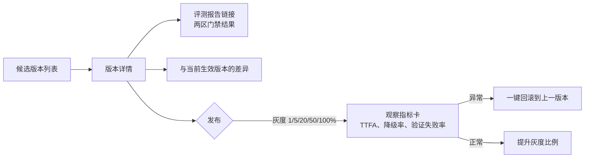

# Post&Comments Reader 架构设计 · 03 管理后台

| 项 | 内容 |
| --- | --- |
| 文档版本 | v1.2（2026-11-26） |
| v1.1 变更 | 新增 §13–§14（后台闭环：开关、数据请求、告警、事件、缓存治理、系统设置、经营指标的路由与权限）；依据改为主 PRD v2.7 草案与《管理后台 PRD》；统一额度池：新增 `CreditText`、`UsageBreakdown` 组件，配额参数页展示费率表 |
| v1.2 变更 | 新增 §15：法域策略、审批策略、实验页面；下架同步清除边缘缓存；订阅显示商店来源 |
| 依据 | 主 PRD v2.7 草案（重点：7.1、7.3、9.3、9.5、9.6、11、12）；《管理后台 PRD》v1.3；`00-overview.md`、`02-backend.md` |
| 技术基线 | React 19、TypeScript 5、Vite、Refine、Ant Design 5、TanStack Query、ECharts |
| 部署 | 国内、海外各一套；静态资源在本区对象存储 + CDN，前置零信任网关；后端为 `admin-api` 角色 |

---

## 1. 定位与原则

管理后台是内部运营工具，供运营、客服、合规与发布者使用。设计原则：

1. **数据不出区**：每个区域一套后台，只连本区 `admin-api`，不存在汇总两区数据的全局后台。
2. **配置不在线编辑**：提示词、站点规则、音色表等共享配置在 Git 中修改，后台只做「发布 / 灰度 / 回滚」。
3. **权限三层执行**：零信任网关（谁能打开）→ `admin-api` RBAC（能做什么）→ 数据库列级授权（能读到什么）。前端的按钮隐藏只是体验，不是安全边界。
4. **默认看不到内容**：后台没有查看帖子正文、评论、译文、邮箱明文的能力。

---

## 2. 目录结构

```text
apps/admin-web/
├─ index.html
├─ vite.config.ts
├─ public/runtime-config.json        # 部署时写入：apiBase、region、sentryDsn
├─ src/
│  ├─ main.tsx
│  ├─ App.tsx                         # <Refine> 与 Provider 装配
│  ├─ providers/
│  │  ├─ data-provider.ts             # Refine dataProvider → admin-api
│  │  ├─ auth-provider.ts             # Passkey 会话
│  │  ├─ access-control-provider.ts   # RBAC
│  │  ├─ i18n-provider.ts
│  │  └─ notification-provider.ts
│  ├─ api/
│  │  ├─ client.ts                    # openapi-fetch 实例（类型来自 admin-openapi.d.ts）
│  │  └─ admin-openapi.d.ts           # openapi-typescript 生成
│  ├─ resources/                      # 每个 Refine resource 一个目录
│  │  ├─ dashboard/
│  │  ├─ accounts/
│  │  ├─ quota/
│  │  ├─ subscriptions/
│  │  ├─ deletions/
│  │  ├─ config-releases/
│  │  ├─ site-adapters/
│  │  ├─ samples/
│  │  ├─ compliance/                  # 仅 region=cn 注册
│  │  ├─ risk/
│  │  ├─ audit/
│  │  └─ admin-users/
│  ├─ layout/                         # 顶栏（区域徽标、用户、角色切换）、侧栏
│  ├─ hooks/
│  └─ utils/
├─ tests/
│  ├─ unit/                           # Vitest + Testing Library
│  └─ e2e/                            # Playwright
└─ AGENTS.md
```

共用组件放在 `packages/ui`（见 §4），本应用只放业务页面。

---

## 3. 技术栈

| 层 | 选型 | 说明 |
| --- | --- | --- |
| 构建 | Vite | 纯 SPA，产物为静态文件 |
| 框架 | React 19 + TypeScript strict | |
| 管理端骨架 | Refine（`@refinedev/core`、`@refinedev/antd`、`@refinedev/react-router`） | resource 路由、列表 / 详情 / 编辑骨架、筛选分页、权限钩子 |
| 组件库 | Ant Design 5 | `ConfigProvider` 统一主题，中文语言包 `zh_CN`，支持暗色算法 |
| 业务组件 | `packages/ui` | 构建在 AntD 之上，后台与测试台架共用 |
| 数据请求 | TanStack Query（Refine 内置）+ `openapi-fetch` | 类型由 admin OpenAPI 生成 |
| 表单校验 | AntD Form + 复用 `packages/contracts` 的 zod schema（通过 `zodToAntdRules` 适配） | 前后端同一份规则 |
| 图表 | ECharts（`echarts-for-react`） | 仪表盘与趋势 |
| 日期 | dayjs（AntD 默认） | 显示本地时区，传输 UTC |
| 认证 | `@simplewebauthn/browser` | Passkey |
| 错误上报 | `@sentry/react`（区内实例） | `beforeSend` 去除 URL 参数与表单值 |
| 测试 | Vitest、Testing Library、Playwright | |

未选：Next.js（无 SEO 与服务端渲染需求，额外部署复杂度）、Retool 等低代码平台（数据会经第三方 SaaS，违反数据不出区）。

---

## 4. 组件库（`packages/ui`）

### 4.1 主题

```ts
export const prTheme: ThemeConfig = {
  token: {
    colorPrimary: '#3a6df0',          // 以设计稿为准
    borderRadius: 8,
    fontFamily: `-apple-system, "PingFang SC", "Segoe UI", Roboto, sans-serif`,
  },
  components: { Table: { cellPaddingBlock: 10 }, Layout: { headerHeight: 56 } },
};
export const regionAccent: Record<Region, string> = { cn: '#d4380d', intl: '#1677ff' };
```

区域主色同时用于顶栏色条与 `RegionBadge`，降低在错误区域操作的风险。

### 4.2 组件清单

| 组件 | 用途 | 关键 props | 说明 |
| --- | --- | --- | --- |
| `AppShell` | 页面框架：顶栏、侧栏、面包屑 | `region`、`user`、`menu` | 顶栏常驻区域色条 |
| `RegionBadge` | 显示当前区域 | `region` | 不可隐藏 |
| `RoleSwitcher` | 切换当前生效角色（最小权限原则） | `roles`、`active` | 切换高权限需重新认证 |
| `ResourceTable<T>` | 统一列表 | `columns`、`useTableResult`、`rowKey` | 基于 Refine `useTable` + AntD `Table`；服务端分页与排序 |
| `FilterBar` | 列表筛选 | `fields: FilterField[]` | 文本、枚举、时间范围、ID 精确匹配 |
| `DetailDrawer` | 侧滑详情 | `title`、`items`、`extra` | 列表页内查看详情，减少跳页 |
| `DescriptionsCard` | 只读键值展示 | `items` | |
| `StatusTag` | 枚举状态标签 | `value`、`dict` | 颜色映射来自字典，不在页面写死 |
| `DurationText` | 毫秒格式化为 `h:mm:ss` | `ms` | 音频与任务时长 |
| `CreditText` | 毫点格式化为点数（保留 2 位小数），负数标红 | `mc` | 统一额度池余额、扣减、补偿 |
| `UsageBreakdown` | 单任务按「阶段 × 模型类别」展开扣点、计量用量与厂商实际用量 | `jobId` | 配额流水（ADM-QUO-08） |
| `MoneyText` | 微单位金额 | `micros`、`currency` | 成本 |
| `MaskedId` | 脱敏 ID 显示与复制 | `value`、`kind: 'user' \| 'email_hash' \| 'task'` | 默认只显示前后各 4 位 |
| `CountdownTag` | 距期限倒计时 | `deadline`、`warnBeforeMs` | 注销工单 24 h 期限 |
| `MetricCard` | 指标卡 | `title`、`value`、`unit`、`delta?`、`target?` | 与目标值比较着色 |
| `TimeSeriesChart` | 时间序列图 | `series`、`yUnit`、`thresholds?` | ECharts 封装，统一配色与 tooltip |
| `HistogramChart` | 分布图 | `buckets`、`markers: { p50, p95 }` | TTFA 分布 |
| `JsonViewer` | 结构化数据查看 | `value`、`redactPaths` | 渲染前按路径脱敏 |
| `ConfigDiffViewer` | 配置包版本对比 | `from`、`to` | 按文件分组的行级差异 |
| `EvalReportLink` | 跳转评测报告 | `runId`、`status` | 链接到测试台架运行详情 |
| `RolloutSlider` | 灰度比例 | `value`、`steps = [1, 5, 20, 50, 100]` | 只允许预设档位 |
| `ConfirmAction` | 危险操作确认 | `title`、`requireReason`、`requireReauth`、`confirmText?` | 补偿、发布、回滚、吊销会话；可要求输入原因与 Passkey 重新验证 |
| `PermissionGate` | 按权限渲染 | `action`、`resource`、`fallback?` | 基于 Refine `useCan` |
| `AuditTrail` | 某对象的审计记录 | `targetType`、`targetId` | 详情页底部 |
| `EmptyState` · `ErrorState` | 空 / 错状态 | `title`、`action?` | |
| `PageErrorBoundary` | 页面级错误边界 | — | 上报 Sentry 并显示 `traceId` |

每个组件附 Storybook 式示例（用 Ladle 或 Vitest 浏览器模式，择一）与单元测试；组件内不直接请求接口，数据由页面传入。

---

## 5. 路由、页面与角色

| 路由 | 页面 | 主要内容 | 最低角色 | PRD |
| --- | --- | --- | --- | --- |
| `/` | 仪表盘 | TTFA P95（分支）、完播率、降级率、`η_pub`、每分钟合成成本、注销 SLA、`stream_lag` | `viewer` | 2.2、10 |
| `/accounts` · `/accounts/:id` | 账户 | 按用户 ID 或邮箱哈希查询；档位、剩余配额、设备与风险标记、会话列表 | `support` | 7.1 |
| `/accounts/:id/sessions` | 会话 | 吊销单个或全部会话 | `support` + 确认 | 9.2 |
| `/quota/ledger` | 配额流水 | 按用户、任务、原因筛选 | `support` | 11.2 |
| `/quota/compensations/new` | 补偿 | 发放额度，必填原因，上限由配置限定 | `ops` + 原因 + 重新认证 | 11 |
| `/quota/settings` | 配额参数（只读） | 当前生效的 `tiers.yaml`、`quotas.yaml`、`credit-rates/<region>.yaml`（费率系数）与 `vendors/pricing/<region>.yaml`（渠道单价） | `viewer` | 11.1、11.2；ADM-QUO-04 |
| `/subscriptions/events` | 订阅事件 | App Store 通知与对账结果 | `support` | 11 |
| `/deletions` · `/deletions/:id` | 注销工单 | 状态、步骤进度、倒计时、手动重试 | `support`（重试需 `ops`） | 9.3 |
| `/config-releases` · `/:version` | 配置发布 | 候选列表、评测报告、差异、发布、灰度、回滚 | `publisher` | 6、7、8 |
| `/site-adapters` | 站点适配器 | 各站点提取成功率、失败原因分布、白名单状态（只读） | `viewer` | 7.1、9.1.3 |
| `/samples` | 预置样帖 | 上传静态音频与脚本、排序、上下线 | `ops` | 7.1、7.3 |
| `/compliance/moderation` | 机审拦截（仅 cn） | 按类别、时间统计，单条只显示 `taskId` 与类别 | `compliance` | 9.3 |
| `/compliance/disclosure` | 备案公示 | 当前生效的模型备案公示信息、合成标识资源版本（只读） | `compliance` | 9.3 |
| `/risk` | 风控 | App Attest 失败设备、频控命中、异常用量账户 | `ops` | 11.2.3 |
| `/audit` | 操作审计 | 后台全部写操作记录 | `owner` | — |
| `/admin-users` | 后台账号 | 邀请、角色、停用 | `owner` | — |

`compliance` 资源只在 `region = cn` 时注册到 Refine。

---

## 6. Refine 配置

### 6.1 Resource 声明

```tsx
<Refine
  dataProvider={dataProvider}
  authProvider={authProvider}
  accessControlProvider={accessControlProvider}
  i18nProvider={i18nProvider}
  notificationProvider={useNotificationProvider}
  routerProvider={routerProvider}
  resources={[
    { name: 'dashboard', list: '/' },
    { name: 'accounts', list: '/accounts', show: '/accounts/:id' },
    { name: 'quota-ledger', list: '/quota/ledger' },
    { name: 'compensations', create: '/quota/compensations/new' },
    { name: 'deletions', list: '/deletions', show: '/deletions/:id' },
    { name: 'config-releases', list: '/config-releases', show: '/config-releases/:version' },
    { name: 'samples', list: '/samples', create: '/samples/new', edit: '/samples/:id/edit' },
    ...(runtime.region === 'cn' ? [{ name: 'moderation', list: '/compliance/moderation' }] : []),
    // …
  ]}
/>
```

### 6.2 dataProvider

`admin-api` 为每个 resource 提供统一形态的 REST：`GET /admin/<resource>?page&pageSize&sort&filter`、`GET /admin/<resource>/:id`、`POST`、`PATCH`；非 CRUD 动作用 `custom`（例如 `POST /admin/config-releases/:version/publish`）。dataProvider 内部使用 `openapi-fetch` 调用，返回值按 Refine 约定映射为 `{ data, total }`。

### 6.3 authProvider

| 方法 | 实现 |
| --- | --- |
| `login` | `POST /admin/auth/passkey/options` → `startAuthentication()` → `POST /admin/auth/passkey/verify`；成功后服务端设置会话 Cookie |
| `check` | `GET /admin/me`；401 → 跳转登录 |
| `logout` | `POST /admin/auth/logout` |
| `getIdentity` | `GET /admin/me` 返回 `{ id, name, roles, activeRole }` |
| `onError` | 401 → 登出；403 → 提示无权限 |

### 6.4 accessControlProvider

登录后拉取 `GET /admin/me/permissions`（服务端按当前生效角色计算的 `{ resource, action }[]`），`can({ resource, action })` 只做本地查表。服务端仍对每个请求独立校验。

---

## 7. `admin-api`

### 7.1 接口

| 接口 | 角色 | 说明 |
| --- | --- | --- |
| `POST /admin/auth/passkey/options` · `/verify` · `/logout` | 无 / 已登录 | 认证 |
| `POST /admin/auth/reauth` | 已登录 | 敏感操作前的 Passkey 重新验证，有效 5 min |
| `POST /admin/auth/invite/accept` | 邀请链接 | 首次注册 Passkey |
| `GET /admin/me` · `/admin/me/permissions` · `POST /admin/me/active-role` | 已登录 | 身份与角色切换 |
| `GET /admin/metrics/overview` | `viewer` | 仪表盘聚合（读区内指标后端或预聚合表） |
| `GET /admin/accounts` · `/:id` | `support` | 按 `id` 或 `emailHash` 精确查询，不支持模糊搜索邮箱 |
| `POST /admin/accounts/:id/sessions/revoke` | `support` | |
| `GET /admin/quota-ledger` | `support` | |
| `POST /admin/compensations` | `ops` + reauth | 必填 `reason`，单笔上限配置化 |
| `GET /admin/subscriptions/events` | `support` | |
| `GET /admin/deletions` · `/:id` · `POST /:id/retry` | `support` / `ops` | |
| `GET /admin/config-releases` · `/:version` · `/:version/diff?from=` | `publisher` | |
| `POST /admin/config-releases/:version/publish` | `publisher` + reauth | body：`rolloutPercent` |
| `POST /admin/config-releases/:version/rollback` | `publisher` + reauth | 回滚到指定版本 |
| `GET /admin/site-adapters/stats` | `viewer` | 来自客户端无内容埋点的聚合 |
| `GET/POST/PATCH /admin/samples` | `ops` | 样帖音频经预签名 URL 直传对象存储 |
| `GET /admin/compliance/moderation` | `compliance`（cn） | |
| `GET /admin/risk/*` | `ops` | |
| `GET /admin/audit` | `owner` | |
| `GET/POST/PATCH /admin/admin-users` | `owner` | 邀请、改角色、停用 |

### 7.2 权限矩阵（表驱动）

```ts
// apps/server/src/modules/admin/permissions.ts
export const PERMISSIONS = {
  'GET /admin/accounts':                        ['support', 'ops', 'owner'],
  'POST /admin/accounts/:id/sessions/revoke':   ['support', 'ops', 'owner'],
  'POST /admin/compensations':                  ['ops', 'owner'],
  'POST /admin/config-releases/:version/publish': ['publisher', 'owner'],
  'GET /admin/compliance/moderation':           ['compliance'],
  // …
} as const satisfies Record<string, Role[]>;
```

- 路由注册时强制查表：未登记的路由启动即失败。
- 测试遍历「全部路由 × 全部角色」，断言允许 / 拒绝与表一致。
- `compliance` 角色不继承其他角色，`owner` 也不能查看机审记录（职责分离）。

### 7.3 数据访问

- 数据库角色 `admin_limited`：对 `*_enc` 列、`user_keys`、`job_units.clean_text_enc`、`job_units.translated_enc` 无 `SELECT` 权限；对业务表只有 `SELECT`，写操作只能通过 `admin` 模块调用其他模块的公开接口（例如补偿调用 `quota.grant`）。
- 返回给前端前，`users` 中只暴露 `id`、`email_hash` 前缀、`status`、`home_region`、`created_at`。

### 7.4 审计

`audit` 中间件包裹所有写接口：`admin_id`、`active_role`、`action`、`target_type`、`target_id`、`before`、`after`（个人信息字段先脱敏）、`reason`、`trace_id`、`at`。`admin_audit_log` 只允许 `INSERT`（数据库层 `REVOKE UPDATE, DELETE`）。

---

## 8. 认证与会话

1. `owner` 在 `/admin-users` 发出邀请 → 生成一次性邀请链接（24 h 有效）→ 被邀请人打开并注册 Passkey。
2. 登录：Passkey 断言 → 服务端设置 `__Host-admin_sid` Cookie（`HttpOnly`、`Secure`、`SameSite=Strict`、`Path=/`），8 h 绝对过期、30 min 无操作过期。
3. 所有写请求另带 `X-Admin-CSRF` 头（登录时下发、存内存），作为 `SameSite` 之外的第二道防护。
4. 敏感操作（补偿、发布、回滚、吊销全部会话、改角色）需在 5 min 内完成过一次 `reauth`。
5. 零信任网关在应用之前做身份校验：海外 Cloudflare Access 或 AWS Verified Access；国内阿里云 IDaaS 或 IP 白名单。网关身份与后台账号做邮箱绑定校验。

---

## 9. 配置发布页设计



- 只有 CI 上传、签名校验通过、且两区门禁均为通过的版本才出现在候选列表；评测未通过的版本显示但不可发布。
- 灰度按 `hash(userId) mod 100` 分桶，服务端决定每个任务使用哪个配置版本，并把版本号写入 `jobs`，便于对比。
- 同一时间只允许一个版本处于灰度中。

---

## 10. 构建、部署与运行时配置

- `vite build` 产出静态文件；CI 上传到本区 `admin-web` bucket，CDN 前置零信任网关。
- 运行时配置 `runtime-config.json`（`apiBase`、`region`、`sentryDsn`）在部署时写入，同一构建产物可部署到两区。
- CSP：`default-src 'self'; script-src 'self'; connect-src 'self' <apiBase> <sentry>; frame-ancestors 'none'`；不加载任何第三方脚本、字体或统计。
- `admin-api` 与后端同镜像，以 `ROLES=admin-api` 启动，独立服务、独立安全组。

---

## 11. 测试

| 层 | 工具 | 内容 |
| --- | --- | --- |
| 组件 | Vitest + Testing Library | `packages/ui` 组件的渲染与交互；`JsonViewer` 脱敏；`ConfirmAction` 必填原因 |
| 页面 | Vitest + MSW | 用录制的 admin API 响应测试列表、筛选、权限隐藏 |
| 权限 | `admin-api` 集成测试 | 路由 × 角色全矩阵 |
| 端到端 | Playwright（预发） | 登录（虚拟认证器模拟 Passkey）→ 查账户 → 补偿 → 审计可见；发布 → 灰度 → 回滚 |

---

## 12. `apps/admin-web/AGENTS.md` 要点

1. 新资源用 Refine 的资源骨架生成，再按 `packages/contracts/src/api/admin` 补字段；不手写请求类型。
2. 只使用 Ant Design 与 `packages/ui` 组件；不引入其他 UI 库与 CSS 框架。
3. 每新增一个 `admin-api` 写接口，必须同时更新 `PERMISSIONS` 表与审计中间件覆盖，并补充权限矩阵测试。
4. 页面上不展示邮箱明文、帖子正文、评论、译文、URL。
5. 危险操作统一使用 `ConfirmAction`，按需要求原因与重新认证。
6. 需人工审阅：`providers/auth-provider.ts`、`modules/admin/permissions.ts`、审计中间件、任何 `compliance` 页面。

---

## 13. 业务闭环增补（《管理后台 PRD》v1.1）

### 13.1 新增路由

| 路由 | 页面 | 主要内容 | 最低角色 | 管理后台 PRD |
| --- | --- | --- | --- | --- |
| `/flags` | 运行时开关 | 白名单开关、当前值、剩余有效期、各实例生效确认、历史 | `viewer`（设置需 `ops` / `publisher` + 原因 + 重新认证） | 5.15 |
| `/data-requests` · `/:id` | 个人数据请求 | 导出请求进度、期限、步骤、重试 | `support`（重试需 `ops`） | 5.16 |
| `/compliance/complaints` · `/:id` | 投诉举报（仅 cn） | 队列、剩余时限、机审记录、处理结论 | `compliance` | 5.11 |
| `/settings/regions` | 区域状态 | 未启用 / 预发 / 生产 | `owner` + 重新认证 | 5.14 |

账户页搜索框同时接受支持码、用户 ID、任务 ID；订阅事件页增加「重新处理」动作（`ops`）。

### 13.2 新增接口与权限

```ts
// 追加到 PERMISSIONS
'GET /admin/runtime-flags':                      ['viewer', 'support', 'ops', 'publisher', 'compliance', 'owner'],
'POST /admin/runtime-flags':                     ['ops', 'publisher', 'owner'],   // 设置或续期
'POST /admin/runtime-flags/:key/clear':          ['ops', 'publisher', 'owner'],
'GET /admin/data-requests':                      ['support', 'ops', 'owner'],
'POST /admin/data-requests/:id/retry':           ['ops', 'owner'],
'POST /admin/subscription-events/:id/reprocess': ['ops', 'owner'],
'GET /admin/compliance/complaints':              ['compliance'],
'POST /admin/compliance/complaints/:id/resolve': ['compliance'],
'PATCH /admin/regions/:region':                  ['owner'],
'POST /admin/config-releases/:version/publish-tiers': ['owner'],   // 含档位参数变更的版本只能走此接口
```

- `POST /admin/config-releases/:version/publish` 在服务端检查版本差异：含 `tiers.yaml`、`quotas.yaml` 变更时拒绝并提示改用 `publish-tiers`。
- 发布前兼容性检查：读取各区域当前服务端版本（实例上报）与包声明的 `minServerVersion`；客户端包额外要求测试台架 G9、G2 通过。
- 样帖上传接口校验台架签名（台架签名公钥随配置包下发）与响度报告。
- 投诉详情中的用户自填文字由服务端用用户 DEK 解密后只返回给 `compliance`，响应不进入访问日志的 body 采样。

### 13.3 新增组件

| 组件 | 用途 |
| --- | --- |
| `FlagSwitchCard` | 开关名称、当前值、到期倒计时、生效实例数 / 总实例数、设置与清除按钮 |
| `DeadlineBadge` | 注销、导出、投诉共用的期限徽标：正常 / 临期 / 超期三态，文字 + 图标，不只靠颜色 |
| `RuleEffectDiff` | 订阅事件的档位与配额变化（前 → 后）及规则版本 |

---

## 14. 后台内部闭环增补（《管理后台 PRD》v1.2）

### 14.1 新增路由

| 路由 | 页面 | 主要内容 | 最低角色 | 管理后台 PRD |
| --- | --- | --- | --- | --- |
| `/alerts` | 告警中心 | 告警列表、确认、关闭结论、转为事件 | `viewer`（关闭需为路由到的角色） | 5.17 |
| `/incidents` · `/:id` | 事件记录 | 时间线（自动关联的开关、回滚、补偿）、影响估算、批量补偿、关闭 | `viewer`（创建与关闭需 `ops` / `publisher` / `owner`） | 5.18 |
| `/cache/denylist` | 公共缓存治理 | 按任务下架、禁止名单、容量与命中率 | `ops`（海外）/ `compliance`（国内）/ `owner` | 5.19 |
| `/settings/system` | 系统设置 | 值班渠道、告警阈值、测试告警 | `owner` | 5.20 |
| `/biz` | 经营指标 | 档位、订阅流转、拦截层转化、配额使用分布、成本；周导出 | `owner`、`publisher` | 5.2 DASH-09 |

### 14.2 新增接口与权限

```ts
'GET /admin/alerts':                                   ['viewer', 'support', 'ops', 'publisher', 'compliance', 'owner'],
'POST /admin/alerts/:id/ack':                          ['support', 'ops', 'publisher', 'compliance', 'owner'], // 服务端再校验 routed_role
'POST /admin/alerts/:id/close':                        ['support', 'ops', 'publisher', 'compliance', 'owner'],
'POST /admin/incidents':                               ['ops', 'publisher', 'owner'],
'POST /admin/incidents/:id/close':                     ['ops', 'publisher', 'owner'],
'POST /admin/incidents/:id/batch-compensations/preview': ['ops', 'owner'],
'POST /admin/incidents/:id/batch-compensations/confirm': ['owner'],
'POST /admin/cache/takedown':                          ['ops', 'compliance', 'owner'],  // 服务端按区域再限制 ops / compliance
'DELETE /admin/cache/denylist/:key':                   ['ops', 'compliance', 'owner'],
'PATCH /admin/system-settings':                        ['owner'],
'POST /admin/system-settings/test-alert':              ['owner'],
'POST /admin/config-releases/:version/promote':        ['publisher', 'owner'],          // 服务端检查 T_canary_min，owner 可带 skipReason
'POST /admin/access-reviews':                          ['owner'],
'GET /admin/biz-metrics':                              ['publisher', 'owner'],
```

### 14.3 新增组件

| 组件 | 用途 |
| --- | --- |
| `AlertRow` | 级别、类型、对象链接、计数、`T_ack` 倒计时、确认与关闭 |
| `IncidentTimeline` | 事件时间线：告警、开关、回滚、补偿、审计按时间排列 |
| `CanaryGate` | 当前灰度级别、剩余观察时间、对比指标是否越界、放量按钮状态 |
| `AttestationBadge` | 门禁证明验签结果、区域、豁免项与到期时间 |

---

## 15. 长远方案增补（《管理后台 PRD》v1.3，架构 00 D17–D24）

| 路由 | 页面 | 内容 | 角色 | PRD |
| --- | --- | --- | --- | --- |
| `/settings/privacy` | 法域策略 | 各 `Jurisdiction` 的同意方式、默认值、权利请求时限、最低年龄、附录版本、当地代表；店面 → 法域映射（只读，来自配置版本） | `viewer` | ADM-SYS-04 |
| `/settings/approval-policy` | 审批策略 | 每类敏感操作的单人 / 多人模式；待批准请求列表 | `owner`（批准：具备该操作权限的另一账号） | ADM-SYS-05 |
| `/experiments` · `/:id` | 实验 | 分组、流量、指标对比（只读） | `publisher`、`owner` | ADM-SYS-06 |

接口与实现要点：

- 所有敏感操作的接口统一经过 `requireApproval(action)`（02 §22.9）。多人模式下接口返回 `202 { approvalRequestId }`，批准后由 `admin-api` 执行原操作并在审计中同时记录申请人与批准人。
- 公共缓存下架（`POST /admin/cache/takedown`）：国内区删除 OSS 对象并刷新 CDN；海外区删除 R2 对象并调用 Cloudflare 缓存清除接口（02 §22.1），两者都完成后才把下架记录标为「已生效」。
- 订阅事件与账户详情显示 `provider`（`apple` / `google` / `web`）；对账按商店适配器分别执行。
- 灰度自动回滚（ADM-CFG-09）为必须：`config-rollout` 任务按 `config/ops.yaml` 的阈值判定，回滚动作记入发布记录与事件时间线。

海外区的安全检查拦截统计（两区安全层，00 D22）在 `/compliance/moderation` 中同样提供，海外由 `ops` 查看；国内仍仅 `compliance` 可见。

新增组件：`ApprovalBanner`（待批准状态与批准人）、`JurisdictionTable`、`ExperimentCompare`。

权限补充：

```ts
'GET /admin/privacy-policies':                ['viewer', 'support', 'ops', 'publisher', 'compliance', 'owner'],
'PATCH /admin/system-settings/approval':      ['owner'],
'POST /admin/approvals/:id/approve':          ['ops', 'publisher', 'compliance', 'owner'], // 服务端校验批准人 ≠ 申请人且具备该操作权限
'GET /admin/experiments':                     ['publisher', 'owner'],
```
