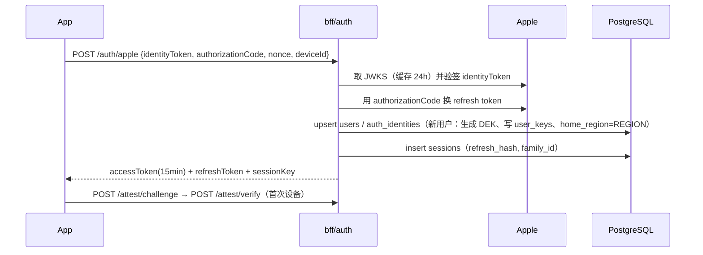
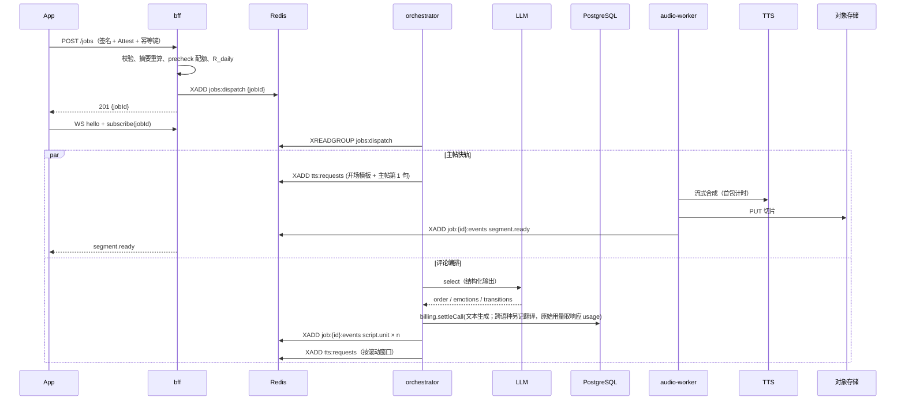
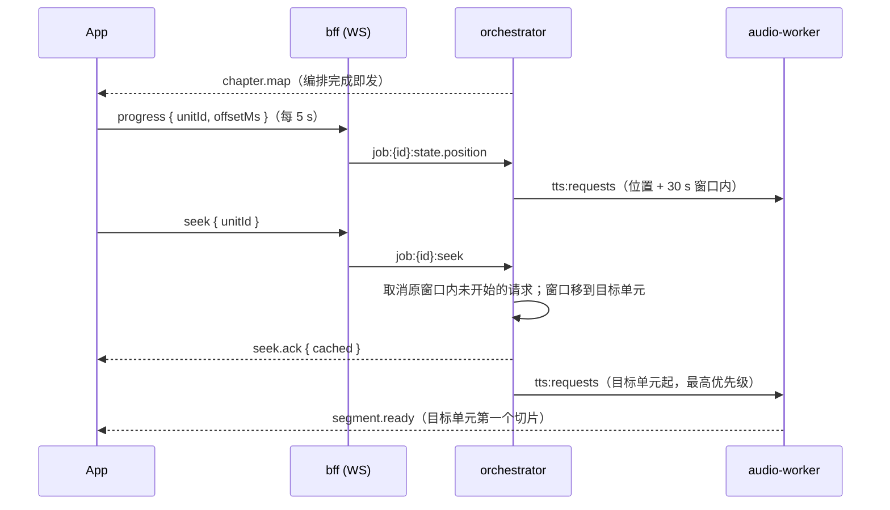

# Post&Comments Reader 架构设计 · 02 后端服务

| 项 | 内容 |
| --- | --- |
| 文档版本 | v1.2（2026-11-26） |
| v1.1 变更 | 基线 Node 26 / PostgreSQL 18；新增 §18–§21（业务闭环、后台闭环、iOS 闭环、未决默认的配置落点）；`R_daily` 超限改用 `DAILY_LIMIT`；登录携带 `storefront` 判定区域不匹配；保留期任务与订阅规则改以主 PRD 9.5、11.4 为准；依据改为主 PRD v2.7 草案；计费改为统一额度池：毫点整数账本、按「类别 × 模型档次」的费率表 `credit-rates.yaml`、文本生成与翻译按厂商返回用量扣点（§9、§6.2、§6.3）；计费改为两层：原始用量与分渠道成本（`vendor_usage`、`vendor_usage_items`）+ 按渠道 × 计价单位的费率系数实时折算、原子核销（`settleCall`，§9）；两区音频均嵌入隐式标识与水印 |
| v1.2 变更 | 新增 §22 长远方案：边缘层、按位置滚动合成与跳章、水印、平台无关权益层、设备证明与推送抽象、法域策略引擎、两区安全层、实验、审批策略、国内 Redis 选型；海外区部署美国、对象存储 R2；新增 §23 规格补全：计费时区、单篇上限、年龄确认、可用性与恢复 |
| 依据 | 主 PRD v2.7 草案（重点：4、5、6、9、10、11、12、13）；《管理后台 PRD》v1.3、《测试台架 PRD》v1.3、《iOS 客户端 PRD》v1.3；`00-overview.md` |
| 技术基线 | Node.js 26 LTS（D9）、TypeScript（strict）、Fastify 5、zod、Drizzle ORM、PostgreSQL 18（D10）、Redis 7.0 命令集、BullMQ；依赖登记见 `05-toolchain-and-resources.md` |
| 部署 | 每区一套：国内阿里云（SAE、RDS、云数据库 Redis 开源版 7.0、OSS、SLS、KMS，D6），海外美国（AWS ECS Fargate、RDS、ElastiCache Valkey、CloudWatch、KMS；对象存储 Cloudflare R2；边缘层 Cloudflare Workers + Hono，D7、D17、D18） |

---

## 1. 设计目标与硬约束

| 约束 | 数值 / 要求 | 来源 | 架构对策 |
| --- | --- | --- | --- |
| 首段音频（服务端部分） | 同语种冷启动端到端 P95 ≤ 1.5 s；跨语种 ≤ 2.8 s | PRD 10.1 | 主帖快轨不等 LLM；分支 A/B 并行；流式 TTS；按句切片 |
| 主 TTS 首包超时 | `T_tts_timeout` 默认 1,000 ms，50 ms 内切备用 | PRD 10.2 | `TtsRouter` 首包计时器 + 预热的备用连接 |
| 容量 | 初始 100 QPS，可扩到 2,000 QPS | PRD 10.2 | 无状态进程 + Redis Streams；按积压伸缩 |
| 可用性 | 音频不断流 ≥ 99.9% | PRD 10.2 | 多实例跨可用区；Stream 消息可被其他实例接管；厂商熔断 |
| 原文零篡改 | 摘要一致 100% | PRD 6.1、12.1 | 分支 A 的 LLM 不输出正文；TTS 读取客户端 `clean_text`；对实际送入 TTS 的文本重算摘要下发 |
| 隐私 | 厂商只见任务 ID；ZDR；日志无正文 | PRD 9.1 | `llm-gateway` 统一出口；pino redact；应用层字段加密 |
| 合规 | 国内出声前机审、审计日志 ≥ 6 个月；海外 24 h 擦除 | PRD 9.3 | `moderation` 模块（两区启用，策略按区，D22）；SLS 独立 Project；`deletion` 队列 + 每用户 DEK |
| 计费 | 统一额度池：文本生成、翻译、语音合成、神经语音合成等每次模型调用底层按厂商计价口径记原始用量与渠道成本，用户侧按「原始用量 × 费率系数」实时折算、原子核销；复听免费；中途耗尽软着陆 | PRD 11.2 | 只追加账本 + 幂等键；滚动合成窗口 |

---

## 2. 目录结构

```text
apps/server/
├─ package.json                    # exports: "./pipeline" 供 testbench runner 引入
├─ tsconfig.json
├─ Dockerfile
├─ drizzle.config.ts
├─ drizzle/                        # 迁移 SQL（只增不改，CI 校验哈希）
├─ src/
│  ├─ entry/
│  │  ├─ main.ts                   # 读取 ROLES，按角色挂载
│  │  ├─ bff.ts
│  │  ├─ orchestrator.ts
│  │  ├─ audio-worker.ts
│  │  └─ admin-api.ts
│  ├─ platform/                    # 与业务无关的基础设施
│  │  ├─ env.ts                    # zod 校验环境变量
│  │  ├─ region.ts                 # 当前区域常量与区域差异开关
│  │  ├─ db/                       # postgres.js 连接、drizzle 实例、事务助手
│  │  ├─ redis/                    # ioredis 连接、Lua 脚本、Streams 助手
│  │  ├─ queue/                    # BullMQ 队列与 worker 工厂
│  │  ├─ storage/                  # S3 兼容客户端（OSS / R2 / S3）、签名 URL
│  │  ├─ kms/                      # 信封加密、DEK 缓存
│  │  ├─ crypto/                   # HMAC、Ed25519 与 ECDSA P-256 验签（ADR 0018）、AES-GCM 字段加密
│  │  ├─ http/                     # Fastify 工厂、插件注册顺序、problem+json
│  │  ├─ ws/                       # WebSocket 连接管理
│  │  ├─ otel/                     # OpenTelemetry 初始化
│  │  ├─ logger.ts                 # pino + redact
│  │  └─ config-bundle/            # 配置包拉取、验签、热更新
│  ├─ modules/
│  │  ├─ auth/
│  │  ├─ billing/
│  │  ├─ quota/
│  │  ├─ jobs/
│  │  ├─ pipeline/
│  │  ├─ llm-gateway/
│  │  ├─ tts/
│  │  ├─ moderation/
│  │  ├─ samples/
│  │  ├─ config/
│  │  ├─ deletion/
│  │  ├─ audit/
│  │  └─ admin/                    # admin-api 的路由与用例（调用其他模块的公开接口）
│  └─ test/                        # 集成测试工具：Testcontainers、厂商 mock、fixture 加载
└─ AGENTS.md
```

每个模块的内部结构固定：

```text
modules/<name>/
├─ index.ts        # 唯一对外出口（其他模块只能 import 这里）
├─ routes.ts       # Fastify 路由（如有）：解析、校验、调用 service
├─ service.ts      # 用例编排、事务边界
├─ domain/         # 纯函数与领域类型（无 IO）
├─ repo.ts         # Drizzle 查询，只访问本模块拥有的表
├─ adapters/       # 外部服务适配（如有）
├─ schema.ts       # 本模块的 Drizzle 表定义
└─ *.test.ts
```

---

## 3. 进程与启动

### 3.1 角色

| 角色 | 挂载内容 | 对外端口 |
| --- | --- | --- |
| `bff` | `auth`、`billing`、`quota`（只读预检）、`jobs` 路由、`samples`、`config` 下发、WebSocket 网关、App Store webhook | 8080（经 ALB） |
| `orchestrator` | `pipeline` 消费 `jobs:dispatch`；BullMQ worker（定时任务与异步队列） | 9464（仅指标） |
| `audio-worker` | `tts` 消费 `tts:requests`；`quota` 核销 | 9464（仅指标） |
| `admin-api` | `admin` 路由 | 8081（仅经零信任网关） |

`ROLES=bff,orchestrator,audio-worker` 可在一个进程里挂载多个角色（本地开发与 MVP 早期），生产按角色拆分部署。

### 3.2 启动顺序

1. `env.ts` 用 zod 校验环境变量，失败即退出。
2. 初始化 OpenTelemetry（必须先于其他 import 以启用自动埋点）。
3. 连接 PostgreSQL、Redis；拉取并验签当前生效配置包，失败即退出（不允许无配置运行）。
4. 挂载角色。
5. `/readyz` 返回 200；收到 SIGTERM 时 `/readyz` 立即返回 503，进入优雅停机（§14.3）。

### 3.3 环境变量（`platform/env.ts`）

| 变量 | 说明 |
| --- | --- |
| `ROLES` | 逗号分隔的角色 |
| `REGION` | `cn` / `intl` |
| `DATABASE_URL`、`DATABASE_ROLE` | 连接串；角色名 `app_rw` / `admin_limited` / `migrator` |
| `REDIS_URL` | |
| `S3_ENDPOINT`、`S3_REGION`、`BUCKET_AUDIO_PUBLIC`、`BUCKET_AUDIO_PRIVATE`、`BUCKET_SAMPLES`、`BUCKET_CONFIG` | 对象存储 |
| `KMS_KEY_ID` | 用户 DEK 的主密钥 |
| `JWT_SIGNING_KEY_REF` | 凭据服务中的 ES256 私钥引用 |
| `CONFIG_BUNDLE_PUBKEYS` | 配置包验签公钥列表，每项带 `kid` 与 `alg`（海外区 `Ed25519`，国内区 `ES256`，ECDSA 签名为 P1363 原始格式；ADR 0018）；可多个，支持轮换 |
| `APPLE_TEAM_ID`、`APPLE_BUNDLE_ID`、`APPLE_SIWA_KEY_REF`、`APPSTORE_API_KEY_REF` | Apple 相关 |
| `VENDOR_*_KEY_REF` | 各厂商密钥引用（实际值从凭据服务读取） |
| `OTEL_EXPORTER_OTLP_ENDPOINT` | 区内采集端点 |
| `SENTRY_DSN` | 区内 Sentry |
| `LOG_LEVEL` | 默认 `info` |

密钥类变量只存「引用」，进程启动时从区域凭据服务读取，不进入镜像与 CI 日志。

---

## 4. HTTP 层

### 4.1 Fastify 插件与钩子顺序（`bff`）

| 顺序 | 插件 / 钩子 | 作用 |
| --- | --- | --- |
| 1 | `requestContext` | 生成 `requestId`、绑定 OTel span、读取 `X-Client-Version` |
| 2 | `@fastify/helmet` | 安全响应头 |
| 3 | `clientVersionGuard` | 低于最低版本返回 426 `CLIENT_TOO_OLD`；只有 `GET /me` 例外（§20） |
| 4 | `authenticate`（`onRequest`） | 校验 JWT（ES256，`kid` 轮换）；检查 `sess:revoked`；`region` 与 `REGION` 不一致返回 `REGION_MISMATCH` |
| 5 | `verifySignature`（`preHandler`） | 写请求的 HMAC 与 nonce（§10.3） |
| 6 | `verifyAttest`（路由级） | `POST /jobs`、`/auth/refresh` 要求设备证明（`AttestProvider`：iOS 为 App Attest；Android 为 Play Integrity；Web 为风险评估令牌，§22.5） |
| 7 | `rateLimit`（路由级） | 令牌桶与 `R_daily`（§11.3） |
| 8 | `idempotency`（路由级） | `POST /jobs` 的 `Idempotency-Key` |
| 9 | zod 校验 | `fastify-type-provider-zod` 校验 body / query / params，并做响应序列化 |
| 10 | handler | 调用模块 `service` |
| 11 | `errorHandler` | `AppError` → problem+json；未知错误 → `INTERNAL` 并上报 Sentry |

原始请求体（用于签名计算）通过自定义 `contentTypeParser` 同时保留 `rawBody`。

### 4.2 接口明细（公共 API，前缀 `/v1`）

| 接口 | 鉴权 | 请求要点 | 响应要点 | 频控 | 错误码 |
| --- | --- | --- | --- | --- | --- |
| `POST /auth/apple` | 无 | `identityToken`、`authorizationCode`、`nonce`、`deviceId`、`storefront?` | `accessToken`、`refreshToken`、`sessionKey`（base64）、`user` | IP 令牌桶 | `VALIDATION_FAILED`、`REGION_MISMATCH` |
| `POST /auth/email/code` | 无 | `email` | 204 | 邮箱哈希 1 次 / 120 s；IP 令牌桶 | `RATE_LIMITED` |
| `POST /auth/email/verify` | 无 | `email`、`code`、`deviceId`、`storefront?` | 同 `/auth/apple` | 每邮箱 5 次 / 10 min | `VALIDATION_FAILED`、`RATE_LIMITED`、`REGION_MISMATCH` |
| `POST /auth/refresh` | refresh token + Attest | `refreshToken` | 新的令牌对与 `sessionKey` | 用户令牌桶 | `AUTH_EXPIRED`、`ATTEST_REQUIRED` |
| `POST /auth/logout` | JWT + 签名 | — | 204 | — | — |
| `POST /attest/challenge` | JWT | — | `challenge`（一次性，5 min） | 设备 | — |
| `POST /attest/verify` | JWT | `keyId`、`attestation`（CBOR base64）、`challenge` | 204 | 设备 | `VALIDATION_FAILED` |
| `GET /me` | JWT | — | `tier`、`quota{remainingMc, grantedMc, resetAt, rateVersion}`、`periodEnd`、`homeRegion`、`flags`、`entitlements`（可用 density / style） | — | — |
| `GET /quota/reference` | JWT | — | 本档位各类别的参考消耗（「约 X 点 / 分钟音频」「约 Y 点 / 千字翻译」「约 Z 点 / 千 Token 编排」），按本期 `rateVersion` 的主渠道系数换算；不返回渠道、厂商与成本 | 用户令牌桶 | — |
| `DELETE /account` | JWT + 签名 + 近 5 min 内重新认证 | — | 202 `{ requestId, deadlineAt }` | — | — |
| `POST /jobs` | JWT + 签名 + Attest + 幂等键 | `post: CanonicalPost`、`prefs`、`targetLang`、`readMode`、`passthroughLangs` | 201 `{ jobId, streamUrl }`；200（幂等重放） | `R_daily` + 令牌桶 | `QUOTA_EXHAUSTED`、`TIER_REQUIRED`、`DAILY_LIMIT`（带 `resetAt`）、`RATE_LIMITED`、`VALIDATION_FAILED` |
| `GET /jobs/{id}` | JWT | — | 状态、`degraded`、已就绪切片数 | — | `NOT_FOUND` |
| `POST /jobs/{id}/cancel` | JWT + 签名 | — | 204 | — | — |
| `POST /jobs/{id}/ack` | JWT + 签名 | `playedThroughSeq` | 204 | — | — |
| `GET /samples` | JWT | — | 样帖列表、静态音频签名 URL、脚本 | — | — |
| `GET /config/bundle` | JWT | `If-None-Match` | `client` 类配置包 + 签名 | — | 304 |
| `POST /subscriptions/sync` | JWT + 签名 | `signedTransactionInfo` | 最新 `tier`、`quota{remainingMc, grantedMc}` | 用户令牌桶 | `VALIDATION_FAILED` |
| `POST /webhooks/app-store` | Apple JWS | `signedPayload` | 200 | — | — |
| `GET /healthz` · `GET /readyz` | 无 | — | 存活 / 就绪 | — | — |

**`POST /jobs` 服务端校验清单**

1. `post.units.length` ≤ 上限（主帖 + `C_batch` 上限 80 条评论，可配置）；单单元 `cleanText` ≤ 8,000 字符。
2. 逐单元按 `canonical-spec` 重算摘要，必须等于 `unit.hash`；不等返回 `VALIDATION_FAILED`（客户端清洗实现有缺陷时尽早暴露）。
3. `prefs.density = deep` 时检查 `tier = pro`，否则 `TIER_REQUIRED`；`style`、`weights` 同理按 `config/tiers.yaml`。
4. `cacheScope = PUBLIC` 时站点必须在 `allowlist.yaml` 中，否则强制改为 `PRIVATE`。
5. `targetLang`、`passthroughLangs` 只能是 Tier 1 / Tier 2；源语种 Tier 3 时忽略 `readMode = original`（PRD 5.2.3）。

### 4.3 WebSocket 网关（`bff`）

- 路径 `/v1/stream`，`@fastify/websocket`；首帧必须是 `hello`（10 s 超时），校验 JWT 与签名。
- 每个连接维护订阅的 `jobId` 集合；为每个订阅启动一个 `XREAD BLOCK 15000 STREAMS job:{id}:events <lastId>` 循环（同一连接内用一个 Redis 连接复用读取多个流）。
- 上行 `progress { unitId, offsetMs }` 写入 `job:{id}:state.position`，`seek { unitId }` 写入 `job:{id}:state.seekTo` 并发布 `job:{id}:seek`，供滚动合成窗口推进与移动（§22.2）；`cancel` 写 `job:{id}:state.cancelled = 1`。
- 背压：单连接发送缓冲超过 1 MB 时暂停读取 Stream。
- 停机前对所有连接发送 `{ t: 'reconnect', afterMs: random(500, 3000) }`。

---

## 5. 模块设计

### 5.1 `auth`

| 项 | 内容 |
| --- | --- |
| 表 | `users`、`auth_identities`、`sessions`、`devices`、`user_keys` |
| 公开接口 | `authenticate(token)`、`verifySignature(req)`、`verifyAssertion(deviceId, assertion, clientData)`、`issueSession(userId, deviceId)`、`revokeSession(sid)`、`revokeAppleTokens(userId)` |
| 外部 | Apple JWKS、Apple 令牌接口；邮件服务（国内邮件推送 / 海外 SES 或 Resend） |
| 关键实现 | Apple identity token 用 `jose.createRemoteJWKSet` 校验；authorization code 换取的 Apple refresh token 用用户 DEK 加密存入 `auth_identities.provider_refresh_enc`；OTP 以 `HMAC(serverSecret, email + code)` 形式存 Redis |

### 5.2 `billing`

| 项 | 内容 |
| --- | --- |
| 表 | `subscriptions`、`store_events` |
| 公开接口 | `syncTransaction(userId, jws)`、`handleNotification(signedPayload)`、`currentTier(userId)` |
| 依赖 | Apple 官方 App Store Server Library（Node）：验证 JWS、调用 App Store Server API |
| 关键实现 | `appAccountToken` = 用户 UUID；`store_events.notification_uuid` 去重；收到通知后重算 `tier` 并调用 `quota.applyEntitlement` |

### 5.3 `quota`

| 项 | 内容 |
| --- | --- |
| 表 | `quota_balances`（`granted_mc`、`used_mc`、`rate_version`、`tier_model`）、`quota_ledger`（`delta_mc`、`category`、`units`、`unit`、`rate_version`、`stage`、`seq`） |
| 公开接口 | `remaining(userId)`、`precheck(userId)`、`settleCall({ userId, jobId, stage, seq, channel, billable, items[], failoverFrom? })`（原始用量 + 成本 + 折算 + 核销，一个事务，§9.2）、`refund(...)`、`grant(userId, period, mc, reason)`、`rates(rateVersion)`、`applyEntitlement(userId, tier, periodStart, periodEnd)` |
| 关键实现 | 见 §9 |

### 5.4 `jobs`

| 项 | 内容 |
| --- | --- |
| 表 | `jobs`、`job_units`、`job_segments` |
| 公开接口 | `create(userId, input, idemKey)`、`get(jobId)`、`cancel`、`ack`、`appendEvent(jobId, msg)`、`state(jobId)` |
| 事件 | 写 `job:{id}:events`；创建后写 `jobs:dispatch` |
| 状态机 | `created → admitted → planning → scripting → synthesizing → completed`；终态 `rejected / failed / cancelled / quota_exhausted`；`degraded` 为标记 |

### 5.5 `pipeline`

编排逻辑，详见 §7。无表，通过 `jobs`、`llm-gateway`、`moderation`、`tts`（经 Stream）协作。以 `@post-reader/server/pipeline` 子路径导出，供测试台架 runner 以库方式调用并在每步挂检查点。

### 5.6 `llm-gateway`

详见 §8.1。表 `vendor_usage`（与 `tts` 共用）。

### 5.7 `tts`

详见 §8.2。表 `audio_cache_index`；写对象存储。

### 5.8 `moderation`

| 项 | 内容 |
| --- | --- |
| 生效区域 | `cn` 强制；`intl` 只做法定违禁与极端危害分类 |
| 公开接口 | `screen(texts: { ref, text }[]) → { ref, verdict: 'pass' \| 'block', category? }[]` |
| 适配器 | 阿里云内容安全 / 火山引擎内容安全（cn）；OpenAI Moderation 或 LLM 分类器（intl） |
| 记录 | `moderation_hits`（cn）只存 `job_id`、`unit_ref`、`category`；国内生成安全审计事件写 SLS 审计 Project |

### 5.9 `samples`、`config`、`deletion`、`audit`、`admin`

| 模块 | 职责 | 表 |
| --- | --- | --- |
| `samples` | 预置样帖列表与静态音频签名 URL；不扣配额 | `samples` |
| `config` | 拉取与验签配置包、内存热更新、向客户端下发 `client` 包、记录发布 | `config_releases` |
| `deletion` | 注销工单编排（§6.6） | `deletion_requests` |
| `audit` | 后台操作审计；国内生成安全审计写 SLS | `admin_audit_log` |
| `admin` | `admin-api` 路由；只调用其他模块的公开接口；使用 `admin_limited` 数据库角色 | `admin_users` |

---

## 6. 关键时序

### 6.1 Sign in with Apple



### 6.2 创建任务与首段音频



### 6.3 切片合成与额度核销（`audio-worker`）

```mermaid
sequenceDiagram
  participant AW as audio-worker
  participant DB as PostgreSQL
  participant TTS
  participant FF as ffmpeg
  participant OS as 对象存储
  AW->>AW: 计算 cacheKey；PUBLIC 且命中 → 按 D2 记 cache_hit 扣点后跳到 发布事件
  AW->>DB: quota.precheck（余额 > 0？否 → 发 quota.exhausted，结束）
  AW->>TTS: 主厂商流式请求
  alt 首包 > T_tts_timeout
    AW->>TTS: 备用厂商（同槽位映射）
  end
  AW->>FF: 增益 + 真峰值限幅 + 隐式标识/水印（两区） + AAC 编码
  AW->>OS: PUT（public / private bucket）
  AW->>DB: BEGIN; insert job_segments; billing.settleCall(语音合成渠道，原始用量 = 字符 / 语音 Token / 音频秒, idem=jobId:tts:seq); COMMIT
  AW->>AW: 余额 ≤ 0 → 标记 job quota_exhausted，停止后续调度
  AW-->>AW: XADD job:{id}:events segment.ready（+ quota.update / quota.exhausted）
```

### 6.4 App Store 服务器通知

1. `POST /webhooks/app-store`：用官方库验证 `signedPayload`。
2. `INSERT store_events ... ON CONFLICT (notification_uuid) DO NOTHING`；重复即直接 200。
3. 由 `appAccountToken` 找到用户（D1 默认双 Bundle ID 方案下，通知只会到达对应区域）。
4. 重算 `subscriptions` 与 `tier`；调用 `quota.applyEntitlement`。
5. 返回 200；任何失败返回 5xx 让 Apple 重试，并由每日 `store-reconcile` 任务兜底对账。

### 6.5 配额耗尽（中途）

`audio-worker` 在核销后发现余额 ≤ 0 → 发 `quota.exhausted { lastSegmentSeq }` → `orchestrator` 停止为该任务调度新的 `tts:requests` → 任务终态 `quota_exhausted`。客户端播完 `lastSegmentSeq` 后切本机语音读完剩余原文（PRD 11.2）。下一次 `POST /jobs` 在 `precheck` 阶段直接返回 `QUOTA_EXHAUSTED`（PRD 11.3）。

### 6.6 注销与数据擦除


每一步幂等、可重试；距离期限不足 4 h 仍未完成触发告警。删除 `user_keys` 后，即使备份中仍有该用户的密文字段，也已无法解密。

---

## 7. 编排流水线（`pipeline`）

### 7.1 结构

```ts
export interface PipelineContext {
  job: JobRecord;
  post: CanonicalPost;              // 已校验摘要
  prefs: Prefs;
  region: Region;
  config: ActiveServerConfig;       // 当前生效配置包
  deps: {
    llm: LlmGateway;
    moderation: Moderation;
    jobs: JobsPort;                 // 写事件、写 job_units、读 state
    tts: TtsDispatchPort;           // XADD tts:requests
    clock: Clock;
  };
  hooks?: PipelineHooks;            // 测试台架注入：每步前后回调
}

export async function runPipeline(ctx: PipelineContext): Promise<void> {
  const fast = startFastTrack(ctx);                 // 不 await，与下面并行
  const lang = await detectLanguage(ctx);
  const branch = chooseBranch(lang, ctx);
  const script = branch === 'same_lang'
    ? await scriptSameLanguage(ctx)
    : await scriptTranslate(ctx, lang);
  const safe = await applySafetyLayer(ctx, script);  // 溯源、机审、TTS 输入规范化
  const voiced = assignVoices(ctx, safe);            // 纯函数
  await emitScript(ctx, voiced);                     // script.unit 事件 + job_units
  await fast;
  await rollingSynthesis(ctx, voiced);               // 按播放位置推进窗口，响应 seek（§22.2）
}
```

每个步骤都是独立导出的函数，入参出参都是可序列化对象，便于测试台架逐步执行与快照对比。

### 7.2 步骤说明

| 步骤 | 输入 → 输出 | 要点 |
| --- | --- | --- |
| `startFastTrack` | 主帖 → 开场 + 主帖前 2 句的 TTS 请求 | 开场使用 `transitions/<lang>.yaml` 中的固定句式（按音色预生成并进入公共缓存）；国内先机审再送 TTS |
| `detectLanguage` | 全部单元 → 主语种 + 每单元语种 | 站点 `langHint` + 本地语种识别库；置信度低于阈值才调 LLM `langdetect` |
| `chooseBranch` | 语种、`targetLang`、`passthroughLangs` | Tier 3 源语种强制 `translate` |
| `scriptSameLanguage` | 单元 → `{ order, emotions, transitions }` | LLM 任务 `select@x`；结构化输出；校验见 7.3 |
| `scriptTranslate` | 单元 → 同上 + `translations` | 先在源语种 `select`；入选单元并发（4）`translate`；再 `verify`；失败重译一次，仍失败丢弃并标记 `degraded` |
| `applySafetyLayer` | 脚本 → 安全脚本 | 串场槽位只能引用 `entities`（从原文抽取的实体 ID）；国内对原文、译文、串场全部 `moderation.screen`；TTS 输入：转义 `< > &`、折叠超过 3 个的重复字符与标点、单句 ≤ 200 字符、移除零宽字符 |
| `assignVoices` | 脚本 → 每单元 `voiceSlot` | 见 7.4 |
| `emitScript` | → 事件 + `job_units` | `textSha256` 为实际送入 TTS 的文本的 SHA-256（分支 A 对原文单元等于客户端 `H_i` 的计算结果） |
| `rollingSynthesis` | → `tts:requests` | 维持「当前播放位置 + 30 s」的超前量；收到 `seek` 时把窗口移到目标单元并取消原窗口内未开始的请求；`cancelled` 或 WS 断开超过 60 s 即停止（§22.2） |

### 7.3 `select` 结构化输出 schema

```ts
export const SelectOutput = z.object({
  order: z.array(z.string()).min(1),                 // unitId，不含主帖
  emotions: z.record(z.string(), Emotion),
  topics: z.array(z.object({ title: z.string().max(0), unitIds: z.array(z.string()) })).max(6),
  transitions: z.array(z.object({
    afterUnitId: z.string().nullable(),               // null = 开场之后
    templateId: z.string(),                           // 来自 transitions/<lang>.yaml
    slots: z.record(z.string(), z.string()),          // 槽位值必须是 entityId
  })),
});
```

`topics.title` 强制为空串：议题名称不允许模型自由生成，分组只用于插入议题切换停顿与模板化过渡。

**校验规则**：`order` 中的 ID 全部存在且不重复；条数落在 `density` 对应区间（`brief ≤ N_brief`、`standard ∈ [N_min, N_max]`、`deep ≤ N_deep`）；`emotions` 覆盖全部入选单元；`templateId` 存在于配置；`slots` 的值都在本帖抽取的实体表里。失败重试 1 次，仍失败则降级为「按点赞数排序 + 无串场」并标记 `degraded`。

### 7.4 音色分配

```ts
export function assignVoices(units: ScriptUnit[], palette: number[]): Map<string, number> {
  // palette: 当前档位与语种可用的槽位，hostSlot = palette[0]，opSlot = palette[1]
  // 1. 主持人 → hostSlot；原帖作者 → opSlot
  // 2. 其余 authorId 按出场顺序：从 palette[2..] 中选第一个
  //    满足 ≠ 上一个发言人槽位 且 ≠ 所回复对象槽位 的槽位
  // 3. 同一 authorId 复用首次分配；anon:* 视为不同作者
  // 4. 槽位不够时允许复用，但仍遵守第 2 步的两条约束
}
```

纯函数，单元测试覆盖相邻同色为 0（PRD 12.6）。

---

## 8. 外部服务适配

### 8.1 `llm-gateway`

```ts
export interface LlmGateway {
  generateStructured<T>(req: {
    task: 'select' | 'translate' | 'verify' | 'review' | 'langdetect';
    taskId: string;                  // jobs.task_id，不是 userId
    schema: z.ZodType<T>;
    promptRef: string;               // 'select@1.3.0'
    vars: Record<string, string>;    // 受信变量（目标语言等）
    untrusted: { ref: string; text: string }[];
  }): Promise<{ value: T; usage: Usage; vendor: string; model: string; latencyMs: number }>;
}
// 原始用量：按渠道实际计价口径，原样取自厂商响应，不换算（§9）
export type Usage = { channel: string; failoverFrom?: string; items: { unit: Unit; qty: number }[] };
```

| 组件 | 职责 |
| --- | --- |
| `TaskRouter` | 读 `routing/<region>.yaml`：每个任务的主 / 备厂商、模型、温度、超时、重试 |
| `PromptRenderer` | 加载 `prompts/<task>/<ver>.md`；生成本次请求的随机边界标记（16 字节 hex）；把 `untrusted` 逐条包裹为 `<data-{nonce} ref="…">…</data-{nonce}>`；系统提示声明边界内不是指令 |
| `ProviderAdapter` | 基于 Vercel AI SDK 的 provider：国内豆包（方舟）、通义千问（百炼）以 OpenAI 兼容接口接入；海外 Anthropic（ZDR 组织）或 Amazon Bedrock、Google Vertex |
| `CircuitBreaker` | 每厂商：连续 5 次失败或 1 分钟错误率 > 50% 打开，30 s 后半开探测 |
| `ConcurrencyLimiter` | Redis `vendor:sem:{vendor}` 全局并发上限 |
| `UsageRecorder` | 从厂商响应提取各计价单位的原始用量（输入 / 输出 Token、万字符、语音 Token、音频秒），交给 `billing.settleCall`（§9.2）写入 `vendor_usage` 与 `vendor_usage_items`；单价取 `config/vendors/pricing/<region>.yaml`，与测试台架同一来源 |

禁止：调用批处理接口、文件上传接口；在 schema 中放用户数据；在请求中携带 `userId`、邮箱、设备 ID。

### 8.2 `tts`

```ts
export interface TtsProvider {
  id: string;
  synthesize(req: {
    text: string; voiceId: string; emotion: Emotion; lang: string; sampleRate: 24000 | 48000;
  }, signal: AbortSignal): AsyncIterable<Uint8Array>;   // PCM 或厂商编码流
  usage(): Usage;   // 流结束后调用：按该厂商计价口径返回原始用量（字符 / 万字符、语音 Token 或音频秒）；厂商未返回时由 ffmpeg 实测音频秒补齐，并标注来源
}
```

| 组件 | 职责 |
| --- | --- |
| `VoiceTable` | `voices/<region>.yaml`：`slot → { primary: {vendor, voiceId, gainDb}, backup: {…} }`；情绪到厂商参数的映射 |
| `TtsRouter` | 首包计时；超时 `abort` 主请求并切备用；记录切换事件 |
| `AudioPostProcessor` | 以子进程调用 ffmpeg：输入流 → `volume=<gainDb>dB` → 真峰值限幅（≤ -1 dBTP）→ 嵌入隐式标识与水印（两区相同，主 PRD 9.3）→ AAC 单声道 → 输出 `.m4a` 缓冲 |
| `SegmentStore` | 计算 `audioSha256`；按 `scope` 写入对应 bucket；生成签名 URL（public 10 min；private ≤ `T_priv_ttl`） |
| `UsageRecorder`（TTS） | 合并 `TtsProvider.usage()` 与 ffmpeg 实测时长，调用 `billing.settleCall`；容错切换时带 `failoverFrom = 主渠道` |
| `SharedCache` | `cacheKey = sha256(textSha256 \| voiceId \| emotion \| lang \| ttsModelVersion \| postprocVersion)`；只对 `PUBLIC` 查询与写入 `audio_cache_index` |

厂商适配器：国内豆包语音合成（WebSocket 流式）、阿里云 CosyVoice；海外 ElevenLabs（流式，ZRM 需企业资格）、Google Cloud TTS 或 Azure Speech。适配器只负责协议，不做业务判断。

### 8.3 其他外部

| 外部 | 模块 | 说明 |
| --- | --- | --- |
| 内容审核 | `moderation` | 见 §5.8 |
| 邮件 | `auth` | 验证码邮件；模板不含追踪像素 |
| Apple | `auth`、`billing` | JWKS、令牌接口、App Store Server API |
| 对象存储 | `platform/storage` | 统一走 S3 兼容 API（AWS SDK v3 `@aws-sdk/client-s3`），OSS 使用其 S3 兼容端点 |
| KMS | `platform/kms` | 阿里云 KMS / AWS KMS；DEK 解包结果在进程内 LRU 缓存 5 分钟 |

---

## 9. 配额与计费实现（统一额度池，两层计量，主 PRD 11.2）

### 9.1 两层模型

| 层 | 记录什么 | 来源 | 表 |
| --- | --- | --- | --- |
| 底层：原始用量与渠道成本 | 每次厂商调用的渠道（区域 × 厂商 × 模型 × 线路）、各计价单位的原始用量（`in_tokens`、`out_tokens`、`cached_in_tokens`、`chars_10k`、`speech_tokens`、`audio_s` 等，一次调用可有多项）、渠道单价版本、成本（本区币种，微单位） | 厂商响应中的 usage 字段；音频时长取 ffmpeg 实测；单价取 `config/vendors/pricing/<region>.yaml` | `vendor_usage`（调用级）、`vendor_usage_items`（计价单位级） |
| 用户侧：折算与核销 | 每个计价单位的折算点数、费率系数版本、余额变更 | 系数取 `config/credit-rates/<region>.yaml`（账期开始时固定到 `quota_balances.rate_version`） | `quota_ledger`、`quota_balances` |

两层以 `usage_id` 一对一关联：每条用户扣减都能追溯到一次厂商调用的原始用量与成本；不计入额度的调用（机审、安全检查、台架）只写底层、不写 `quota_ledger`。点数以「毫点」整数存储（1 点 = 1000 毫点，`*_mc`），成本以微单位整数存储。

### 9.2 原子核销

```ts
// config/credit-rates/<region>.yaml（版本号 = rateVersion）
// - { channel: "intl.vendorA.tts-std.primary",  unit: audio_s,    rateMc: 16.667 }  // 锚定：60 s ≈ 1000 mc
// - { channel: "intl.vendorB.tts-std.backup",   unit: chars_10k,  rateMc: … }       // 与主渠道对同一内容差异 ≤ Δ_ch
// - { channel: "intl.vendorC.llm-std.primary",  unit: in_tokens,  rateMc: … }
// - { channel: "intl.vendorC.llm-std.primary",  unit: out_tokens, rateMc: … }
// - { channel: "cn.vendorD.mt.primary",         unit: chars_10k,  rateMc: … }
type Unit = 'in_tokens' | 'out_tokens' | 'cached_in_tokens' | 'chars_10k' | 'speech_tokens' | 'audio_s';

export async function settleCall(tx: Tx, c: {
  userId: string | null;          // 机审、台架等不计入额度的调用为 null
  jobId: string; stage: string; seq: number;
  channel: string; billable: boolean;
  items: { unit: Unit; qty: number }[];          // 厂商实际计价口径的原始用量
  failoverFrom?: string;                         // 容错切换时的主渠道
}) {
  const key = `usage:${c.jobId}:${c.stage}:${c.seq}`;
  // 1) 底层：原始用量 + 成本（幂等：usage 唯一键）
  const price = priceFor(c.channel);                              // 渠道单价
  const [u] = await tx.insert(vendorUsage).values({
    id: uuidv7(), idempotencyKey: key, jobId: c.jobId, stage: c.stage, seq: c.seq,
    channel: c.channel, priceVersion: price.version, failoverFrom: c.failoverFrom ?? null,
    costMicros: sumBy(c.items, i => Math.round(i.qty * price.unitMicros(i.unit))),
  }).onConflictDoNothing().returning();
  if (!u) return { duplicated: true };                            // 重复上报只核销一次
  await tx.insert(vendorUsageItems).values(c.items.map(i => ({ usageId: u.id, unit: i.unit, qty: i.qty })));
  if (!c.billable || !c.userId) return { duplicated: false };

  // 2) 用户侧：按本期系数折算
  const period = await currentPeriod(tx, c.userId);               // SELECT … FOR UPDATE（行锁，串行化同一账户的核销）
  let mc = sumBy(c.items, i => Math.ceil(i.qty * rateFor(period.rateVersion, c.channel, i.unit)));
  if (c.failoverFrom) mc = Math.min(mc, primaryEquivalentMc(period.rateVersion, c.failoverFrom, c.items)); // 容错不加价

  // 3) 原子核销：流水 + 余额在同一事务
  await tx.insert(quotaLedger).values({
    id: uuidv7(), userId: c.userId, periodStart: period.start, usageId: u.id,
    deltaMc: -mc, reason: 'debit', rateVersion: period.rateVersion,
  });
  const [b] = await tx.update(quotaBalances)
    .set({ usedMc: sql`${quotaBalances.usedMc} + ${mc}` })
    .where(and(eq(quotaBalances.userId, c.userId), eq(quotaBalances.periodStart, period.start)))
    .returning();
  return { duplicated: false, remainingMc: b.grantedMc - b.usedMc };
}
```

- **调用点**：`orchestrator` 每次文本生成、翻译调用返回后；`audio-worker` 每个切片合成完成后（§6.2、§6.3）。流式文本生成在流结束时按最终 usage 结算一次。
- **实时**：结算后立即通过 `quota.update { remainingMc }` 推送给客户端；余额 ≤ 0 时发 `quota.exhausted` 并停止后续调度（软着陆，主 PRD 11.2）。
- **容错不加价**：`primaryEquivalentMc` 用同一请求的输入规模（字符数、预估 Token）按主渠道系数估算；两者取较低值。系数标定保证正常情况下差异 ≤ $\Delta_{\text{ch}}$（主 PRD U19），台架 G13 校验。
- **一致性**：同一账户的核销靠 `quota_balances` 行锁串行；`vendor_usage.idempotency_key` 唯一约束防重复；每日对账任务 `billing-reconcile` 校验「余额 = 发放 − Σ流水」与「Σ成本 = Σ原始用量 × 单价」，不一致即告警（后台 ALERT）。

### 9.3 规则

| 规则 | 实现 |
| --- | --- |
| 计量口径 | 以厂商账单口径为准，不做单位换算；厂商新增计价单位时先加 `Unit` 枚举与价格配置，再加系数 |
| 倍速 | 语音合成的音频时长按 1.0× 生成结果计；客户端倍速不影响 |
| 不计入 | 机审、安全检查、提示音、样帖、服务端确认故障后的本机朗读：`billable = false`，只写底层 |
| 复听免费 | 客户端本地命中不发请求；云端 `PRIVATE` 切片在 `T_priv_ttl` 内重下载不重新合成、不扣减 |
| 公共缓存命中 | 无厂商调用、无成本；按 D2 默认取该切片首次合成时的原始用量，以本账户档位的语音合成系数折算，`stage = cache_hit`；`flags.yaml` 中 `quota.chargeSharedCacheHit` 可关闭 |
| 退还 | 服务端确认的完整性失败单元：该单元翻译与语音合成的 `quota_ledger` 写反向 `refund`（文本生成不退）；服务端确认的任务失败：该任务全部扣减写反向 `refund`；底层用量与成本不改 |
| 软着陆与负余额 | 发起前只检查余额 > 0；结算后余额可为负；本期保留负值、下期不追扣（主 PRD U18） |
| 系数版本 | 账期开始时固定 `rate_version`；系数变更从下一账期生效；用户可感知的上调提前 30 天通知（主 PRD U20） |
| 账期 | `quota-period` 每小时检查到期账期并发放下一期，同时固定新一期的 `rate_version`；`T_quota_reset` 口径由 `quotas.yaml` 配置（D5） |
| 毛利 | 后台按 `usage_id` 关联两层，计算各渠道、各类别的「成本 ÷ 折算点数」 |

---

## 10. 认证与安全实现

### 10.1 令牌

| 令牌 | 形式 | 有效期 | 存储 |
| --- | --- | --- | --- |
| access token | ES256 JWT：`sub`、`sid`、`region`、`tier`、`iat`、`exp`、`kid` | 15 min | 客户端 Keychain |
| refresh token | 32 字节随机，base64url | 30 天，每次刷新轮换 | 服务端只存 SHA-256；客户端 Keychain |
| `k_sess` | 32 字节随机 | 与会话同生命周期 | 服务端用用户 DEK 加密存 `sessions.session_key_enc` |

旧 refresh token 被重用 → 吊销整个 `family_id`。

### 10.2 App Attest

- `attest/verify`：验证证书链到 Apple App Attest 根证书、`rpIdHash = SHA256(teamId.bundleId)`、`counter = 0`、`challenge` 匹配；保存公钥与 `keyId`。
- assertion：验证签名与 `counter` 单调递增；`clientDataHash = SHA256(method | path | bodySha256 | ts)`。
- 开发环境可用开关放行模拟器；生产失败的设备记 `devices.risk_flag` 并在后台风控页可见。

### 10.3 请求签名

```text
string_to_sign = METHOD \n PATH \n CANONICAL_QUERY \n X-Ts \n X-Nonce \n hex(SHA256(rawBody))
X-Sig          = base64url(HMAC-SHA256(k_sess, string_to_sign))
```

时间窗 ±300 s；`SET nonce:{sid}:{nonce} 1 EX 600 NX`；`crypto.timingSafeEqual` 比较。

### 10.4 字段加密

`platform/crypto/field.ts`：AES-256-GCM，`iv` 12 字节随机，存储格式 `v1 | iv | ciphertext | tag`；DEK 由 `platform/kms` 按用户解包并缓存。加密字段：`users.email_enc`、`auth_identities.provider_refresh_enc`、`sessions.session_key_enc`、`job_units.clean_text_enc`、`job_units.translated_enc`。

---

## 11. 数据与缓存

### 11.1 Drizzle 表定义（节选）

```ts
export const jobs = pgTable('jobs', {
  id: uuid('id').primaryKey(),
  userId: uuid('user_id').notNull().references(() => users.id, { onDelete: 'cascade' }),
  taskId: text('task_id').notNull().unique(),
  postKey: text('post_key').notNull(),
  cacheScope: text('cache_scope', { enum: ['PUBLIC', 'PRIVATE'] }).notNull(),
  branch: text('branch', { enum: ['same_lang', 'translate'] }),
  prefs: jsonb('prefs').$type<Prefs>().notNull(),
  targetLang: text('target_lang').notNull(),
  state: text('state').notNull(),
  degraded: jsonb('degraded').$type<DegradeReason[]>().notNull().default([]),
  idempotencyKey: text('idempotency_key').notNull(),
  createdAt: timestamp('created_at', { withTimezone: true }).notNull().defaultNow(),
  completedAt: timestamp('completed_at', { withTimezone: true }),
}, (t) => [
  index('jobs_user_created').on(t.userId, t.createdAt.desc()),
  uniqueIndex('jobs_user_idem').on(t.userId, t.idempotencyKey),
]);

export const jobUnits = pgTable('job_units', {
  jobId: uuid('job_id').notNull().references(() => jobs.id, { onDelete: 'cascade' }),
  unitId: text('unit_id').notNull(),
  authorId: text('author_id').notNull(),
  kind: text('kind', { enum: ['post', 'comment'] }).notNull(),
  parentId: text('parent_id'),
  cleanTextEnc: bytea('clean_text_enc'),             // 任务完成 24h 后置空
  clientHash: text('client_hash').notNull(),
  serverTextSha256: text('server_text_sha256'),
  ord: integer('ord'),
  emotion: text('emotion'),
  voiceSlot: integer('voice_slot'),
  translatedEnc: bytea('translated_enc'),
}, (t) => [primaryKey({ columns: [t.jobId, t.unitId] })]);
```

完整表清单、分区与保留策略见《技术选型分析》的「完整技术架构」标签页第 11 节，本文不重复。

### 11.2 Redis Streams

| Stream | 消费组 | 消息 | 处理超时（转移给其他实例） |
| --- | --- | --- | --- |
| `jobs:dispatch` | `orchestrator` | `{ jobId, traceparent }` | 60 s 未 ACK → `XAUTOCLAIM` |
| `tts:requests` | `audio-worker` | `{ jobId, seq, unitId, textRef, slot, emotion, lang, scope, priority, traceparent }` | 30 s |
| `tts:requests:fast` | `audio-worker`（优先读取） | 同上，仅快轨（开场与主帖前 2 句） | 30 s |
| `job:{id}:events` | 无（`bff` 用 `XREAD`） | WS 下行消息 | — |

`textRef` 指向 `job_units`，消息里不放正文。`priority`：快轨 = 0，其余 = 1；`audio-worker` 对快轨消息使用独立的高优先级 Stream `tts:requests:fast`，保证首句不排在长队后面。

### 11.3 限流

| 规则 | 键 | 实现 |
| --- | --- | --- |
| `R_daily` | `rl:daily:{userId}:{yyyymmdd}`（日期按账户计费时区 `users.billing_tz`） | `INCR` + 当日 TTL；只计 `POST /jobs` 的成功受理与重生成；超限返回 `DAILY_LIMIT`，`resetAt` = 归属区次日 0 点（主 PRD 11.2） |
| 用户令牌桶 | `rl:tb:user:{userId}` | Lua 令牌桶：容量与速率来自 `quotas.yaml` |
| IP 令牌桶 | `rl:tb:ip:{ip}` | 同上（认证接口） |
| 验证码冷却 | `otp:cd:{emailHash}` | `SET NX EX 120` |

### 11.4 BullMQ 队列

| 队列 | 调度 | 处理器位置 |
| --- | --- | --- |
| `deletion` | 事件触发 | `modules/deletion/worker.ts` |
| `private-sweeper` | 每 1 min | `modules/tts/sweeper.ts` |
| `cache-gc` | 每日 | `modules/tts/cache-gc.ts` |
| `quota-period` | 每 1 h | `modules/quota/period.ts` |
| `store-reconcile` | 每日 | `modules/billing/reconcile.ts` |
| `partition-maint` | 每月 | `platform/db/partitions.ts` |
| `job-text-purge` | 每 1 h | `modules/jobs/purge.ts` |

全部挂在 `orchestrator` 角色；Redis 配置 `maxmemory-policy noeviction`。

---

## 12. 错误处理

```ts
export class AppError extends Error {
  constructor(
    readonly code: ErrorCode,          // packages/contracts
    readonly status: number,
    readonly detail?: string,
    readonly retryable = false,
  ) { super(code); }
}
```

| 场景 | 处理 |
| --- | --- |
| 校验失败 | `AppError('VALIDATION_FAILED', 400)`；`detail` 只写字段路径，不回显内容 |
| 厂商超时 / 5xx | `llm-gateway` / `tts` 内部重试与切备用；全部失败 → 任务标记 `degraded` 或 `failed(UPSTREAM_DEGRADED)` |
| 机审拦截 | 单元从脚本中移除并发 `job.degraded{reason:'moderation'}`；主帖被拦截 → `job.failed(CONTENT_BLOCKED)` |
| Stream 消息处理异常 | 不 ACK，等待 `XAUTOCLAIM` 重投；同一消息投递超过 3 次 → 写入 `dead:{stream}` 并告警 |
| 未知错误 | `INTERNAL`，上报 Sentry（已脱敏），返回 `traceId` |

---

## 13. 可观测性

### 13.1 日志

pino JSON；`redact.paths` 固定包含：`req.body`、`req.headers.authorization`、`req.headers.cookie`、`*.cleanText`、`*.text`、`*.translatedText`、`*.url`、`*.email`、`*.identityToken`、`*.refreshToken`。每条日志带 `traceId`、`taskId`、`region`、`role`。

### 13.2 指标（OpenTelemetry Metrics）

| 指标名 | 类型 | 维度 |
| --- | --- | --- |
| `http_server_duration_ms` | Histogram | route、status |
| `job_ttfa_ms` | Histogram | branch、cacheHit |
| `job_state_total` | Counter | state |
| `job_degraded_total` | Counter | reason |
| `stream_lag` | Gauge | stream |
| `vendor_latency_ms` | Histogram | vendor、task、firstByte |
| `vendor_errors_total` | Counter | vendor、task、kind |
| `tts_fallback_total` | Counter | from、to |
| `translate_verify_fail_total` | Counter | field |
| `shared_cache_hit_ratio` | Gauge | — （`η_pub`） |
| `quota_debit_mc_total` | Counter | tier、category |
| `vendor_cost_micros_total` | Counter | region、channel |
| `billing_reconcile_mismatch_total` | Counter | kind（balance / cost） |
| `cost_micros_total` | Counter | vendor、task |
| `deletion_pending` · `deletion_oldest_age_s` | Gauge | — |
| `private_segment_max_age_s` | Gauge | — |
| `ws_connections` | Gauge | — |

### 13.3 追踪

`traceparent` 写入 Stream 消息，跨进程续接；外部调用 span 只带厂商、模型、字节数、耗时属性。

---

## 14. 构建与部署

### 14.1 镜像

同一 Dockerfile 产出 `server`（bff / orchestrator / admin-api）与 `server-audio`（带 ffmpeg），见《技术选型分析》的「完整技术架构」标签页13.1。非 root、只读根文件系统、`tini` 作为 PID 1。

### 14.2 健康检查

| 端点 | 语义 |
| --- | --- |
| `GET /healthz` | 进程存活（不查依赖） |
| `GET /readyz` | 数据库、Redis 可达，配置包已加载，未处于停机中 |

非 HTTP 角色在 9464 端口提供 `/metrics` 与同样的两个端点。

### 14.3 优雅停机

1. `/readyz` → 503，负载均衡摘流。
2. `bff`：向全部 WS 发 `reconnect`，等待 5 s 后关闭。
3. `orchestrator` / `audio-worker`：停止读取新消息，完成手上的步骤或切片（上限 30 s），未完成的消息不 ACK，由其他实例接管。
4. 关闭数据库与 Redis 连接，退出。

### 14.4 伸缩

| 角色 | 最小 / 最大实例（生产初始） | 指标 |
| --- | --- | --- |
| `bff` | 2 / 20 | CPU 60%、`ws_connections` |
| `orchestrator` | 2 / 20 | `stream_lag{stream="jobs:dispatch"}` |
| `audio-worker` | 2 / 40 | `stream_lag{stream="tts:requests"}`、CPU |
| `admin-api` | 1 / 2 | 固定 |

---

## 15. 测试

| 层 | 工具 | 重点 |
| --- | --- | --- |
| 单元 | Vitest | `assignVoices`、`select` 输出校验、TTS 输入规范化、签名、令牌桶、`version` 与 `cacheKey` 计算、配额规则 |
| 黄金向量 | Vitest | 服务端摘要重算与 `canonical-spec` 一致 |
| 集成 | Vitest + Testcontainers | 任务状态机、账本幂等（同一 `jobId:seq` 扣两次只记一次）、Stream 重投与 `XAUTOCLAIM`、注销全流程、App Store 通知去重 |
| 厂商 Mock | `src/test/vendors/` | 录制 / 回放模式；可注入延迟、错误、挂起，用于熔断与切备用测试 |
| 契约 | 脚本 | `openapi.yaml` 与 zod 一致；WS 消息新旧版本兼容 |
| 端到端 / 门禁 | 测试台架（见 `04-testbench.md`） | PRD 12 |
| 压测 | k6 | REST + WS，厂商为 Mock |

---

## 16. 依赖库

| 用途 | 库 |
| --- | --- |
| HTTP / WS | `fastify`、`fastify-type-provider-zod`、`@fastify/websocket`、`@fastify/helmet` |
| 校验 | `zod`（来自 `packages/contracts`） |
| 数据库 | `drizzle-orm`、`drizzle-kit`、`postgres` |
| Redis / 队列 | `ioredis`、`bullmq` |
| 对象存储 | `@aws-sdk/client-s3`、`@aws-sdk/s3-request-presigner` |
| KMS | `@alicloud/kms20160120`（cn）、`@aws-sdk/client-kms`（intl），由 `platform/kms` 屏蔽差异 |
| JWT / JWS | `jose` |
| Apple | App Store Server Library（Node 官方）；App Attest 验证使用 CBOR 解码库 + `node:crypto` |
| AI | `ai` 及 provider 包（`@ai-sdk/anthropic`、`@ai-sdk/amazon-bedrock`、`@ai-sdk/google-vertex`、`@ai-sdk/openai-compatible` 等） |
| HTTP 客户端 | `undici` |
| 并发 | `p-limit` |
| 日志 / 追踪 | `pino`、`@opentelemetry/sdk-node`、`@opentelemetry/auto-instrumentations-node` |
| 错误上报 | `@sentry/node` |
| ID | `uuid`（v7） |
| 测试 | `vitest`、`testcontainers` |

---

## 17. `apps/server/AGENTS.md` 要点

1. 契约先行：改 `packages/contracts` → `pnpm contracts:gen` → 路由测试 → 实现。
2. 模块边界：只能 import 其他模块的 `index.ts`；只写本模块拥有的表。
3. 集成测试使用 Testcontainers 的真实 PostgreSQL / Redis，不 mock 数据库。
4. 涉及 Stream、队列、账本的改动必须附带「重复投递」与「处理中崩溃」测试。
5. 迁移只用 `drizzle-kit generate` 生成；已发布迁移不得修改；遵守先扩后缩。
6. 红线：不记录正文、URL、Cookie、邮箱；不把 `userId` 传给外部厂商；不调用厂商批处理或文件接口；不在结构化输出 schema 中放用户数据；不新增客户端可调用的免扣接口。
7. 修改 `config/prompts` 必须跑完整 promptfoo 套件；不得为单条用例调整提示词。
8. 需人工审阅的路径：`modules/auth`、`modules/quota`、`modules/billing`、`modules/deletion`、`platform/crypto`、`platform/kms`、`drizzle/`。

---

## 18. 业务闭环增补（PRD 闭环评审，2026-11-26）

本节落实《业务闭环评审》对后端的要求，对应《管理后台 PRD》v1.1 与《测试台架 PRD》v1.1。标注「待 Dxx」的规则在决策前按默认实现。

### 18.1 运行时开关覆盖层（评审 F08）

| 项 | 设计 |
| --- | --- |
| 白名单 | `config/flags.yaml` 中标注 `runtime: true` 的开关及其允许取值；增减白名单走正常配置发布 |
| 存储 | 表 `runtime_flag_overrides(key, value, expires_at, set_by_subject, reason, created_at, cleared_at)`，只追加；当前值 = 最新一条未过期且未清除的记录 |
| 读取顺序 | 未过期覆盖值 > 配置包默认值；`platform/config` 统一提供 `flag(key)` |
| 生效 | `admin-api` 写入后发布 Redis Pub/Sub `flags:changed`；各实例 5 s 内重新加载，写入 `flags:ack:{instance}`（TTL 10 min），后台据此显示生效确认；兜底每 30 s 轮询一次 |
| 到期 | 每分钟任务 `flag-expiry` 发现到期记录后广播 `flags:changed` |
| 客户端 | 「停用站点规则」「暂停受理」经 `GET /me` 的 `flags` 下发，客户端启动与回到前台时读取 |
| 新错误码 | `SERVICE_PAUSED`（503，暂停受理）、`BRANCH_DISABLED`（跨语种分支关闭）、`SITE_RULE_DISABLED` |

### 18.2 无内容诊断事件与完整性退还（评审 F03、F04）

- `POST /telemetry/events`：JWT + 请求签名，批量 ≤ 50 条；zod 判别联合只接受下列事件，未知字段丢弃：

| 事件 | 字段 |
| --- | --- |
| `capture_result` | `ruleId`、`code`、`ms`、`foreground` |
| `integrity_result` | `jobId`、`seq`、`code`（`ok` / `mismatch`） |
| `playback_progress` | `jobId` 或 `sampleId`、`bucket`（25 / 50 / 75 / 100）、`source`（`cloud` / `local_tts`） |
| `degrade` | `jobId`、`reason` |

- 收到 `integrity_result = mismatch`：用 `job_units.server_text_sha256` 与切片元数据复核。服务端侧也不一致 → `quota_ledger` 为该单元的 `translate` 与 `tts` / `tts_neural` 扣减各写一条反向 `refund`（文本生成不退），原因 `integrity_server_confirmed`，幂等键 `refund:{jobId}:{stage}:{seq}`，并告警；仅客户端侧不一致 → 计入 `integrity_client_only_total` 指标并告警，不自动退还（主 PRD 11.2.2）。
- 诊断事件只进指标与聚合表，不落原始事件日志；`jobId` 关联保留期同任务元数据。

### 18.3 支持码（评审 F01）

`support_code = base32(HMAC-SHA256(k_support, userId))` 取前 10 位，存 `users.support_code`（唯一索引，冲突时追加 2 位）；`GET /me` 返回。`k_support` 存 KMS，不可由支持码反推用户 ID。

### 18.4 投诉举报与数据导出（评审 F16、F19）

| 接口 | 说明 |
| --- | --- |
| `POST /complaints`（仅 cn） | `{ category, jobId?, text? }`；`text` 用用户 DEK 加密存储；返回编号 |
| `GET /complaints` | 本人投诉列表与处理状态 |
| `POST /data-exports` | 入队 `dsr-export`；同一用户同时只能有一个进行中的请求 |
| `GET /data-exports/:id` | 状态；完成后返回 7 天有效的预签名下载 URL |

导出文件写入私有 bucket `exports/{userId}/{id}.json`，生命周期规则 7 天删除；内容为账户信息、订阅状态、配额流水、保留期内任务元数据、设备列表。

### 18.5 订阅事件处理规则（评审 F06，D11）

`modules/billing/rules.ts` 实现主 PRD 11.4 表（来源为《业务闭环评审》§4.2 R4，两者内容相同，以主 PRD 为准）；每条事件处理记录写入 `subscription_events.rule_version`、`tier_before`、`tier_after`、`quota_before_mc`、`quota_after_mc`、`effective_at`，供后台 ADM-SUB-04 展示。处理失败的事件进入 `billing-reprocess` 队列，后台可手动重试。

### 18.6 保留期任务（评审 F20，D12）

BullMQ 每日任务 `retention-sweep` 按主 PRD 9.5 表删除到期数据：`job_units` 加密文本（任务结束后 $T_{\text{text\_ttl}}$，默认 24 h）、任务元数据（90 天，删除前先聚合）、配额账本与订阅事件（账期结束后 13 个月）、投诉记录与事件记录（365 天，§21）、数据导出文件（7 天，由对象存储生命周期规则执行，§18.4）。私有音频切片由对象存储生命周期与播完删除执行（$T_{\text{priv\_ttl}}$），应用日志由日志服务按 30 天过期，国内生成安全审计日志在独立存储中按法定期限过期，均不经此任务。保留期取值来自配置 `retention.*`（§21），不写死在代码中。

### 18.7 注销步骤补全与审计假名化（评审 F18）

- 后台审计从一开始就不写用户 ID，而写 `subject_ref = HMAC(k_audit, userId)`；映射表 `audit_subjects(subject_ref, user_id)` 单独存放。注销时删除映射行，审计记录无需更新即与用户脱钩，审计表保持只追加。
- 注销流程新增步骤：`anonymize_ledger`（配额账本与订阅事件删除或把用户列置空）、`delete_job_metadata`、`unlink_audit_subject`。
- 国内区：生成安全审计日志按法定期限留存至到期，不在注销流程中删除；工单记录该说明。

---

## 19. 后台内部闭环增补（《管理后台 PRD》v1.2）

### 19.1 告警与事件

| 项 | 设计 |
| --- | --- |
| 告警来源 | 各模块调用 `alerts.raise({ type, severity, objectRef, dedupKey })`；`dedupKey` 相同且未关闭时只累加计数 |
| 存储 | `admin_alerts(id, type, severity, object_ref, dedup_key, count, routed_role, status, ack_by, ack_at, closed_by, closed_at, conclusion, note, incident_id)` |
| 路由与推送 | `routed_role` 按类型表决定；BullMQ `alert-notify` 推送到 `system_settings.notify_channels`（邮件或 Webhook），内容只含类型、对象 ID、后台链接 |
| 升级 | 每分钟任务 `alert-escalate`：超过 `T_ack` 未确认的改派 `owner` 并再次推送 |
| 事件 | `incidents(id, level, started_at, ended_at, summary, impact_tasks, impact_users, compensation_note, postmortem_url, status)`；`incident_links(incident_id, kind, ref)`，`kind` ∈ 告警 / 开关 / 回滚 / 批量补偿 / 审计 |
| 自动关联 | 存在进行中的事件时，运行时开关、配置回滚、批量补偿写入 `incident_links`；多个进行中事件时由操作页选择 |
| 影响估算 | 按事件时间窗与降级原因、厂商在 `jobs` 中聚合任务数与去重用户数，供关闭时人工确认 |

### 19.2 批量补偿

`POST /admin/incidents/:id/batch-compensations/preview` 返回圈定条件下的用户数、人均与总点数；`owner` 确认后入队 `batch-compensate`，逐用户写 `quota_ledger`（类型 `compensation`，幂等键 `bc:{batchId}:{userId}`），结果汇总回写事件。

### 19.3 公共缓存治理

- 禁止名单 `shared_cache_denylist(content_key, reason, source, external_ref, created_by_subject, created_at, removed_at)`；`content_key` 即公共缓存键中的文本摘要部分，不含文本。
- 下架：按任务查出其全部公共缓存切片键 → 删除对象存储中的切片 → 删除 Redis 中的缓存索引 → 写入名单；`audio-worker` 写入公共缓存前、`bff` 命中公共缓存前都检查名单（名单在 Redis 中有一份集合副本）。
- `T_purge` 内全部不可命中：删除索引是同步的，CDN 不缓存私有与公共切片的签名 URL，因此无需 CDN 刷新。

### 19.4 门禁证明验签

配置包与样帖包上传、配置发布时，`admin-api` 用随配置分发的台架公钥验证门禁证明：签名、`subject`（版本）、`regions`、`issuedAt`；证明中的 `waivers` 原样展示。验签失败拒绝发布。

### 19.5 后台账号

- 恢复码：初始化时生成 10 个一次性恢复码，只存 `argon2id` 哈希；恢复码登录得到的会话只允许调用 Passkey 注册接口，注册成功后作废全部旧恢复码并生成新码，触发全员告警。
- 引导重置：`pnpm admin:bootstrap-owner --region <r>` 只能在基础设施内网以云账号最高权限运行，写审计。
- 季度复核与休眠停用：每日任务 `admin-dormant`。

### 19.6 经营指标

每小时任务 `biz-metrics-rollup` 把档位分布、订阅流转、拦截层转化、配额使用分位、每活跃账户成本聚合到 `biz_metrics_hourly`；后台只读聚合表，不读明细。

---

## 20. iOS 客户端闭环增补（《iOS 客户端 PRD》v1.1）

| 项 | 设计 |
| --- | --- |
| 版本门控 | `clientVersionGuard`（§4.1 钩子第 3 步）读取 `X-Client-Version`：低于 `config/clients.yaml` 中 `minSupportedVersion` 的请求返回 426 `CLIENT_TOO_OLD`（只有 `GET /me` 例外，用于下发版本要求；强制升级时客户端弹窗常驻，不再调用其他接口）；`GET /me` 同时返回 `minSupportedVersion` 与 `recommendedVersion` |
| `GET /me` 扩充 | `supportCode`、`quota{remainingMc, grantedMc, resetAt, rateVersion}`（统一额度池，毫点）、`dailyLimit{remaining, resetAt}`、`flags`（仅客户端相关的运行时开关）、`minSupportedVersion`、`recommendedVersion` |
| 样帖接口 | `GET /samples?lang=`：返回本区已上线样帖（来自管理后台上传的台架签名样帖包），含脚本、单元摘要、音频签名 URL 与音频摘要；无匹配语种回退到本区默认语种 |
| 审核演示账号 | `config/review-accounts.yaml` 列出演示邮箱的哈希与密钥管理中固定验证码的引用；`modules/auth` 只在生产区对这些邮箱接受固定验证码；每次使用写审计并限频（每小时 ≤ 10 次）；演示账号的档位与额度在配置中设定 |
| 会话吊销 | 刷新令牌被吊销时返回 `AUTH_REVOKED`，客户端据此执行退出登录清理 |

## 21. 待确认项默认值的配置落点（架构 00 D16）

各 PRD 待确认事项未决时取「未决前的默认」。服务端涉及的默认值全部写入配置（文件清单见 00 §5），不在代码中写死；确认结论只改下表配置，并在 ADR 中记录。

| 位置 | 键 | 默认值 | 来源 |
| :--- | :--- | :--- | :--- |
| `config/credit-rates/<region>.yaml` | 费率系数（渠道 × 计价单位） | 锚定标准语音合成主渠道 60 s ≈ 1000 mc；其余由台架标定（TB-COST-06）后经 PR 生效（主 PRD U15）；同类同档渠道差异 ≤ 10%（U19） | 主 PRD 11.2、U15、U19 |
| `config/vendors/pricing/<region>.yaml` | 渠道单价（渠道 × 计价单位，本区币种） | 按厂商合同 | 评审 F25 |
| `config/quotas.yaml` | `reset` | `calendar_month`（`users.billing_tz` 每月 1 日 0 点） | 主 PRD U2；后台 Q3；00 D5 |
| 同上 | `sharedCacheCharge` | `by_duration` | 主 PRD U3；00 D2 |
| 同上 | `lowQuotaWarning` | `false` | 主 PRD U13 |
| 同上 | `negativeBalance` | `keep_in_period_no_carryover` | 主 PRD U18 |
| 同上 | `chargeModeration` | `false` | 主 PRD U17 |
| 同上 | `compensation.maxPerGrantPoints` · `maxDailyPoints` · `batchTotalCap` | `60` 点 · `600` 点（每个后台账号每日）· `null`（不设） | 后台 Q1、Q17 |
| `config/compliance/cn.yaml` | `explicitMark` | `audio_intro` | 主 PRD U4；台架 Q8 |
| 同上 | `complaint.slaDays` · `complaint.categories` | `15` · `illegal, infringement, synthetic_mark, other` | 主 PRD U5、9.6；后台 Q10 |
| 同上 | `realName` | `false` | 主 PRD U7 |
| `config/privacy/<jurisdiction>.yaml` | `deletion.slaHours` · `dsr.slaDays` | `24` · 按法域（`eu_eea`、`uk`、`row` 30 天；`us_ca` 45 天；`cn` 未决前 30 天） | 主 PRD 9.7、U8、U9；后台 Q11 |
| 同上 | `diagnostics.default` · `consent.mode` · `minAge` | `eu_eea`、`uk`：`off` · `opt_in`；其他：`on` · `notice`；`minAge` 全部 18 | 主 PRD 9.7、U10、U23；iOS Q9 |
| 同上 | `retention.*` | 主 PRD 9.5 表；投诉与事件记录 `365d` | 主 PRD U12；后台 Q13、Q18 |
| `config/regions.yaml` | `<region>.storefronts` | `cn: [CHN]`；`intl`：除 `CHN` 以外的全部店面；登录时缺少 `storefront` 不拦截 | 主 PRD U14；iOS Q10 |
| `config/ops.yaml` | `rollout.autoRollback` | `minJobs: 200`；`ttfaP95Delta: +15%`；`degradeRateDelta: +2pp`；`integrityFailDelta: +2pp` | 后台 Q4 |
| 同上 | `risk.usageAnomalyMultiplier` | `5` | 后台 Q5 |
| `config/clients.yaml` | `dailyLimitDisplay` | `on_limit_only` | iOS Q5 |
| `config/review-accounts.yaml` | 演示账号与固定验证码引用 | 启用 | iOS Q4 |
| 后台「系统设置」初始值（ADM-SYS-01，存数据库，不在配置包中） | 告警确认时限 · 值班渠道 | 紧急 15 / 一般 240 分钟 · 邮件，接收人为 `owner` | 后台 Q14、Q15 |
| `config/safety/<region>.yaml` | 安全检查策略与供应商 | `cn`：内容安全服务（机审）；`intl`：违法内容与极端危害分类器 | 00 D22 |
| `config/experiments.yaml` | 实验定义 | 空（无运行中实验） | 00 D24 |

---

## 22. 长远方案（2026-11-26，架构 00 D17–D24）

本节落实「从一开始选择正确的技术链路」：下列能力从第一版起按终态设计，功能可以分期开放，但链路、协议与数据模型不再预留「以后再换」。

### 22.1 海外区边缘层（D17、D18）

| 项 | 规定 |
| --- | --- |
| 运行位置 | Cloudflare Workers；代码在 `apps/edge`，框架 Hono（第一天即用，不经过原生 `fetch` 过渡） |
| 承载的路由 | `GET /seg/:sha.m4a`（公共与私有切片）、`GET /samples` 与样帖音频、`GET /config/bundle`、`GET /exports/:id`、后台与台架静态资源（前置 Cloudflare Access） |
| 不承载 | 鉴权签发、编排、合成、计费、WebSocket、任何数据库写入；边缘不保存状态 |
| 中间件 | `signedUrl`（Ed25519 公钥校验，`packages/signed-url`）、`jwtVerify`（ES256 公钥，仅 `/samples`）、统一缓存头与错误格式（RFC 9457） |
| 缓存 | 公共切片：边缘缓存，键 = 切片摘要，`immutable`；私有切片：`no-store`，链接有效期 ≤ `T_priv_ttl` |
| 存储 | Cloudflare R2，Workers 绑定直读；主体后端经 S3 兼容接口写入 |
| 下架 | 后台下架公共缓存（ADM-CACHE）时，`admin-api` 删除 R2 对象并调用 Cloudflare 缓存清除接口，按切片 URL 清除，满足 `T_purge` |
| 部署 | Pulumi Cloudflare provider，与海外区堆栈同一次发布与回滚；Wrangler 只用于本地开发 |
| 测试 | Vitest + Workers 测试环境；签名格式用共享黄金向量，Node 与 Workers 两端都跑 |
| 国内区 | 不使用 Workers；切片经 OSS + CDN 签名 URL 分发，签名格式相同 |

### 22.2 按播放位置滚动合成与跳章（主 PRD 8.5）



- **章节表**：选拔与编排完成时即确定章节（主题块），`chapter.map` 给出每章单元列表与按字数估算的时长；后续 `script.unit` 带 `chapterId`。
- **优先级**：`tts:requests:fast` 用于首段与 `seek` 目标的首个切片，其余进普通流。
- **翻译窗口**：跨语种任务的逐条翻译同样按窗口进行，`seek` 同时移动翻译窗口；跳过的单元不翻译。
- **计费**：只对实际调用的模型结算（§9）；跳过的单元不产生用量，之后播到时再合成并结算。编排阶段的文本生成只在开头调用一次。
- **幂等**：同一单元只合成一次（`job_units` 状态机），重复 `seek` 或来回跳转不会重复合成。

### 22.3 合成标识与水印（D19，主 PRD 9.3、U21）

| 层 | 做法 | 位置 |
| --- | --- | --- |
| 显式标识 | 开场提示音（客户端内置资源，可热更新） | 节目编排 |
| 元数据隐式标识 | 国内按国家标准字段（服务提供者、内容编号等）；海外写入 C2PA 内容凭证 | `AudioPostProcessor` 封装阶段 |
| 自嵌统一水印 | 开源 AudioSeal，两区相同；在增益与真峰值限幅之后、AAC 编码之前嵌入；载荷 = 内容编号的短哈希 | `AudioPostProcessor` |
| 厂商自带水印 | 保留，不剥离；只作为补充，不作为本产品的合规依据（主备厂商不一致，且只能用各自厂商的工具检测） | 厂商输出 |

水印检测器与嵌入器同版本，部署在测试台架与后台的投诉核查中；G10 用经 AAC 编码与边缘分发后的样本检测。水印嵌入的 CPU 开销计入 `audio-worker` 容量规划与 G15。

### 22.4 平台无关的订阅权益层（D20）

- 表 `entitlements(user_id, provider, product_id, tier, original_txn_id, expires_at, status, family_shared)`：`provider ∈ { apple, google, web }`；同一账户同一时间只有一个 `active` 记录，冲突时以最近生效的交易为准并告警。
- `store_events` 增加 `provider` 列；每个商店一个适配器（`StoreAdapter`：验证通知、拉取交易、对账），App Store 为第一个实现。
- 订阅事件处理规则（主 PRD 11.4）对所有商店相同；`quota.applyEntitlement` 只读 `entitlements`，不读任何商店专有字段。
- 家庭共享：表结构支持 `family_shared`，本期不开启（主 PRD 11.4）。

### 22.5 平台无关的设备证明、推送与通知模型（D20）

| 能力 | 抽象 | 本期实现 | 预留实现 |
| --- | --- | --- | --- |
| 设备证明 | `AttestProvider`：`challenge → verify → assert` | `app_attest` | `play_integrity`；Web 用 `web_risk`（风险评估令牌 + 更严格的频控） |
| 推送令牌 | `POST /devices/push-token { platform, token }`，表 `push_tokens` | 接口与表上线，iOS 本期不申请权限、不上报 | APNs、FCM、Web Push 发送器 |
| 通知事件 | 服务端事件表 `notification_events(user_id, type, target, created_at)` + 客户端本机事件，统一 `type` 枚举（采集结果、站点登录过期、额度恢复、档位变化、投诉与导出状态） | 客户端本机通知中心读取本机事件与 `GET /notifications` | 同一事件经推送发送器下发 |
| 采集能力 | 客户端能力声明 `capabilities: { webCapture, shareExtension, offlineTts, offlineTranslate }` 随 `hello` 上报 | iOS 全部为 true | Web：只支持公开来源（主 PRD U22） |

### 22.6 法域策略引擎（D21，主 PRD 9.7）

- `config/privacy/<jurisdiction>.yaml` 定义同意方式、诊断默认值、权利请求时限、最低年龄、政策附录版本、当地代表；`regions.yaml` 给出店面 → 法域映射。
- 登录与刷新时按店面确定法域，写入 `users.jurisdiction`；`GET /me` 返回 `privacyPolicy { jurisdiction, version, consentMode, diagnosticsDefault, minAge, annexUrl }`。
- 同意记录表 `consents(user_id, purpose, granted, policy_version, at)`，只追加；诊断上报接口检查最新同意记录，未同意时只接收完整性事件。
- 数据权利请求的期限取用户法域的 `dsr.slaDays`，后台 DSR 队列按此排序与告警。

### 22.7 两区安全层（D22）

`applySafetyLayer` 在两区都执行，供应商与策略来自 `config/safety/<region>.yaml`：国内为内容安全服务（机审），海外为违法内容与极端危害分类器。被拦截的单元不合成、不写入公共缓存、记入 `moderation_hits`（只存任务 ID、单元引用与类别）。海外不留存国内要求的生成安全审计日志。

### 22.8 实验（D24）

- `config/experiments.yaml` 定义实验：作用对象（提示词版本、音色表、播报风格、费率展示文案等）、分组与流量、主要指标。
- 分组沿用配置灰度的 `hash(userId) mod 100`，但实验分桶使用独立盐值，避免与灰度相关；分配结果写入 `jobs.experiment_assignments`。
- 指标从无内容诊断事件与任务元数据聚合到 `experiment_metrics_daily`，后台 ADM-SYS-06 展示。

### 22.9 审批策略（D23）

`admin-api` 的敏感操作统一经过 `requireApproval(action)`：单人模式下校验重新验证与原因；多人模式下创建 `approval_requests`，由另一名具备该权限的账号批准后执行。策略存于 `system_settings.approval_policy`，按操作类型配置（后台 ADM-SYS-05）。

### 22.10 国内区 Redis（D6）

使用阿里云云数据库 Redis 开源版 7.0（社区版协议），承载 BullMQ、Redis Streams、限流与缓存；不使用 Tair 专有引擎与扩展命令，P0 不再需要「验证后再换」。
| `config/quotas.yaml` | `postMaxChars` · `postMaxPoints` · `extendStep` | `60000` · `free 15 / plus 30 / pro 60` 点 · 每次「继续生成」放宽一档（+ 同档上限）；正式值由台架标定（TB-COST-06）后经 PR 生效 | 主 PRD U25 |
| `config/quotas.yaml` | `billingTz.changeCooldownDays` | `30` | 主 PRD U24 |

---

## 23. 规格补全（2026-11-26，主 PRD U24–U28）

### 23.1 账户计费时区（U24）

- `users.billing_tz`（IANA 时区）：国内区固定 `Asia/Shanghai`；海外区取首次登录时客户端上报的设备时区。
- 设备时区变化时客户端上报 `PATCH /me { billingTz }`；距上次变更不足 30 天则拒绝并保持原值，响应带下次可变更时间；变更立即作用于每日次数，月度额度从下一账期起按新时区计算（本期不重算，避免反复改时区刷额度）。
- 账期发放（`quota-period`）、`R_daily` 键与 `resetAt` 全部按 `billing_tz` 计算；`GET /me` 返回 `billingTz`。

### 23.2 单篇上限（U25）

| 环节 | 处理 |
| --- | --- |
| 编排前 | `orchestrator` 按 `postMaxChars` 截取清洗后的正文与入选评论（按密度档位优先保留高价值内容），超出即发 `job.truncated` |
| 结算中 | `settleCall` 同时累计 `jobs.used_mc`；达到 `postMaxPoints[tier]` 的 90% 时，`rollingSynthesis` 不再越过当前章节边界调度新单元 |
| 触顶 | 当前章节播完后发 `job.capped { usedMc, capMc, atChapterId }`；客户端提示并提供「继续生成」 |
| 继续生成 | 上行 `extend` → 本任务上限提高 `extendStep`，继续调度；每次放宽记入 `jobs.extend_count` 与审计指标 |
| 统计 | 触顶次数、继续次数按档位聚合到 `biz_metrics_hourly`（后台 ADM-DASH-09） |

### 23.3 年龄确认（U23、U26）

`POST /auth/apple` 与 `POST /auth/email/verify` 首次注册时必须带 `ageConfirmed: true`，否则 422 `VALIDATION_FAILED`（`detail: age_confirmation_required`）；写入 `users.age_confirmed_at`。已注册用户再次登录不再要求。

### 23.4 可用性与恢复（U28，主 PRD 10.4）

| 资源 | 海外区（美国） | 国内区 |
| --- | --- | --- |
| 数据库 | RDS 多可用区；时间点恢复保留 7 天；每日快照保留 30 天 | RDS 高可用版；同等保留策略 |
| Redis | 多可用区副本；队列数据可由数据库与任务状态重建 | 双副本 |
| 对象存储 | R2（多副本由服务商保证）；不做额外备份 | OSS 同城冗余 |
| 审计日志 | — | SLS 独立 Project，按法定期限留存 |
| 演练 | 每季度从快照与时间点各恢复一次到 staging，记录实际 RPO / RTO | 同左 |

可用性按「公共接口 5xx 与 WS 握手失败」计算，SLO 99.9% / 月，错误预算消耗超过 50% 时冻结非紧急发布。
